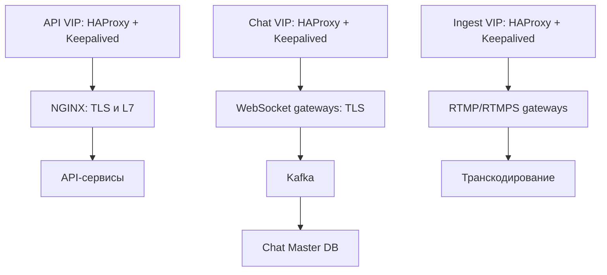
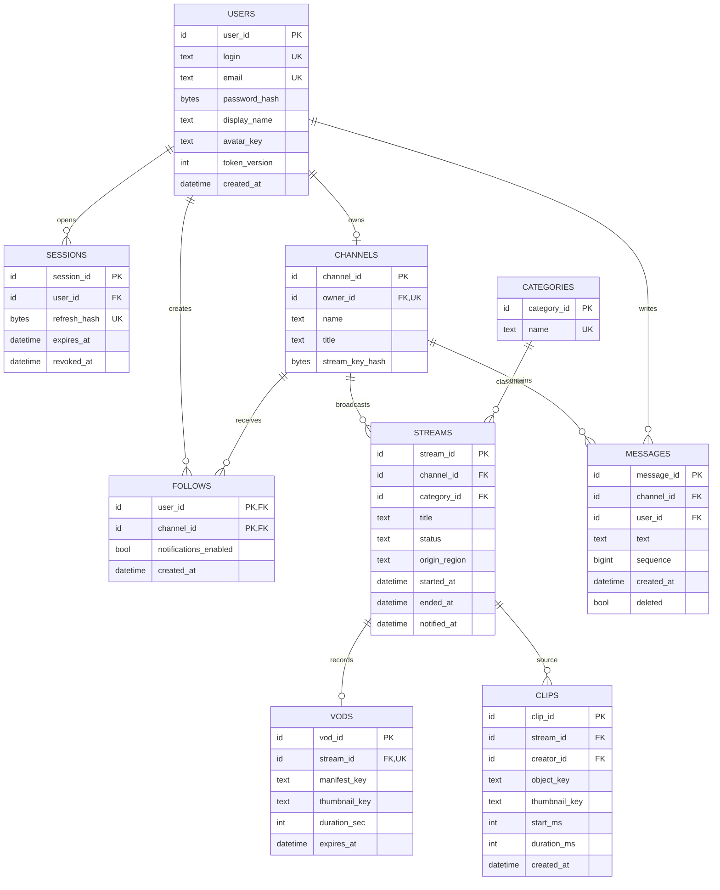
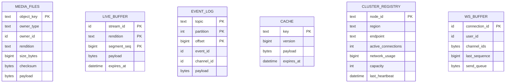
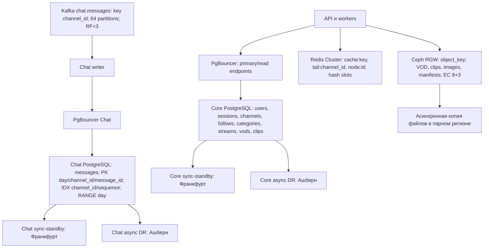

# Расчётно-пояснительная записка для курсовой работы по предмету «Проектирование высоконагруженных систем»

## 1. Тема и целевая аудитория

**Тип сервиса**: платформа интерактивных прямых трансляций (аналог Twitch).

**Основной функционал MVP**:

1. Регистрация и авторизация пользователей;
2. Создание канала и проведение прямой трансляции;
3. Просмотр прямых трансляций с адаптивным качеством видео;
4. Подписка на каналы и получение уведомлений о начале трансляции;
5. Общение в чате трансляции в реальном времени;
6. Просмотр каталога трансляций и поиск каналов;

**Ключевые продуктовые решения**:

1. Публичные трансляции можно смотреть без регистрации;
2. Качество видео автоматически изменяется в зависимости от пропускной способности сети пользователя;
3. Сообщения чата доставляются участникам трансляции в реальном времени;
4. Записи завершённых трансляций хранятся ограниченное время, а созданные пользователями клипы — до их удаления.
5. Просмотр записей завершённых трансляций и создание коротких клипов.

**Ключевые функции, характеризующие сервис**:

1. Проведение и просмотр прямых видеотрансляций;
2. Общение зрителей и автора трансляции в реальном времени;

**Целевая аудитория**: около 105 млн пользователей в месяц и 35 млн пользователей в день по всему миру. По внутренним данным Twitch, сайт посещают в среднем 105 млн пользователей в месяц, около 70% зрителей находятся в возрасте от 18 до 34 лет.[[1]](#source1) По данным Amazon Ads, ежедневно Twitch посещают в среднем 35 млн пользователей со всего мира.[[2]](#source2)

## 2. Расчёт нагрузки

### 2.1. Продуктовые метрики

В расчётах используются опубликованные показатели Twitch: 105 млн MAU, 35 млн DAU, 2,5 млн одновременно активных зрителей, 7 млн стримеров в месяц и 1,3 трлн минут просмотра в год.[[1]](#source1)[[2]](#source2)[[3]](#source3)

Среднее время просмотра на одного дневного пользователя:

```
1,3 трлн / 365 / 35 млн ≈ 102 минуты в сутки
```

| Метрика | На одного DAU в сутки | Всего в сутки | Статус и обоснование |
|---|---:|---:|---|
| Месячная аудитория | — | 105 млн пользователей | Исходная метрика Twitch[[1]](#source1) |
| Дневная аудитория | — | 35 млн пользователей | Исходная метрика Amazon Ads[[2]](#source2) |
| Просмотр прямых трансляций | 102 минуты | 3,56 млрд минут | Расчёт по 1,3 трлн минут в год[[3]](#source3) |
| Открытие страниц | 6,57 | 230 млн | Исходная метрика Twitch; 230 млн / 35 млн DAU[[3]](#source3) |
| Авторизация / обновление сессии | 0,5 | 17,5 млн | Допущение: обновление сессии требуется половине DAU |
| Поиск | 1 | 35 млн | Допущение: один поиск на активного пользователя |
| Отправка сообщения в чат | 3 | 105 млн | Допущение: большинство зрителей только читает чат |
| Подписка / отписка от канала | 0,05 | 1,75 млн | Допущение: одно действие раз в 20 активных дней |
| Просмотр записи трансляции | 0,1 | 3,5 млн | Допущение: 10% DAU смотрят одну запись |
| Просмотр клипа | 0,6 | 21 млн | Допущение: 20% DAU смотрят по три клипа |
| Создание клипа | 0,01 | 350 тыс. | Допущение: 1% DAU создаёт один клип |
| Запуск трансляции | 0,029 | 1 млн | Допущение на основании 7 млн стримеров в месяц[[3]](#source3) |


Число открытий страниц взято из данных Twitch.[[3]](#source3) Остальные действия являются проектными допущениями.

Средний объём данных рассчитан по всей месячной аудитории:

| Тип данных | В среднем на пользователя | Объём | Расчёт |
|---|---:|---:|---|
| Профиль, подписки, чат и метаданные | около 87 записей | менее 0,001 Гбайт | 1 профиль, 50 подписок, 30 сообщений и служебные записи |
| Записи трансляций | 0,067 записи | 0,706 Гбайт | 7 млн записей / 105 млн MAU |
| Клипы | 1,22 клипа | 0,0137 Гбайт | 127,75 млн клипов / 105 млн MAU |
| **Итого** | — | **около 0,72 Гбайт** | Сумма типов данных |

Данные распределены неравномерно: обычный зритель хранит менее 0,1 Мбайт, а на активного стримера приходится около 10,6 Гбайт.

### 2.2. Технические метрики

Для расчётов приняты следующие допущения:

- 1 млн трансляций в сутки со средней длительностью 2,4 часа — около 100 тыс. одновременных трансляций;
- качества 360p, 720p и 1080p имеют битрейты 0,8, 3 и 6 Мбит/с; средний битрейт просмотра — 3,31 Мбит/с;
- полная ABR-лестница занимает 9,8 Мбит/с, или 4,41 Гбайт за час видео;
- записи хранятся 7 суток, сообщения чата — 30 суток; 365 суток для клипов — среднее время до удаления, а не обязательный TTL;
- просмотр записи длится в среднем 20 минут, просмотр клипа — 30 секунд;
- аватар есть у 10% пользователей; миниатюра есть у каждого VOD и клипа; средний файл изображения — 20 Кбайт;
- медиасегмент длится 2 секунды; накладные расходы сети составляют 10%;
- коэффициент пика равен 3 для API и чата и 1,5 для прямого видео.

#### Хранилище

| Тип данных | Количество | Логический объём, Тбайт |
|---|---:|---:|
| Профили, подписки, чат и метаданные | около 9,12 млрд записей | 1,79 |
| Буфер прямых трансляций за 10 минут | 100 тыс. трансляций | 73,50 |
| Записи трансляций за 7 суток | 7 млн записей | 74 088,00 |
| Клипы | 127,75 млн | 1 437,19 |
| Аватары и миниатюры | 145,25 млн файлов | 2,905 |
| Манифесты записей и клипов | 134,75 млн | 0,513 |
| **Итого** | — | **75 603,89 Тбайт (75,6 Пбайт)** |

Итоги рассчитаны до округления отдельных строк. Объём указан без индексов, репликации и резервных копий. Буфер live в таблице рассчитан для средней нагрузки; в пике он занимает 110,25 Тбайт. Основную часть хранилища занимают записи трансляций.

#### Сетевой трафик

Пропускная способность рассчитывается как произведение количества одновременных потоков на битрейт. Суточный объём: `трафик × 86 400 / 8`.

| Тип трафика | Средний, Гбит/с | Пиковый, Гбит/с | Гбайт/сутки |
|---|---:|---:|---:|
| Раздача прямых трансляций | 9 102,5 | 13 653,8 | 98 307 000 |
| Приём потоков стримеров | 660,0 | 990,0 | 7 128 000 |
| Записи трансляций и клипы | 203,5 | 610,6 | 2 198 254 |
| Чат и HTTP API | 10,0 | 30,0 | 108 000 |
| **Итого** | **9 976,0** | **15 284,4** | **107 741 254 (107,7 Пбайт)** |

Это глобальный трафик сервиса. Основной исходящий поток должен обслуживаться распределённой CDN.

#### RPS

Средний RPS рассчитывается по формуле `количество операций / 86 400`. Для пика используется коэффициент 3, а для прямого видео — 1,5.

| Метод или операция | Операций в сутки | Средний RPS | Пиковый RPS |
|---|---:|---:|---:|
| Получение страницы и метаданных трансляции | 230 млн | 2 662 | 7 986 |
| Авторизация / обновление сессии | 17,5 млн | 203 | 608 |
| Поиск | 35 млн | 405 | 1 215 |
| Подписки, управление трансляцией и создание клипа | 4,1 млн | 47 | 142 |
| Отправка сообщения чата | 105 млн | 1 215 | 3 646 |
| Доставка сообщения чата | 210 млрд | 2,43 млн | 7,29 млн |
| Плейлисты и сегменты прямого видео | 216 млрд | 2,50 млн | 3,75 млн |
| Сегменты записей и клипов | 2,415 млрд | 27 951 | 83 854 |

Для чата принят средний fan-out 2 000 получателей: 105 млн сообщений дают 210 млрд доставок в сутки. Это соответствует опубликованному Twitch порядку нагрузки — сотням миллиардов доставок сообщений в сутки.[[3]](#source3)

Таким образом, HTTP API обрабатывает около 3,3 тыс. RPS в среднем и 10 тыс. RPS в пике. Основная нагрузка приходится на CDN и доставку сообщений чата.

## 3. Глобальная балансировка нагрузки

### 3.1. Разбиение по доменам

| Домен | Назначение |
|---|---|
| `www.twitch-clone.com` | Веб-приложение и статика через CDN |
| `api.twitch-clone.com` | Авторизация, каталог, поиск, подписки и выбор региональной точки входа |
| `chat-{region}-{pool}.twitch-clone.com` | Региональные WebSocket-соединения |
| `ingest-{region}-{pool}.twitch-clone.com` | Приём RTMP/RTMPS от стримеров |
| `video.twitch-clone.com` | Прямое видео, VOD и клипы через CDN |

`pool` обозначает отдельный VIP внутри регионального кластера. Клиент получает адрес нужного пула в ответе API при открытии трансляции или запросе параметров публикации.

### 3.2. Расположение дата-центров

| ДЦ | Регион | Роль |
|---|---|---|
| Франкфурт | Европа | Основной API, Core DB, Chat Master DB, Kafka; региональные чат и ingest |
| Ашберн | Северная Америка | Чат и ingest; резервные копии и аварийные реплики основных БД |
| Сингапур | Азия | Региональные чат и ingest |
| Сан-Паулу | Южная Америка | Региональные чат и ingest |

Обычные API-запросы направляются во Франкфурт. Так не требуется поддерживать независимые базы пользователей, сессий и подписок во всех регионах. Межконтинентальная задержка допустима для каталога и настроек; постоянные соединения чата и видеопотоки принимаются ближе к пользователям.

Это проектная архитектура, а не описание внутренней инфраструктуры Twitch. Реальный Twitch также разделяет точки приёма видео и origin-центры обработки и учитывает доступные вычислительные и сетевые ресурсы при маршрутизации.[[4]](#source4)

### 3.3. Геораспределение динамических запросов

Точные доли аудитории Twitch по регионам не опубликованы. Для расчёта принимаются 35% Северной Америки, 35% Европы, 20% Азии и 10% Южной Америки. Это начальное распределение, которое меняется при перегрузке.

В таблице показан пик из раздела 2. Все 10 тыс. API RPS обрабатываются во Франкфурте; распределяются регионально только чат и приём видео.

| ДЦ | HTTP API, RPS | Отправка сообщений, событий/с | WebSocket-соединения | RTMP-соединения | Приём видео, Гбит/с |
|---|---:|---:|---:|---:|---:|
| Франкфурт | 10 000 | 1 276 | 1 312 500 | 52 500 | 346,5 |
| Ашберн | 0 | 1 276 | 1 312 500 | 52 500 | 346,5 |
| Сингапур | 0 | 729 | 750 000 | 30 000 | 198,0 |
| Сан-Паулу | 0 | 365 | 375 000 | 15 000 | 99,0 |
| **Итого** | **10 000** | **3 646** | **3 750 000** | **150 000** | **990,0** |

CDN-запросы сюда не включены: 3,75 млн запросов/с live и около 83,9 тыс. запросов/с VOD/клипов обслуживаются точками присутствия CDN. Отправка одного сообщения в чат также не равна его доставке: до 7,29 млн доставок/с выполняются региональными WebSocket-шлюзами.

### 3.4. Маршрутизация по загрузке кластера

При открытии трансляции API возвращает адрес чата, при запуске эфира — ingest-адрес. Отдельного дополнительного запроса к Resolver не требуется: выбор выполняется внутри существующего API-запроса.

1. По IP пользователя определяется предпочтительный регион.
2. Проверяются health и загрузка соответствующего сервиса: число соединений, CPU и занятая полоса; для ingest также учитывается свободная мощность транскодирования.
3. Если каждый из показателей ниже 80% рабочего лимита, выбирается этот регион. Иначе проверяется следующий ближайший регион со свободной ёмкостью.
4. Внутри региона выбирается VIP с наименьшей относительной загрузкой пула. Данные мониторинга обновляются раз в 5 секунд.
5. Клиент получает основной и резервный адреса. Установленное соединение остаётся на выбранном сервере; на каждое сообщение или видеопакет выбор не повторяется.

Если все регионы достигли рабочего порога, система использует оставшийся запас до жёсткого лимита; при его исчерпании ограничивает новые подключения. Существующие трансляции не мигрируют автоматически.

Для OBS список ingest-адресов отображается в настройках канала. При отказе основной точки OBS переподключается к резервной. Наш API не предполагает, что стандартный OBS умеет вызывать собственный Resolver сервиса.

DNS возвращает региональные VIP; TTL — 60 секунд. Anycast применяется только на стороне CDN для `www` и `video`. Адреса API, WebSocket и RTMP — региональные unicast-адреса. При отказе основного API DNS переключается на резервный API в Ашберне после повышения резервных БД; уже открытые чаты продолжают работать, пока доступен поток сообщений.

### 3.5. Размещение постоянных данных

Core DB хранит профили, каналы, подписки и метаданные видео. Отдельная **Chat Master DB** во Франкфурте хранит все сообщения за последние 30 суток.

Сообщение поступает в Kafka один раз. Региональные потребители рассылают его зрителям, а отдельный consumer сохраняет в мастер-БД. Сбой записи БД не останавливает рассылку сразу: Kafka хранит события 24 часа и позволяет обработать их повторно.

```text
WebSocket gateway → Kafka chat.messages → региональная рассылка
                                      → Chat writer → Chat Master DB
```

При 3 646 исходных сообщениях/с и размере 400 байт поток записи истории составляет около 1,46 Мбайт/с без индексов и репликации. Миллионы доставок не становятся миллионами SQL-вставок.

## 4. Локальная балансировка нагрузки

### 4.1. Схема и механизм L4

Внутри ДЦ используются HAProxy в TCP-режиме и NGINX для API. CDN edge-узлы в локальную балансировку не входят.



Каждый VIP обслуживается парой HAProxy **active/standby**. Проверяются процесс HAProxy и необходимые сетевые интерфейсы. Keepalived переносит VIP на standby через VRRP при отказе активного узла. Если нужны `N` рабочих узлов, разворачиваются `N` независимых пар — резервирование **N × 2**. Внутри каждого пула HAProxy выбирает backend по `leastconn` и проверяет доступность серверов.

Так задан механизм обоих уровней: API выбирает регион и конкретный VIP по загрузке, HAProxy распределяет новые TCP-соединения между backend-серверами. Обычный L4 не анализирует URL, поэтому API, чат и RTMP имеют разные VIP.

### 4.2. API и TLS termination

Для API TLS завершается на NGINX. Он маршрутизирует запросы к сервисам авторизации, каталога и подписок по URI и использует `least_conn`.

В тесте NGINX на 8 CPU получено 31 485 TLS TPS без Hyper-Threading.[[5]](#source5) Для проекта принимаются более низкие рабочие лимиты: **5 тыс. новых TLS-соединений/с**, **100 тыс. HTTPS RPS** и **40 Гбит/с** на узел. Это проектные лимиты, которые требуется подтвердить нагрузочным тестом.

Для верхней оценки каждый API-запрос создаёт новое TLS-соединение:

```text
N_TLS = ceil(10 000 / 5 000) = 2
N_RPS = ceil(10 000 / 100 000) = 1
N_network = ceil(30 / 40) = 1
N_NGINX = max(2, 1, 1) + 1 = 3
```

30 Гбит/с — консервативная верхняя граница всей категории «API и чат» из раздела 2. Реальный API-трафик будет ниже. Для обычных запросов используется keep-alive; для расчёта L4 принято до 100 тыс. одновременных API TCP-соединений — пик 10 тыс. RPS с резервом до 10 секунд жизни соединения.

### 4.3. WebSocket

HAProxy передаёт зашифрованное TCP-соединение WebSocket-шлюзу. TLS и WebSocket завершаются на gateway. Соединение закреплено за gateway до закрытия; сообщения канала доставляются через Kafka, поэтому пользователям одного канала не обязательно находиться на одном сервере.

Рабочий лимит одного L4-сервера — **700 тыс. клиентских TCP-соединений** и **40 Гбит/с**. Количество учитывает соединения клиентов; дополнительные соединения до backend и память под буферы должны входить в ресурсный бюджет сервера.

Например, для Европы:

```text
N_chat = ceil(1 312 500 / 700 000) × 2 = 4 L4-сервера
```

Это две независимые пары HAProxy с двумя VIP. На каждую пару приходится не более 700 тыс. клиентских соединений.

### 4.4. RTMP

Для ingest выделяется отдельный пул HAProxy. Он проксирует RTMP/RTMPS по `leastconn`; ключ трансляции проверяется ingest gateway. При RTMPS TLS также завершается на gateway, а не на L4-балансировщике. После приёма поток направляется на транскодирование и в live-буфер.

Для L4 ingest принимаются 2 × 100 GbE и рабочая полоса **160 Гбит/с** с запасом 20%. Здесь ограничитель — сеть:

```text
N_ingest_EU = ceil(346,5 / 160) × 2 = 6 L4-серверов
```

Получаются три active/standby-пары с разными VIP. API распределяет новые трансляции между ними по загрузке.

### 4.5. Количество балансировщиков и отказоустойчивость

| ДЦ | L4 API, N × 2 | L4 WebSocket, N × 2 | L4 RTMP, N × 2 | NGINX API, N + 1 |
|---|---:|---:|---:|---:|
| Франкфурт | 2 | 4 | 6 | 3 |
| Ашберн | 2 | 4 | 6 | 3 |
| Сингапур | — | 4 | 4 | — |
| Сан-Паулу | — | 2 | 2 | — |
| **Итого** | **4** | **14** | **18** | **6** |

API-балансировщики Ашберна — заранее подготовленный резерв на полную нагрузку основного API. В штатном режиме клиентские API-запросы идут во Франкфурт.

N × 2 резервирует производительность L4, но не переносит TCP-состояние. При отказе HAProxy его WebSocket- и RTMP-соединения разрываются. После переключения VIP клиенты переподключаются; чат восстанавливает последние сообщения по `message_id`/`sequence`. HTTP-клиент повторяет безопасные запросы, а изменяющие операции используют idempotency key.

## 5. Логическая схема БД

### 5.1. Основные сущности

Схема показывает данные без выбора СУБД и шардирования. ID основных сущностей — глобально уникальные 64-битные идентификаторы. Байты видео и изображений находятся в файловом хранилище; в карточках записаны ключи объектов.



`notified_at` отмечает обработку старта эфира. Worker выбирает новые старты из БД и формирует уведомления онлайн-подписчикам. Повторная отправка допустима; клиент удаляет дубликаты по `stream_id`. Постоянного inbox на каждого подписчика в MVP нет.

### 5.2. Файловые и временные данные



| Данные | Назначение и связь |
|---|---|
| `MEDIA_FILES` | Объекты VOD, клипов, аватаров, миниатюр и манифестов; связи по ключам из USERS/VODS/CLIPS |
| `LIVE_BUFFER` | Последние 10 минут сегментов STREAMS, с вариантами качества |
| `EVENT_LOG` | Сообщения чата для записи и рассылки; ключ упорядочивания — channel_id |
| `CACHE` | Последние 100 сообщений канала, карточки пользователей/каналов и live-манифесты |
| `CLUSTER_REGISTRY` | Heartbeat и загрузка для выбора региона/VIP |
| `WS_BUFFER` | Очередь отправки и состояние открытого сокета в gateway |
| CDN-кеш | Восстанавливаемая копия MEDIA_FILES и LIVE_BUFFER по URL/byte range; относится к глобальной доставке видео |

### 5.3. Размеры и QPS

Объёмы — логические, без индексов, реплик и backup. 1 Тбайт = 10¹² байт. Размеры строк и частота служебных чтений — проектные допущения. В таблице приведён глобальный пик: QPS чтения списка — один запрос, запись — одна изменённая строка; при batch физическое число SQL-запросов меньше.

| Таблица | Количество строк | Байт/строка | Объём, Тбайт | Чтение, QPS | Запись, строк/с |
|---|---:|---:|---:|---:|---:|
| USERS | 105 млн | 512 | 0,053760 | 1 408 | 4 |
| SESSIONS | до 105 млн | 160 | 0,016800 | 608 | 608 |
| CHANNELS | 7 млн | 384 | 0,002688 | 2 015 | 4 |
| FOLLOWS | 5,25 млрд | 64 | 0,336000 | 1 354 | 61 |
| CATEGORIES | 10 тыс. | 128 | 0,000001 | 10 | менее 1 |
| STREAMS | около 365 млн | 256 | 0,093440 | 800 | 70 |
| VODS | 7 млн | 256 | 0,001792 | 100 | 70 |
| CLIPS | 127,75 млн | 192 | 0,024528 | 300 | 24 |
| MESSAGES | 3,15 млрд за 30 суток | 400 | 1,260000 | 243 | 3 646 |
| **Итого** | **около 9,12 млрд** | — | **1,789** | — | — |

Обоснование:

- При 90% попаданий в кеш чтение карточки: `7 986 × 10% ≈ 800 QPS`. USERS дополнительно читает авторизацию: `800 + 608 = 1 408`. CHANNELS дополнительно обслуживает поиск: `800 + 1 215 = 2 015`.
- Для FOLLOWS принято открытие списка подписок в 10% просмотров страниц: около 799 QPS. Ещё около 555 QPS — сканирование 16 секций при обработке 35 стартов эфира/с. Размер страницы до 500 записей; крупные каналы потребуют дополнительных страниц и отдельного запаса.
- В среднем 50 подписок на MAU: `105 млн × 50 = 5,25 млрд`. Сессии ограничены одной на MAU в расчётной модели. Для регистрации принято 100 тыс. новых пользователей/сутки, или около 4/с в пике.
- Два открытия чата на DAU в сутки дают около 2 431/с в пике; 90% обслуживает кеш хвоста, около 243 чтений/с остаётся мастер-БД.
- Старт и завершение 1 млн эфиров/сутки дают около 70 изменений/с. Метаданные старых эфиров сохраняются, пока на них ссылаются VOD/клипы; 365 суток — средняя оценка для расчёта.
- Для VOD и клипов в записи учтены создание и последующее удаление. Счётчики зрителей обновляются агрегатами раз в 5 секунд, а не SQL-записью на каждый просмотр.

| Файлы / временные данные | Количество и размер | Объём | Пиковое чтение / запись |
|---|---|---:|---|
| VOD-файлы | 3,024 млрд минутных объектов; в среднем 24,5 Мбайт | 74 088 Тбайт | GET вместе с клипами — до 4 193/с после CDN/shield; VOD PUT — до 7 500/с |
| Клипы | 127,75 млн × 11,25 Мбайт | 1 437,19 Тбайт | GET входят в предыдущую строку; около 12 PUT/с |
| Аватары и миниатюры | 145,25 млн × 20 Кбайт | 2,905 Тбайт | До 800 GET/с после кеша и 51 PUT/с |
| VOD/clip-манифесты | 7 млн × 64 Кбайт + 127,75 млн × 512 байт | 0,513 Тбайт | GET входят в бюджет VOD; до 47 PUT/с |
| LIVE_BUFFER | До 135 млн 2-секундных сегментов | 110,25 Тбайт в пике | До 375 тыс. GET/с и 225 тыс. записей/с |
| Live-манифесты | До 450 тыс. × 4 КиБ | 1,843 Гбайт | До 375 тыс. GET/с и 225 тыс. обновлений/с |
| Кеш карточек, на регион | Лимит 5 млн × 1 Кбайт | До 5 Гбайт | До 25 тыс. GET/с и 2,5 тыс. SET/с |
| Кеш хвоста чата, на регион | До 150 тыс. каналов × 100 × 400 байт | До 6 Гбайт | 2 431 чтение/с и 3 646 добавлений/с |
| EVENT_LOG | 105 млн × 400 байт за 24 ч | 42 Гбайт | 3 646 записей/с; до 18 230 чтений событий/с: writer + четыре региона |
| CLUSTER_REGISTRY | До 10 тыс. × 256 байт | 2,56 Мбайт | До 2 тыс. heartbeat/с; снимок читается маршрутизатором раз в 5 с |
| WS_BUFFER | До 3,75 млн соединений, лимит 16 КиБ | До 61,44 Гбайт | До 7,29 млн постановок/отправок в секунду |
| CDN-кеш | Проектный лимит по всем PoP | 400 Тбайт | До 3,834 млн клиентских запросов/с; запись только при промахах |

Размеры двух Redis-кешей указаны на регион: при четырёх полных копиях это до 20 Гбайт карточек и 24 Гбайт хвостов без реплик и накладных расходов Redis. QPS в таблице остаётся глобальным.

Для origin-промахов приняты 20% live-запросов и 5% VOD/clip-запросов. Это доли запросов, а не байтов; их необходимо уточнить измерениями. Для live половина запросов приходится на сегменты, половина — на плейлисты.

```text
Live origin: 3,75 млн × 20% = 750 тыс. запросов/с.
Запись live: 150 тыс. эфиров × 3 качества / 2 с = 225 тыс. сегментов/с.
VOD origin: 83 854 × 5% ≈ 4 193 GET/с.
```

### 5.4. Консистентность и горячие ключи

| Данные | Требование | Распределение нагрузки |
|---|---|---|
| Пользователи, сессии, подписки | Транзакции, уникальные login/email, read-after-write через primary | По user_id; у популярных каналов горячий обратный индекс подписчиков |
| Трансляции | Только один live-эфир на канал; атомарный старт/стоп | Чтения популярных каналов обслуживает кеш |
| Чат | Порядок внутри канала; подтверждение после надёжной записи в Kafka; история в SQL появляется асинхронно, цель lag до 5 с | Kafka key = channel_id; gateway выполняет fan-out своим зрителям; каждое сообщение сохраняется в SQL один раз |
| Файлы | Карточка готова после публикации файла и манифеста | Ключ объекта неизменяемый; популярные файлы кешируются |
| Кеши, поиск, счётчики | Устаревание карточек допустимо до 5 с; счётчики приблизительные | TTL, инвалидация, объединение одновременных промахов |
| Уведомления | Как минимум одна попытка, возможны дубликаты | Дедупликация по stream_id; сканирование подписчиков страницами |

При недоступности Kafka новые сообщения не подтверждаются как принятые. При недоступности мастер-БД writer повторяет запись, пока события сохраняются в журнале. Если отставание угрожает 24-часовому retention, приём новых сообщений ограничивается: молча терять историю нельзя.

## 6. Физическая схема БД

### 6.1. Размещение данных

Основные SQL-данные разделены на **Core PostgreSQL** и **Chat Master PostgreSQL**. Разделение изолирует запись чата от авторизации и каталога. Поиск каналов выполняется средствами PostgreSQL; отдельный поисковый кластер для MVP не требуется.

На физической схеме перечислены ключи доступа, секционирование и копии. Полный состав полей совпадает с логической схемой; новые производные поля и индексы приведены в таблице ниже.



Стрелки реплик показывают копирование данных. Chat writer на схеме — consumer потока; WebSocket-шлюзы публикуют в Kafka и потребляют его независимо от SQL writer.

### 6.2. Таблицы и индексы

| Данные | Хранилище и индексы | Шардирование / резервирование |
|---|---|---|
| USERS | Core PostgreSQL: PK `user_id`; UNIQUE `login`, `email` | Без горизонтального шардирования; primary + локальная sync-standby + async DR |
| SESSIONS | Core PostgreSQL: PK `session_id`; UNIQUE `refresh_hash`; IDX `user_id`, `expires_at` | То же; истёкшие строки удаляются пакетами |
| CHANNELS | Core PostgreSQL: PK `channel_id`; UNIQUE `owner_id`, `stream_key_hash`; GIN `search_vector` | `search_vector` — производное поле name/title; обновляется вместе с каналом |
| FOLLOWS | Core PostgreSQL: PK `(user_id, channel_id)`; IDX `(channel_id, user_id)` | 16 HASH-секций по user_id внутри одного primary; обратная выборка читает 16 индексов |
| CATEGORIES | Core PostgreSQL: PK `category_id`; UNIQUE `name` | Без шардирования, справочник кешируется целиком |
| STREAMS | Core PostgreSQL: PK `stream_id`; IDX `(channel_id, started_at DESC)`; частичный UNIQUE `channel_id WHERE status='live'`; IDX `(category_id, started_at DESC) WHERE live`; IDX необработанных стартов | Без шардирования; старые метаданные удаляются после исчезновения ссылок |
| VODS | Core PostgreSQL: PK `vod_id`; UNIQUE `stream_id`; IDX `expires_at` | Без шардирования; файл удаляется фоновым worker |
| CLIPS | Core PostgreSQL: PK `clip_id`; IDX `(stream_id, created_at DESC)`, `(creator_id, created_at DESC)`, `(channel_id, created_at DESC)` | `channel_id` денормализован из исходной трансляции для быстрого списка клипов канала |
| MESSAGES | Chat PostgreSQL: PK `(day, channel_id, message_id)`; IDX `(channel_id, sequence DESC)` | RANGE по UTC-дню; 30–31 суточная секция; отдельный primary + sync-standby + async DR |
| Кеш карточек и чата | Redis Cluster: `entity:type:id`, `tail:channel_id`; hash/string/list | В каждом регионе 3 master + 3 replica; TTL и удаление старых сообщений |
| Реестр кластеров | Redis Cluster: `node:id`, поля heartbeat/load/capacity, TTL 15 с | Обновление каждые 5 с; во Франкфурт передаются heartbeat всех регионов; API использует локальный снимок реестра |
| Чат-события | Kafka: `chat.messages`, key `channel_id` | 64 partitions; RF=3, `acks=all`, `min.insync.replicas=2`; retention 24 ч |
| MEDIA_FILES | Ceph RGW, S3 API: уникальный `object_key` и диапазон байтов | Хеш объекта распределяет данные внутри региона; EC 8+3 по стойкам; async-копия в парный регион |
| LIVE_BUFFER и live-манифесты | NVMe + память media-серверов; `(stream_id, rendition, seq)` | Две копии в разных стойках; TTL 10 минут |
| WS_BUFFER | Память gateway, map по connection_id | Не реплицируется: клиент переподключается и получает хвост чата |
| CDN-кеш | Внешняя CDN: URL/версия/byte range | Повторно заполняется из origin; не источник постоянных данных |

PostgreSQL поддерживает HASH/RANGE-секционирование и удаление старых данных целыми секциями.[[6]](#source6) Это не распределяет таблицу по серверам: горизонтального шардирования SQL в текущем MVP нет. Core содержит около 0,529 Тбайт строк, Chat Master — 1,26 Тбайт; нагрузка записи позволяет начать с отдельных primary и масштабировать чтение репликами. Окончательное количество дисков и CPU проверяется нагрузочным тестом.

Для сообщений `day` вычисляется из серверного `created_at`. При повторной обработке события сохраняются исходные `message_id` и `day`; вставка идемпотентна по PK. `sequence` берётся из offset Kafka-партиции. Один канал всегда попадает в одну партицию; число партиций без миграции порядка не меняется.

### 6.3. Чат, кеши и видео

Для чата работает одна consumer group записи истории и по одной группе рассылки на регион. Сообщения читаются регионами по одному разу, затем WebSocket-шлюзы отправляют их своим клиентам. Миллионы индивидуальных доставок не проходят через Kafka как отдельные события.

Chat writer сохраняет сообщения пакетами до 100 или раз в 50 мс и подтверждает consumer offset после SQL commit. Повторное чтение после сбоя не создаёт дубликатов. У текущего primary одна локальная синхронная реплика; межконтинентальная DR-реплика асинхронная.[[7]](#source7)

Redis хранит последние 100 сообщений канала и популярные карточки, но не всю историю. Кеш карточек — cache-aside с TTL до 5 с; от stampede защищает один выполняющийся запрос на ключ. Redis Cluster распределяет ключи по hash slots, клиент обрабатывает перенаправления.[[8]](#source8) Для Kafka порядок задан партицией, а RF и ISR определяют устойчивость журнала.[[9]](#source9)

Сегменты live имеют длину 2 секунды. Для VOD по 30 сегментов одного качества объединяются в минутный объект, а компактный манифест хранит индекс byte ranges. HLS-плейлист формируется из этого индекса. Это уменьшает число объектов до 3,024 млрд за 7 суток, сохраняя 2-секундную выдачу зрителю. Клипы создаются отдельными файлами и не зависят от удаления исходного VOD.

Ceph хранит бинарные данные с erasure coding 8+3: физический множитель одной копии — 11/8 = 1,375.[[10]](#source10) Вторую независимую региональную копию нужно учитывать дополнительно. Для 75,53 Пбайт логических медиаданных две копии с EC занимают примерно 207,7 Пбайт, без свободного места и backup. Для профиля EC по стойкам требуется не менее 11 доменов размещения.

### 6.4. Подключения и клиентские библиотеки

| Хранилище | Интеграция из Go | Балансировка и ограничение подключений |
|---|---|---|
| PostgreSQL | `pgx/v5`, `pgxpool` | PgBouncer transaction pooling; отдельные endpoints primary/read-only; до 300 активных server connections на БД |
| Redis Cluster | `redis/go-redis` | Подключение по slot map; pipeline для добавления и ограничения хвоста чата |
| Kafka | `twmb/franz-go` | Bootstrap через несколько брокеров, далее соединение с leader партиции; idempotent producer |
| Ceph RGW | AWS SDK for Go v2, S3 API | Пул HTTPS keep-alive, несколько RGW за внутренним балансировщиком |

Записи, авторизация, refresh token и чтение сразу после изменения идут на primary. Остальные SQL-чтения могут обслуживаться локальной standby; при большом отставании запрос возвращается на primary. На соединения приложения устанавливаются лимиты и таймауты, чтобы всплеск запросов не создавал тысячи PostgreSQL-процессов.

### 6.5. Репликация и резервное копирование

| Компонент | Резервирование | Backup и восстановление |
|---|---|---|
| Core DB и Chat Master DB | Primary + sync-standby в другой стойке Франкфурта; async DR в Ашберне | Полный backup еженедельно, differential ежедневно, непрерывный WAL archive; хранение 30 суток в отдельном backup-bucket; PITR |
| Redis | Реплика на каждый master | Кеш восстанавливается из SQL/событий; для реестра достаточно новых heartbeat |
| Kafka | RF=3, минимум две ISR; журнал чата дополнительно копируется в DR-регион | Retention 24 ч для повторной обработки; это буфер, а не backup 30-дневной истории |
| Ceph: VOD | EC 8+3 и async-копия в парный регион | Откат ошибочного явного удаления в течение 24 ч; после планового TTL 7 суток восстановление не обещается |
| Ceph: клипы и изображения | EC и региональная копия | Versioning и защита удалённых версий 30 суток; доступ backup-оператора отделён от приложения |
| Live/CDN/WS-буферы | Live — две копии; остальное восстанавливается | Долговременные backup не нужны; live — из входящего потока, CDN — из origin, WS — после переподключения |

Реплика не заменяет backup при ошибочном удалении. При полном отказе Франкфурта резервная БД повышается в Ашберне только после fencing старого primary; затем включается резервный API. Межрегиональная репликация асинхронная, поэтому RPO зависит от фактического lag. Целевые показатели: до 5 с для DR-реплики и 5–15 минут на переключение; это требования к проекту, которые нужно проверить учениями.

Для SQL резервируется дополнительно 60–100% размера строк под индексы и служебные данные. При расчёте серверов отдельно добавляются WAL, backup и не менее 20% свободного диска. Раз в месяц выполняется пробное восстановление БД и выборочная проверка файлов.

## Список источников

1. <a id="source1"></a>[Twitch Ads — Reach the Twitch audience](https://twitchadvertising.tv/) — месячная аудитория.
2. <a id="source2"></a>[Amazon Ads — Twitch ads](https://advertising.amazon.com/library/guides/twitch-ads) — дневная аудитория.
3. <a id="source3"></a>[Twitch State of Engineering 2023](https://blog.twitch.tv/en/2023/09/28/twitch-state-of-engineering-2023/) — просмотры, число стримеров и порядок нагрузки чата.
4. <a id="source4"></a>[Twitch — Ingesting Live Video Streams at Global Scale](https://blog.twitch.tv/en/2022/04/26/ingesting-live-video-streams-at-global-scale/) — разделение ingest/origin и маршрутизация по доступным ресурсам.
5. <a id="source5"></a>[NGINX — Testing the Performance of NGINX Ingress Controller for Kubernetes](https://blog.nginx.org/blog/testing-performance-nginx-ingress-controller-kubernetes) — тесты SSL termination.
6. <a id="source6"></a>[PostgreSQL — Table Partitioning](https://www.postgresql.org/docs/current/ddl-partitioning.html) — секционирование таблиц.
7. <a id="source7"></a>[PostgreSQL — Log-Shipping Standby Servers](https://www.postgresql.org/docs/current/warm-standby.html) — репликация и standby.
8. <a id="source8"></a>[Redis — Scale with Redis Cluster](https://redis.io/docs/latest/operate/oss_and_stack/management/scaling/) — распределение ключей и реплики.
9. <a id="source9"></a>[Apache Kafka — Design](https://kafka.apache.org/41/design/design/) — партиции и надёжная доставка.
10. <a id="source10"></a>[Ceph — Erasure code](https://docs.ceph.com/en/latest/rados/operations/erasure-code/) — избыточное хранение бинарных данных.
