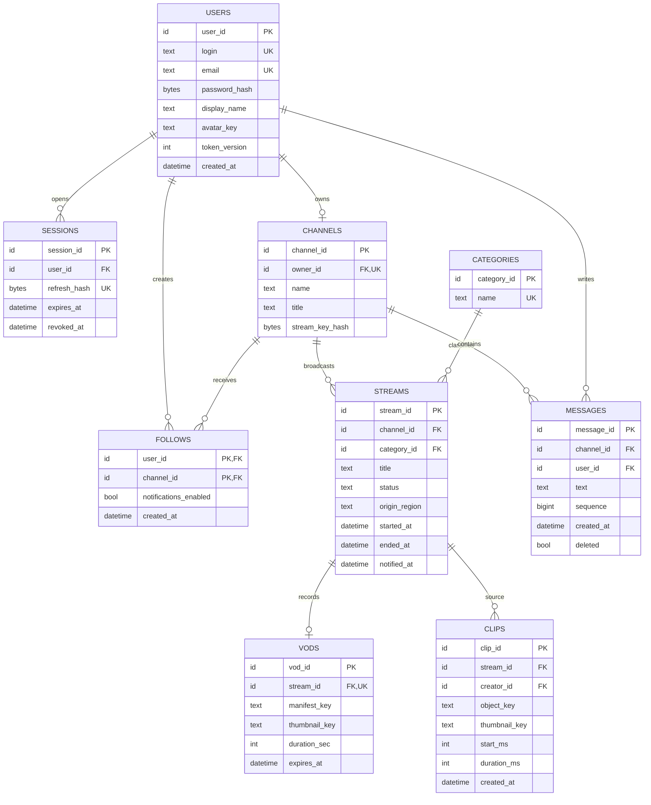
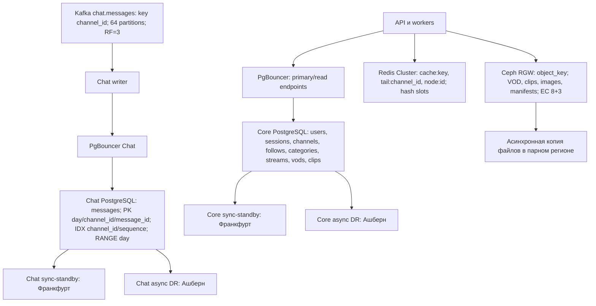

# Расчётно-пояснительная записка для курсовой работы по предмету «Проектирование высоконагруженных систем»

## 1. Тема и целевая аудитория

**Тип сервиса**: платформа интерактивных прямых трансляций (аналог Twitch).

**Основной функционал MVP**:

1. Регистрация и авторизация пользователей;
2. Создание канала и проведение прямой трансляции;
3. Просмотр прямых трансляций с адаптивным качеством видео;
4. Подписка на каналы и получение уведомлений о начале трансляции;
5. Общение в чате трансляции в реальном времени;
6. Просмотр каталога трансляций и поиск каналов;
7. Просмотр записей завершённых трансляций и создание коротких клипов.

**Ключевые продуктовые решения**:

1. Публичные трансляции можно смотреть без регистрации;
2. Качество видео автоматически изменяется в зависимости от пропускной способности сети пользователя;
3. Сообщения чата доставляются участникам трансляции в реальном времени;
4. Записи завершённых трансляций хранятся 7 суток, а созданные пользователями клипы — до их удаления.

**Ключевые функции, характеризующие сервис**:

1. Проведение и просмотр прямых видеотрансляций;
2. Общение зрителей и автора трансляции в реальном времени;

**Целевая аудитория**: около 105 млн пользователей в месяц и 35 млн пользователей в день по всему миру. По внутренним данным Twitch, сайт посещают в среднем 105 млн пользователей в месяц, около 70% зрителей находятся в возрасте от 18 до 34 лет.[[1]](#source1) По данным Amazon Ads, ежедневно Twitch посещают в среднем 35 млн пользователей со всего мира.[[2]](#source2)

## 2. Расчёт нагрузки

Ниже приведена оценка нагрузки проектируемого MVP. Публичные показатели Twitch используются как ориентир масштаба, а частоты действий, размеры объектов и коэффициенты пика задаются отдельно как проектные допущения. Источники относятся к разным периодам: DAU — к 2022 году, MAU и время просмотра — к 2023 году.[[1]](#source1)[[2]](#source2) Это расчётная модель, а не измеренная нагрузка действующего сервиса.

Во всех расчётах используются десятичные единицы: 1 Кбайт = 10³ байт, 1 Гбайт = 10⁹ байт, 1 Тбайт = 10¹² байт, 1 Пбайт = 10¹⁵ байт; 1 байт = 8 бит. В сутках 86 400 секунд. Промежуточные значения не округляются; результаты в таблицах округляются для чтения.

### 2.1. Продуктовые метрики

В расчётах используются опубликованные показатели Twitch: 105 млн MAU, 35 млн DAU, 2,5 млн одновременно активных зрителей, 7 млн стримеров в месяц и 1,3 трлн минут просмотра в год.[[1]](#source1)[[2]](#source2)[[3]](#source3)

Среднее время просмотра на одного дневного пользователя:

```
1,3 трлн / 365 / 35 млн ≈ 102 минуты в сутки
```

Проверка среднего числа одновременных зрителей: `1,3 трлн / (365 × 24 × 60) ≈ 2,47 млн`. Для дальнейшего расчёта принимается округлённая величина 2,5 млн зрителей, согласующаяся по порядку с показателем источника.[[3]](#source3)

| Метрика | На одного DAU в сутки | Всего в сутки | Статус и обоснование |
|---|---:|---:|---|
| Месячная аудитория | — | 105 млн пользователей | Исходная метрика Twitch[[1]](#source1) |
| Дневная аудитория | — | 35 млн пользователей | Исходная метрика Amazon Ads[[2]](#source2) |
| Просмотр прямых трансляций | 102 минуты | 3,56 млрд минут | Расчёт по 1,3 трлн минут в год[[3]](#source3) |
| Открытие страниц | 6,57 | 230 млн | Исходная метрика Twitch; 230 млн / 35 млн DAU[[3]](#source3) |
| Авторизация / обновление сессии | 0,5 | 17,5 млн | Допущение: обновление сессии требуется половине DAU |
| Поиск | 1 | 35 млн | Допущение: один поиск на активного пользователя |
| Отправка сообщения в чат | 3 | 105 млн | Допущение: большинство зрителей только читает чат |
| Подписка / отписка от канала | 0,05 | 1,75 млн | Допущение: одно действие раз в 20 активных дней |
| Просмотр записи трансляции | 0,1 | 3,5 млн | Допущение: 10% DAU смотрят одну запись |
| Просмотр клипа | 0,6 | 21 млн | Допущение: 20% DAU смотрят по три клипа |
| Создание клипа | 0,01 | 350 тыс. | Допущение: 1% DAU создаёт один клип |
| Запуск трансляции | 0,029 | 1 млн | Допущение на основании 7 млн стримеров в месяц[[3]](#source3) |


Число открытий страниц взято из данных Twitch для веб-приложения Twilight.[[3]](#source3) В модели MVP оно используется как бюджет операций получения страницы и метаданных: одно открытие соответствует одному такому API-запросу. Это упрощение; дополнительные запросы интерфейса и трафик других клиентов отдельно не моделируются.

Для остальных действий суточное количество рассчитывается как `DAU × доля пользователей × действий на пользователя`. Частоты являются допущениями, а не статистикой Twitch:

```text
Просмотр live: 1,3 × 10¹² / 365 ≈ 3,56 млрд минут/сутки.
Открытия страниц на DAU: 230 млн / 35 млн ≈ 6,57.
Авторизация: 35 млн × 50% × 1 = 17,5 млн операций/сутки.
Поиск: 35 млн × 1 = 35 млн операций/сутки.
Сообщения: 35 млн × 3 = 105 млн сообщений/сутки.
Подписка/отписка: 35 млн × 0,05 = 1,75 млн операций/сутки.
Просмотры VOD: 35 млн × 10% × 1 = 3,5 млн просмотров/сутки.
Просмотры клипов: 35 млн × 20% × 3 = 21 млн просмотров/сутки.
Создание клипов: 35 млн × 1% × 1 = 350 тыс. клипов/сутки.
```

Для получения 1 млн стартов эфира в сутки дополнительно принимается, что каждый из 7 млн месячных стримеров проводит в среднем 30/7 ≈ 4,29 эфира за условный 30-дневный месяц: `7 млн × (30/7) / 30 = 1 млн эфиров/сутки`. Само число месячных стримеров не определяет частоту эфиров. В пересчёте на DAU это `1 млн / 35 млн ≈ 0,029 старта/сутки`.

Средний объём данных рассчитан по всей месячной аудитории:

| Тип данных | В среднем на пользователя | Объём | Расчёт |
|---|---:|---:|---|
| Профиль, подписки, чат и метаданные | около 87 записей | менее 0,001 Гбайт | 1 профиль, 50 подписок, 30 сообщений и служебные записи |
| Записи трансляций | 0,067 записи | 0,706 Гбайт | 7 млн записей / 105 млн MAU |
| Клипы | 1,22 клипа | 0,0137 Гбайт | 127,75 млн клипов / 105 млн MAU |
| **Итого** | — | **около 0,72 Гбайт** | Сумма типов данных |

Данные распределены неравномерно: обычный зритель хранит менее 0,1 Мбайт, а на активного стримера приходится около 10,6 Гбайт.

Выкладки для этой таблицы по объёмам хранилища из §2.2:

```text
Структурированные записи: 9,11676 млрд / 105 млн ≈ 87 записей/MAU.
Их объём: 1,789 Тбайт × 1 000 / 105 млн ≈ 0,000017 Гбайт/MAU.
VOD: 7 млн / 105 млн ≈ 0,067 записи/MAU;
     74 088 Тбайт × 1 000 / 105 млн = 0,7056 Гбайт/MAU.
Клипы: 127,75 млн / 105 млн ≈ 1,22 клипа/MAU;
       1 437,1875 Тбайт × 1 000 / 105 млн ≈ 0,0137 Гбайт/MAU.
Итого без изображений, манифестов и live-буфера: около 0,72 Гбайт/MAU.
VOD на одного месячного стримера: 74 088 × 1 000 / 7 млн ≈ 10,6 Гбайт.
```

Это усреднение хранимых данных по месячной аудитории. Для зрителя без собственных видео профиль, 50 подписок и 30 сообщений занимают `512 + 50 × 64 + 30 × 400 = 15 712 байт`, то есть менее 0,1 Мбайт без индексов и служебных накладных расходов.

### 2.2. Технические метрики

Для расчётов приняты следующие допущения:

- 1 млн трансляций в сутки со средней длительностью 2,4 часа — около 100 тыс. одновременных трансляций;
- качества 360p, 720p и 1080p имеют битрейты 0,8, 3 и 6 Мбит/с; средний битрейт просмотра — 3,31 Мбит/с;
- полная ABR-лестница занимает 9,8 Мбит/с, или 4,41 Гбайт за час видео;
- записи хранятся 7 суток, сообщения чата — 30 суток; 365 суток для клипов — среднее время до удаления, а не обязательный TTL;
- просмотр записи длится в среднем 20 минут, просмотр клипа — 30 секунд;
- аватар есть у 10% пользователей; миниатюра есть у каждого VOD и клипа; средний файл изображения — 20 Кбайт;
- медиасегмент длится 2 секунды; накладные расходы сети составляют 10%;
- коэффициент пика равен 3 для API и чата и 1,5 для прямого видео.

Клипы хранятся и выдаются в одном качестве 720p с битрейтом 3 Мбит/с. Для live и VOD средний битрейт просмотра рассчитан при долях зрителей 20% / 55% / 25% для 360p / 720p / 1080p. Входящий поток стримера принимается равным 6 Мбит/с; каждый эфир сохраняется как VOD со всеми тремя качествами. Коэффициенты пика выбраны как запас для проектирования и требуют проверки по суточному профилю реального сервиса.

```text
Средний битрейт просмотра = 0,8 × 0,20 + 3 × 0,55 + 6 × 0,25
                         = 3,31 Мбит/с.
Битрейт полной ABR-лестницы = 0,8 + 3 + 6 = 9,8 Мбит/с.
Объём часа ABR-видео = 9,8 × 10⁶ × 3 600 / 8 / 10⁹ = 4,41 Гбайт.
Среднее число эфиров онлайн = 1 млн × 2,4 / 24 = 100 тыс.
Пиковое число эфиров онлайн = 100 тыс. × 1,5 = 150 тыс.
Пиковое число live-зрителей = 2,5 млн × 1,5 = 3,75 млн.
```

#### Хранилище

Для данных с ограниченным сроком хранения используется формула `число объектов = создание за сутки × срок хранения`. Для видео: `объём = длительность в секундах × битрейт / 8`. Предполагается установившаяся нагрузка: истёкшие записи удаляются с той же скоростью, с какой создаются новые.

| Тип данных | Количество | Логический объём, Тбайт |
|---|---:|---:|
| Профили, подписки, чат и метаданные | около 9,12 млрд записей | 1,79 |
| Буфер прямых трансляций за 10 минут | 100 тыс. трансляций | 73,50 |
| Записи трансляций за 7 суток | 7 млн записей | 74 088,00 |
| Клипы | 127,75 млн | 1 437,19 |
| Аватары и миниатюры | 145,25 млн файлов | 2,905 |
| Манифесты записей и клипов | 134,75 млн | 0,513 |
| **Итого** | — | **75 603,89 Тбайт (75,6 Пбайт)** |

Итоги рассчитаны до округления отдельных строк. Объём указан без индексов, репликации и резервных копий. Буфер live в таблице рассчитан для средней нагрузки; в пике он занимает 110,25 Тбайт. Основную часть хранилища занимают записи трансляций.

Выкладки для файловых данных:

```text
Live-буфер: 100 тыс. × 600 с × 9,8 × 10⁶ / 8 / 10¹² = 73,50 Тбайт.
Live-буфер в пике: 73,50 × 1,5 = 110,25 Тбайт.
Количество VOD: 1 млн эфиров/сутки × 7 суток = 7 млн записей.
Один VOD: 2,4 ч × 4,41 Гбайт/ч = 10,584 Гбайт.
Все VOD: 7 млн × 10,584 / 1 000 = 74 088 Тбайт.
Количество клипов: 350 тыс./сутки × 365 суток = 127,75 млн.
Один клип: 30 с × 3 × 10⁶ / 8 = 11,25 Мбайт.
Все клипы: 127,75 млн × 11,25 × 10⁶ / 10¹² = 1 437,1875 Тбайт.
Изображения: 105 млн × 10% + 7 млн + 127,75 млн = 145,25 млн файлов;
             145,25 млн × 20 × 10³ / 10¹² = 2,905 Тбайт.
Манифесты: (7 млн × 64 × 10³ + 127,75 млн × 512) / 10¹²
           = 0,513408 Тбайт.
```

Размеры манифестов — допущения: 64 Кбайт на набор плейлистов одного VOD и 512 байт на клип. Размеры структурированных записей раскрыты в §5.3. Их количество получается из 105 млн профилей, до 105 млн сессий, 7 млн каналов, 5,25 млрд подписок, 10 тыс. категорий, 365 млн метаданных эфиров, 7 млн VOD, 127,75 млн клипов и 3,15 млрд сообщений. При среднем размере строки соответственно 512 / 160 / 384 / 64 / 128 / 256 / 256 / 192 / 400 байт сумма `количество × размер строки` равна 1,78900928 Тбайт. Здесь `5,25 млрд = 105 млн × 50 подписок`, `365 млн = 1 млн эфиров × 365 суток`, `3,15 млрд = 105 млн сообщений × 30 суток`.

Общий логический объём: `1,78900928 + 73,50 + 74 088 + 1 437,1875 + 2,905 + 0,513408 = 75 603,89491728 Тбайт ≈ 75,6 Пбайт`. Физическая ёмкость с учётом избыточности хранения рассчитывается отдельно в разделе 6.

#### Сетевой трафик

Пропускная способность рассчитывается как произведение количества одновременных потоков на битрейт с коэффициентом сетевых накладных расходов 1,1. Суточный объём в Гбайт: `средний трафик в Гбит/с × 86 400 / 8`. Пиковую полосу нельзя умножать на полные сутки: пик не длится 24 часа.

| Тип трафика | Средний, Гбит/с | Пиковый, Гбит/с | Гбайт/сутки |
|---|---:|---:|---:|
| Раздача прямых трансляций | 9 102,5 | 13 653,8 | 98 307 000 |
| Приём потоков стримеров | 660,0 | 990,0 | 7 128 000 |
| Записи трансляций и клипы | 201,1 | 603,2 | 2 171 400 |
| Чат и HTTP API | 10,0 | 30,0 | 108 000 |
| **Итого** | **9 973,6** | **15 276,9** | **107 714 400 (107,7 Пбайт)** |

Это глобальный трафик сервиса. Основной исходящий поток должен обслуживаться распределённой CDN.

```text
Live-выдача: 2,5 млн зрителей × 3,31 Мбит/с × 1,1 = 9 102,5 Гбит/с.
Live-приём: 100 тыс. стримеров × 6 Мбит/с × 1,1 = 660 Гбит/с.
Просмотр VOD: 3,5 млн × 20 × 60 = 4,2 млрд секунд/сутки.
Просмотр клипов: 21 млн × 30 = 630 млн секунд/сутки.
VOD и клипы: (4,2 млрд × 3,31 × 10⁶ + 630 млн × 3 × 10⁶)
             × 1,1 / 8 / 10⁹ = 2 171 400 Гбайт/сутки;
             2 171 400 × 8 / 86 400 ≈ 201,06 Гбит/с.
Пики: live-выдача 9 102,5 × 1,5 = 13 653,75 Гбит/с;
      live-приём 660 × 1,5 = 990 Гбит/с;
      VOD и клипы 201,0556 × 3 ≈ 603,17 Гбит/с.
```

Для чата принят средний размер передаваемого сообщения 400 байт, включая прикладные поля. При среднем fan-out 2 000 получателей исходящая доставка занимает `105 млн × 2 000 × 400 × 8 × 1,1 / 86 400 / 10⁹ ≈ 8,56 Гбит/с`; приём исходных сообщений — ещё около 0,004 Гбит/с. Для HTTP API принимается средний суммарный размер запроса и ответа 4,7 Кбайт: `286,6 млн операций/сутки × 4 700 × 8 × 1,1 / 86 400 / 10⁹ ≈ 0,137 Гбит/с`. Суммарно получается около 8,70 Гбит/с. В таблице заложен округлённый бюджет 10 Гбит/с с дополнительным запасом на служебный трафик; его пик — `10 × 3 = 30 Гбит/с`. Статика и изображения в этот бюджет API не входят; отдельная оценка их CDN-трафика здесь не выполнена.

Сумма строк описывает объём на перечисленных границах сервиса, включая входящий ingest и исходящую выдачу. Внутренние пересылки, репликация и загрузка origin в CDN требуют отдельного расчёта и сюда не добавлены.

#### RPS

Средний RPS рассчитывается по формуле `количество операций / 86 400`. Для пика используется коэффициент 3, а для прямого видео — 1,5.

| Метод или операция | Операций в сутки | Средний RPS | Пиковый RPS |
|---|---:|---:|---:|
| Получение страницы и метаданных трансляции | 230 млн | 2 662 | 7 986 |
| Авторизация / обновление сессии | 17,5 млн | 203 | 608 |
| Поиск | 35 млн | 405 | 1 215 |
| Подписки, управление трансляцией и создание клипа | 4,1 млн | 47 | 142 |
| Отправка сообщения чата | 105 млн | 1 215 | 3 646 |
| Доставка сообщения чата | 210 млрд | 2,43 млн | 7,29 млн |
| Плейлисты и сегменты прямого видео | 216 млрд | 2,50 млн | 3,75 млн |
| Сегменты записей и клипов | 2,415 млрд | 27 951 | 83 854 |

Для чата принят средний fan-out 2 000 получателей: 105 млн сообщений дают 210 млрд доставок в сутки. Это соответствует опубликованному Twitch порядку нагрузки — сотням миллиардов доставок сообщений в сутки.[[3]](#source3)

Выкладки для операций API и чата:

```text
Страницы: 230 млн / 86 400 ≈ 2 662,04 RPS; пик × 3 ≈ 7 986.
Авторизация: 17,5 млн / 86 400 ≈ 202,55 RPS; пик × 3 ≈ 608.
Поиск: 35 млн / 86 400 ≈ 405,09 RPS; пик × 3 ≈ 1 215.
Прочие записи API: 1,75 млн подписок + 1 млн стартов эфира
                  + 1 млн завершений + 0,35 млн клипов = 4,1 млн/сутки;
                  4,1 млн / 86 400 ≈ 47,45 RPS; пик × 3 ≈ 142.
Приём чата: 105 млн / 86 400 ≈ 1 215,28 событий/с; пик ≈ 3 646.
Доставка чата: 105 млн × 2 000 = 210 млрд событий/сутки;
              210 млрд / 86 400 ≈ 2,43 млн событий/с; пик ≈ 7,29 млн.
Всего HTTP API: (230 + 17,5 + 35 + 4,1) млн / 86 400
                ≈ 3 317 RPS; пик ≈ 9 951 RPS.
```

Для HLS предполагается, что каждый зритель скачивает один сегмент выбранного качества раз в 2 секунды. Для live он также обновляет media playlist раз в 2 секунды. Три качества не утраивают клиентский RPS: одновременно скачивается одно качество.

```text
Live на зрителя: 1/2 запроса сегмента + 1/2 запроса плейлиста = 1 запрос/с.
Live в среднем: 2,5 млн × 1 = 2,5 млн RPS;
                2,5 млн × 86 400 = 216 млрд запросов/сутки.
Live в пике: 2,5 млн × 1,5 = 3,75 млн RPS.
VOD-сегменты: 3,5 млн просмотров × (20 × 60 / 2) = 2,1 млрд/сутки.
Клип-сегменты: 21 млн просмотров × (30 / 2) = 315 млн/сутки.
Всего VOD/clip-сегментов: 2,415 млрд / 86 400 ≈ 27 951,39 RPS;
                         пик × 3 ≈ 83 854 RPS.
```

Начальные запросы master playlist и статических VOD/clip-плейлистов здесь опущены: их число зависит от плеера. Для масштаба, по одному плейлисту на каждый просмотр VOD/клипа — `(3,5 + 21) млн / 86 400 ≈ 284 RPS` в среднем. Видеозапросы в таблице относятся к клиентской стороне CDN, а после кеширования нагрузка на origin ниже (§3.5). Приём и доставка сообщений чата считаются событиями WebSocket, а не отдельными HTTP-запросами.

Таким образом, HTTP API обрабатывает около 3,3 тыс. RPS в среднем и 10 тыс. RPS в пике. Основная нагрузка приходится на CDN и доставку сообщений чата.

## 3. Глобальная балансировка нагрузки

### 3.1. Функциональное разбиение по доменам

| Домен | Трафик | Точка обработки |
|---|---|---|
| `www.twitch-clone.com` | Веб-приложение и статика | CDN; при промахе — origin |
| `api.twitch-clone.com` | Авторизация, каталог, поиск, подписки, метаданные | Региональный L7-вход по GeoDNS, далее активный API (штатно во Франкфурте) |
| `chat-{region}.twitch-clone.com` | WebSocket-чаты | L7 WebSocket ingress региона, назначенного Routing Service |
| `ingest-{region}.twitch-clone.com` | Приём RTMP/RTMPS | L7 ingest gateway региона, назначенного Routing Service |
| `video.twitch-clone.com` | HLS live, VOD, клипы | Ближайший CDN edge; при промахе — shield региона зрителя |

Имена `chat-{region}` и `ingest-{region}` разрешаются в адреса шлюзов указанного региона. Прикладной шлюз выбирает backend по Host, URI, Upgrade или stream key с учётом состояния backend (§4). Отдельного транспортного балансировщика нет.

### 3.2. Расположение ДЦ и данных

| ДЦ | Назначение |
|---|---|
| Франкфурт | Центральный control plane: основной API, Routing Service, Core DB, Chat Master DB и Kafka; также европейские чат, ingest, транскодирование и media origin |
| Ашберн | Региональный L7-вход для Северной Америки, чат, ingest, транскодирование и media origin; аварийные реплики БД, резерв Kafka, API и Routing Service |
| Сингапур | Региональный L7-вход, чат, ingest, транскодирование и media origin для Азии |
| Сан-Паулу | Региональный L7-вход, чат, ingest, транскодирование и media origin для Южной Америки |

Региональный L7-вход завершает TLS, проверяет запрос, применяет rate limit и проксирует API к активному управляющему контуру по внутренней магистрали. Чат публикует каждое сообщение один раз в центральную Kafka. Региональные consumer groups выполняют локальный fan-out, Chat Master DB хранит историю.

### 3.3. Геораспределение динамических запросов

| Трафик | Глобальная точка входа | Дальнейший маршрут |
|---|---|---|
| HTTP API | Региональный L7-шлюз по GeoDNS | Региональный ingress → активный API (штатно Франкфурт, резерв Ашберн) |
| WebSocket-чат | Первый доступный chat endpoint из списка Routing Service | Региональный gateway; события → Kafka во Франкфурте → региональные fan-out workers |
| RTMPS от стримера | Ingest endpoint из списка Routing Service | Региональный ingest gateway → транскодер и live-буфер этого же региона |
| Live HLS | Ближайший CDN edge к зрителю | Edge → shield региона зрителя → напрямую origin-регион трансляции |
| VOD и клипы | Ближайший CDN edge к зрителю | Edge → региональный shield → ближайшая доступная копия объекта |


**Нагрузка центрального API (§2)**

| Тип запроса из раздела 2 | Средний RPS | Пиковый RPS | Основной ДЦ |
|---|---:|---:|---|
| Страница и метаданные трансляции | 2 662 | 7 986 | Франкфурт |
| Авторизация / обновление сессии | 203 | 608 | Франкфурт |
| Поиск | 405 | 1 215 | Франкфурт |
| Подписки, управление эфиром, создание клипа | 47 | 142 | Франкфурт |
| **Итого, округлённо** | **3 300** | **10 000** | **Франкфурт; резерв — Ашберн** |

Для штатного пика приняты проектные доли 35/35/20/10%. Фактическое распределение чата и ingest зависит от назначений и переподключений, распределение запросов к shield — от CDN.

| ДЦ | Доля | Отправка чата, событий/с | Доставка чата, событий/с | WebSocket-соединения | RTMP-соединения | RTMP, Гбит/с |
|---|---:|---:|---:|---:|---:|---:|
| Франкфурт | 35% | 1 276 | 2 551 500 | 1 312 500 | 52 500 | 346,5 |
| Ашберн | 35% | 1 276 | 2 551 500 | 1 312 500 | 52 500 | 346,5 |
| Сингапур | 20% | 729 | 1 458 000 | 750 000 | 30 000 | 198,0 |
| Сан-Паулу | 10% | 365 | 729 000 | 375 000 | 15 000 | 99,0 |
| **Итого** | **100%** | **3 646** | **7 290 000** | **3 750 000** | **150 000** | **990,0** |

Число открытых соединений характеризует нагрузку на шлюзы. До 7,29 млн доставок чата в секунду выполняет региональный fan-out. В историю записывается исходное сообщение.

### 3.4. Выбор региона по задержке, доступности и прикладной ёмкости

**GeoDNS** выбирает доступный региональный L7-вход для первоначального запроса к `api.twitch-clone.com` по GeoIP. DNS возвращает IP шлюзов выбранного региона с TTL 60 с. После обнаружения отказа вход исключается из новых ответов. Время восстановления также зависит от DNS-кеша, таймаутов и повторных попыток.

**Routing Service** через API назначает endpoints для новых WSS- и RTMPS-соединений. Их регионы могут отличаться от API-входа и друг от друга. Сервис исключает недоступные регионы и регионы с устаревшими данными для нужного типа соединения. Heartbeat в `CLUSTER_REGISTRY` обновляется каждые 5 с, данные старше 15 с считаются устаревшими.

- **Чат** — открытые WebSocket-соединения, CPU, сеть, скорость fan-out и свободная ёмкость gateway.
- **Ingest** — доступность RTMPS-шлюзов, мощность транскодирования, сеть и ёмкость live-буфера.

Сервис сортирует по оценке RTT регионы, где существенные показатели ниже 80% рабочих лимитов. Если таких регионов нет, используются доступные регионы с остаточной ёмкостью до жёсткого лимита. При исчерпании ёмкости сервис отклоняет подключение с рекомендацией повторить попытку.

**Оценки задержки** — проектное допущение для обоих уровней. Для GeoDNS предполагается оценка сетевой задержки до API-входов в дополнение к GeoIP, для Routing Service — оценка RTT от клиента до регионов чата или ingest.

API возвращает упорядоченный список основного и резервных endpoints для нужного типа соединения. Клиент подключается напрямую, а региональный L7-шлюз закрепляет соединение за backend (§4). Работающие соединения остаются в своём регионе. После обрыва клиент пробует сохранённый резерв, затем обновляет список после восстановления API. Для RTMPS автоматическое переключение зависит от программы вещания, иначе стример меняет адрес вручную.

### 3.5. Прямая межрегиональная доставка видео

CDN использует Anycast для `www` и `video`. При промахе edge запрос идёт в shield региона зрителя. При промахе shield читает `origin_region` из подписанного маршрута манифеста и запрашивает live-сегмент напрямую из буфера региона фактического ingest по частной магистрали. VOD и клипы выдаются из ближайшей доступной объектной копии.

Shield объединяет одновременные промахи по одному сегменту (request coalescing). Ответ кешируется в shield и edge. Если shield и origin находятся в одном регионе, запрос обслуживается без межрегионального перехода. Origin RPS ниже рассчитан по доле промахов без дополнительного уменьшения за счёт request coalescing.

| Видео в пике | Клиентский RPS | Origin RPS после CDN/shield | Клиентская полоса, Гбит/с | Origin-полоса, Гбит/с |
|---|---:|---:|---:|---:|
| Live | 3 750 000 | 750 000 при 20% промахов | 13 653,8 | 2 730,75 при доле байтов 20% |
| VOD и клипы | 83 854 | 4 193 при 5% промахов | 603,2 | 30,16 при доле байтов 5% |
| **Итого** | **3 833 854** | **754 193** | **14 256,9** | **2 760,91** |

Для расчёта полосы отдельно приняты доли origin-байтов 20% для live и 5% для VOD. Эти доли требуют замера. Полоса включает трафик origin → shield, а репликация VOD и запись ABR требуют отдельных внутренних каналов.

Проектные доли нагрузки по регионам shield — 35/35/20/10%.

| ДЦ | Origin RPS | Origin-выдача, Гбит/с |
|---|---:|---:|
| Франкфурт | 263 967,55 | 966,32 |
| Ашберн | 263 967,55 | 966,32 |
| Сингапур | 150 838,60 | 552,18 |
| Сан-Паулу | 75 419,30 | 276,09 |

Таблица группирует запросы по shield зрителя. Фактический origin может находиться в другом ДЦ. При сбросе CDN-кеша coalescing, ограничение параллелизма и admission control защищают origin. Пулы не рассчитаны на прямую выдачу всех 14,26 Тбит/с.

### 3.6. Переключение при отказе региона

- **Чат.** После переподключения клиент восстанавливает подписку и догружает хвост. Дубликаты исключаются по `message_id`.
- **Приём эфира.** После переподключения и выпуска первых готовых сегментов API обновляет `origin_region` (§9.3). Shield запрашивает новые сегменты из этого региона. Недоступный live-буфер и непереданные пакеты могут привести к паузе.
- **Просмотр.** При отказе edge или shield CDN пробует доступную точку обслуживания. VOD и клипы выдаются из доступной копии. Возобновление live зависит от доступности origin или переподключения стримера.
- **Потеря Франкфурта.** После fencing и повышения реплик в Ашберне запускаются резервные API и Routing Service, реестр собирается из свежих heartbeat, региональные шлюзы переключают управляющий трафик (§6.5, §9.3). До восстановления API клиенты могут использовать ранее выданные endpoints, если соответствующие шлюзы доступны. Доставка новых сообщений возобновляется после переключения Kafka. Целевой RTO управляющего контура — 5–15 минут, потеря данных зависит от задержки асинхронной репликации.

## 4. Локальная балансировка нагрузки

В каждом ДЦ используются только прикладные L7-шлюзы. Дополнительного транспортного прокси-слоя перед ними нет. Для имени API GeoDNS возвращает адреса здоровых L7-шлюзов выбранного региона. Имена чата и ingest указывают на шлюзы региона, заданного в endpoint. Обычная сетевая маршрутизация доставляет пакеты до выбранного адреса, но не выбирает backend приложения.

### 4.1. Слои L7-маршрутизации

| Трафик | L7-точка входа | Прикладное решение |
|---|---|---|
| HTTP API | Региональный NGINX/Envoy ingress | TLS termination, rate limit и маршрутизация по Host/URI; запрос передаётся в активный API Gateway (штатно во Франкфурте) |
| WebSocket | Региональный NGINX/Envoy ingress | Проверка HTTP Upgrade и выбор chat gateway по `least_conn`; соединение закрепляется до закрытия |
| RTMPS | RTMP-aware ingest gateway | TLS и RTMP handshake, проверка stream key, затем выбор media-worker по загрузке и `stream_id` |
| Live HLS | Региональный media shield | По `stream_id` и `origin_region` выбирается локальный кеш либо прямой запрос в регион-источник |
| VOD/клипы | Региональный media shield | По ключу объекта выбирается локальная/ближайшая копия Ceph RGW |

HTTP API проходит через два L7-уровня: региональный ingress, выбранный GeoDNS, защищает внешний периметр, а активный API Gateway маршрутизирует запрос к бизнес-сервису. Это осознанный дополнительный переход ради единого control plane. Видеодоставка не использует API Gateway во Франкфурте.

Для WebSocket задаются `Upgrade`/`Connection`, idle timeout 120 с и ping раз в 30 с.[[5]](#source5) Сообщения одного канала могут обслуживаться разными gateway: региональный fan-out передаёт событие только тем gateway, у которых есть подписанные зрители.

RTMPS балансируется на прикладном уровне после разбора протокола. Ingest gateway учитывает не только число соединений, но и свободные профили транскодирования, сеть и место в live-буфере. После назначения поток остаётся на одном media-worker до завершения или переподключения OBS.

### 4.2. Правила выбора backend

1. L7-шлюз получает из service discovery только здоровые backend с актуальным heartbeat.
2. Короткие HTTP-запросы распределяются по `least_conn`; для повторного запроса не требуется попасть на тот же экземпляр, потому что состояние хранится во внешних БД и кешах.
3. WebSocket закрепляется за выбранным chat gateway до закрытия соединения. Новые соединения не направляются на узел, достигший лимита FD, send queue или event-loop lag.
4. RTMPS после проверки stream key направляется на media-worker с достаточной транскодирующей ёмкостью. `stream_id` сохраняет назначение, чтобы все пакеты одного эфира попадали на один worker.
5. Live-сегмент сначала ищется в destination-shield. При промахе используется consistent hash по `stream_id`, а запрос идёт напрямую в `origin_region`. Одновременные запросы одного ключа объединяются.
6. Health check исключает backend после трёх ошибок подряд; возвращает после двух успешных проверок. Переключение backend применяется к новым запросам и соединениям, но не переносит существующий TCP/WebSocket/RTMP-сеанс.

### 4.3. Рабочие лимиты и расчёт L7-пулов

| Пул | Ориентир конфигурации | Рабочие ограничения одного узла |
|---|---|---|
| Региональный ingress / API Gateway | 16 CPU, 64 Гбайт RAM, 2 × 25 GbE | 100 тыс. клиентских соединений; 100 тыс. HTTPS RPS; 10 тыс. TLS handshakes/с; 20 Гбит/с |
| WebSocket ingress | 16 CPU, 64 Гбайт RAM, 2 × 25 GbE | 100 тыс. клиентских WSS-соединений; 10 тыс. TLS handshakes/с; до 200 тыс. сообщений/с; 20 Гбит/с |
| RTMP-aware ingest gateway | 32 CPU, 128 Гбайт RAM, 2 × 100 GbE | До 160 Гбит/с проксируемого RTMPS-трафика; ёмкость media-worker проверяется отдельно |
| Media shield / origin | 32 CPU, 128 Гбайт RAM, 2 × 100 GbE | 100 тыс. HTTPS RPS; 10 тыс. TLS handshakes/с; до 20 Гбит/с на процессный узел |

Это проектные рабочие лимиты, а не гарантии производителя. В тесте NGINX 2019 года получено 31 485 новых TLS-соединений/с на 8 CPU без HT; для расчёта принято 10 тыс. с запасом.[[5]](#source5) Реальные пределы TLS, NIC, копирования буферов, event loop и RTMP-парсинга проверяются нагрузочным тестом.

Для каждого L7-пула берётся наиболее жёсткое ограничение, после чего добавляется резерв на отказ половины узлов:

```text
N = max(ceil(соединения / лимит соединений),
        ceil(RPS / лимит RPS),
        ceil(TLS CPS / лимит TLS CPS),
        ceil(трафик / лимит сети),
        ceil(сообщения в секунду / лимит сообщений))
Всего = N × 2.
```

Резервирование L7-балансировщиков. Каждый региональный L7-пул работает по схеме active-active: все его экземпляры одновременно принимают трафик. Экземпляры распределяются между двумя независимыми стойками с раздельным питанием и сетевым подключением. Половина пула рассчитана на полную пиковую нагрузку соответствующего региона, поэтому отказ одного балансировщика или одной стойки компенсируется оставшимися экземплярами.

GeoDNS возвращает для имени API несколько адресов здоровых L7-балансировщиков выбранного региона. Региональные имена чата и ingest возвращают здоровые адреса в пределах указанного региона. Внешние проверки доступности проверяют каждый адрес на уровне обслуживаемого протокола; после трёх последовательных неудачных проверок адрес исключается из DNS-ответов, после двух успешных — возвращается. Интервал проверок — 5 с, TTL DNS — 60 с. Конфигурация маршрутизации и TLS-сертификаты заранее доставляются на все экземпляры, поэтому оставшиеся балансировщики готовы принимать новые подключения без ручной настройки.

Для центрального API верхняя оценка — 10 тыс. RPS, 10 тыс. TLS-соединений/с, 100 тыс. одновременных соединений и до 30 Гбит/с категории «API и чат». Поэтому API Gateway во Франкфурте требует `max(1, 1, 1, 2) × 2 = 4` узла. В Ашберне поддерживаются 4 резервных узла API, которые включаются после переключения мастер-данных.

Для европейского WebSocket-пула:

```text
max(ceil(1 312 500 / 100 000), ceil(851 / 10 000),
    ceil(10,5 / 20), ceil(2 551 500 / 200 000)) × 2
= max(14, 1, 1, 13) × 2 = 28 узлов.
```

| ДЦ | Региональный API ingress | WebSocket ingress | RTMP-aware ingest | Media shield | Media origin |
|---|---:|---:|---:|---:|---:|
| Франкфурт | 2 + 4 узла центрального API | 28 | 6 | 194 | 98 |
| Ашберн | 2 + 4 резервных узла API | 28 | 6 | 194 | 98 |
| Сингапур | 2 | 16 | 4 | 112 | 56 |
| Сан-Паулу | 2 | 8 | 2 | 56 | 28 |
| **Всего** | **16** | **80** | **18** | **556** | **280** |

Числа включают 2N. Shield рассчитан по запросам и байтам от CDN по регионам зрителей, origin — по запросам к регионам источников и объектных копий (§11.2). Расчёт прикладных узлов API приведён отдельно в §11. Для RTMPS используются региональные полосы 346,5 / 346,5 / 198 / 99 Гбит/с и рабочий предел 160 Гбит/с на узел. Этот предел требует обеих линий 100 GbE. При потере одной линии ёмкость падает, узел исключается или принимает меньше потоков.

### 4.4. Доставка live-видео между ДЦ

Media shield региона зрителя работает как L7-кеш и межрегиональный клиент. Для каждого эфира центральный API во Франкфурте хранит только метаданные, включая `origin_region`; сами сегменты остаются в live-буфере региона стримера.

```text
Стример → ingest endpoint из списка Routing Service → regional media-worker → live buffer
Зритель → CDN edge → destination shield → origin_region → live buffer
```

Если стример находится в Сингапуре, а зритель — в Ашберне, destination shield Ашберна запрашивает отсутствующий сегмент непосредственно в Сингапуре по mTLS. После первого ответа сегмент остаётся в кеше Ашберна и CDN. Франкфурт не находится в data path и не расходует полосу на транзит этого видео.

При недоступности origin-региона shield сначала использует уже закешированные сегменты, затем обращается к синхронной копии live-буфера во второй стойке того же ДЦ. Межрегиональный failover активного эфира возможен только после переподключения стримера к резервному ingest: автоматически восстановить ещё не переданные видеопакеты невозможно.

### 4.5. Отказы и внутренние вызовы

HTTP/gRPC между сервисами распределяется клиентом по доступным экземплярам из service discovery с ограниченными retry, timeout и circuit breaker. Kafka, Redis Cluster и PostgreSQL используют собственные механизмы выбора узла из раздела 6.4; их трафик не направляется через публичные L7-прокси.

При отказе L7-шлюза текущие WebSocket/RTMP-соединения могут оборваться. Клиент может повторить подключение к другому адресу шлюза того же регионального endpoint, если этот адрес доступен в DNS-ответе. При недоступности endpoint используется следующий адрес из списка Routing Service с учётом возможностей клиента. Исключение отказавшего адреса из DNS влияет на новые DNS-ответы, поэтому клиент с закешированным списком должен пробовать следующий адрес при ошибке или тайм-ауте соединения. Состояние TCP/TLS-соединений между балансировщиками не реплицируется: отказоустойчивость обеспечивается повторным подключением. Чат переподключается с exponential backoff и получает хвост по `sequence`. HLS-клиент повторяет GET через другой edge/shield. HTTP-клиент автоматически повторяет GET и явно идемпотентные операции. Запрос создания ресурса при неизвестном результате сначала проверяет idempotency key. Резерв мощности не сохраняет состояние уже установленного соединения.

## 5. Логическая схема БД

### 5.1. Основные сущности

Схема показывает данные без выбора СУБД и шардирования. ID основных сущностей — глобально уникальные 64-битные идентификаторы. Байты видео и изображений находятся в файловом хранилище; в карточках записаны ключи объектов.



`notified_at` отмечает обработку старта эфира. Worker выбирает новые старты из БД и формирует уведомления онлайн-подписчикам. Повторная отправка допустима; клиент удаляет дубликаты по `stream_id`. Постоянного inbox на каждого подписчика в MVP нет.

### 5.2. Файловые и временные данные


| Данные | Назначение и связь |
|---|---|
| `MEDIA_FILES` | Объекты VOD, клипов, аватаров, миниатюр и манифестов; связи по ключам из USERS/VODS/CLIPS |
| `LIVE_BUFFER` | Последние 10 минут сегментов STREAMS, с вариантами качества |
| `EVENT_LOG` | Сообщения чата для записи и рассылки; ключ упорядочивания — channel_id |
| `CACHE` | Последние 100 сообщений канала, карточки пользователей/каналов и live-манифесты |
| `CLUSTER_REGISTRY` | Heartbeat и загрузка регионов, L7-шлюзов, gateway и media-worker; используется Routing Service и service discovery |
| `FANOUT_ROUTES` | Региональная карта channel_id → gateway_ids в памяти fan-out worker; gateway хранит собственные сокеты |
| `WS_BUFFER` | Очередь отправки и состояние открытого сокета в gateway |
| CDN-кеш | Восстанавливаемая копия MEDIA_FILES и LIVE_BUFFER по URL/byte range; относится к глобальной доставке видео |

### 5.3. Размеры и QPS

Объёмы — логические, без индексов, реплик и backup. 1 Тбайт = 10¹² байт. Размеры строк и частота служебных чтений — проектные допущения. В таблице приведён глобальный пик: QPS чтения списка — один запрос, запись — одна изменённая строка; при batch физическое число SQL-запросов меньше.

| Таблица | Количество строк | Байт/строка | Объём, Тбайт | Чтение, QPS | Запись, строк/с |
|---|---:|---:|---:|---:|---:|
| USERS | 105 млн | 512 | 0,053760 | 1 408 | 4 |
| SESSIONS | до 105 млн | 160 | 0,016800 | 608 | 608 |
| CHANNELS | 7 млн | 384 | 0,002688 | 2 015 | 4 |
| FOLLOWS | 5,25 млрд | 64 | 0,336000 | 1 354 | 61 |
| CATEGORIES | 10 тыс. | 128 | 0,000001 | 10 | менее 1 |
| STREAMS | около 365 млн | 256 | 0,093440 | 800 | 70 |
| VODS | 7 млн | 256 | 0,001792 | 100 | 70 |
| CLIPS | 127,75 млн | 192 | 0,024528 | 300 | 24 |
| MESSAGES | 3,15 млрд за 30 суток | 400 | 1,260000 | 243 | 3 646 |
| **Итого** | **около 9,12 млрд** | — | **1,789** | — | — |

Обоснование:

- При 90% попаданий в кеш чтение карточки: `7 986 × 10% ≈ 800 QPS`. USERS дополнительно читает авторизацию: `800 + 608 = 1 408`. CHANNELS дополнительно обслуживает поиск: `800 + 1 215 = 2 015`.
- Для FOLLOWS принято открытие списка подписок в 10% просмотров страниц: около 799 QPS. Ещё около 555 QPS — сканирование 16 секций при обработке 35 стартов эфира/с. Размер страницы до 500 записей; крупные каналы потребуют дополнительных страниц и отдельного запаса.
- В среднем 50 подписок на MAU: `105 млн × 50 = 5,25 млрд`. Сессии ограничены одной на MAU в расчётной модели. Для регистрации принято 100 тыс. новых пользователей/сутки, или около 4/с в пике.
- Два открытия чата на DAU в сутки дают около 2 431/с в пике; 90% обслуживает кеш хвоста, около 243 чтений/с остаётся мастер-БД.
- Старт и завершение 1 млн эфиров/сутки дают около 70 изменений/с. Метаданные старых эфиров сохраняются, пока на них ссылаются VOD/клипы; 365 суток — средняя оценка для расчёта.
- Для VOD и клипов в записи учтены создание и последующее удаление. Счётчики зрителей обновляются агрегатами раз в 5 секунд, а не SQL-записью на каждый просмотр.

| Файлы / временные данные | Количество и размер | Объём | Пиковое чтение / запись |
|---|---|---:|---|
| VOD-файлы | 3,024 млрд минутных объектов; в среднем 24,5 Мбайт | 74 088 Тбайт | GET вместе с клипами — до 4 193/с после CDN/shield; VOD PUT — до 7 500/с |
| Клипы | 127,75 млн × 11,25 Мбайт | 1 437,19 Тбайт | GET входят в предыдущую строку; около 12 PUT/с |
| Аватары и миниатюры | 145,25 млн × 20 Кбайт | 2,905 Тбайт | До 800 GET/с после кеша и 51 PUT/с |
| VOD/clip-манифесты | 7 млн × 64 Кбайт + 127,75 млн × 512 байт | 0,513 Тбайт | GET входят в бюджет VOD; до 47 PUT/с |
| LIVE_BUFFER | До 135 млн 2-секундных сегментов | 110,25 Тбайт в пике | До 375 тыс. GET/с и 225 тыс. записей/с |
| Live-манифесты | До 450 тыс. × 4 КиБ | 1,843 Гбайт | До 375 тыс. GET/с и 225 тыс. обновлений/с |
| Кеш карточек, на регион | Лимит 5 млн × 1 Кбайт | До 5 Гбайт | До 25 тыс. GET/с и 2,5 тыс. SET/с |
| Кеш хвоста чата, на регион | До 150 тыс. каналов × 100 × 400 байт | До 6 Гбайт | 2 431 чтение/с и 3 646 добавлений/с |
| EVENT_LOG | 105 млн × 400 байт за 24 ч | 42 Гбайт | 3 646 записей/с; до 18 230 чтений событий/с: writer + четыре региона |
| CLUSTER_REGISTRY | До 25 тыс. × 256 байт | 6,4 Мбайт | До 5 тыс. heartbeat/с; снимок читается маршрутизатором раз в 5 с |
| FANOUT_ROUTES | До 3,75 млн пар channel_id/gateway_id × 16 байт, при одном чате на соединение | До 60 Мбайт глобально | До 14 584 локальных lookup/с и 4 862 изменений/с при подключении/отключении |
| Буферы L7-прокси | Лимит 32 КиБ на проксируемое клиентское соединение | До 122,88 Гбайт для 3,75 млн WSS-соединений | Передача до 7,29 млн WSS-сообщений/с; не отдельные SQL-запросы |
| WS_BUFFER | До 3,75 млн соединений, лимит 16 КиБ | До 61,44 Гбайт | До 7,29 млн постановок/отправок в секунду |
| CDN-кеш | Проектный лимит по всем PoP | 400 Тбайт | До 3,834 млн клиентских запросов/с; запись только при промахах |

Размеры двух Redis-кешей указаны на регион: при четырёх полных копиях это до 20 Гбайт карточек и 24 Гбайт хвостов без реплик и накладных расходов Redis. QPS в таблице остаётся глобальным.

Для origin-промахов приняты 20% live-запросов и 5% VOD/clip-запросов. Для расчёта сети отдельно приняты такие же доли байтов, раздел 3.5; это самостоятельное допущение, не следствие числа промахов. Это доли запросов, а не байтов; их необходимо уточнить измерениями. Для live половина запросов приходится на сегменты, половина — на плейлисты.

```text
Live origin: 3,75 млн × 20% = 750 тыс. запросов/с.
Запись live: 150 тыс. эфиров × 3 качества / 2 с = 225 тыс. сегментов/с.
VOD origin: 83 854 × 5% ≈ 4 193 GET/с.
```

### 5.4. Консистентность и горячие ключи

| Данные | Требование | Распределение нагрузки |
|---|---|---|
| Пользователи, сессии, подписки | Транзакции, уникальные login/email, read-after-write через primary | По user_id; у популярных каналов горячий обратный индекс подписчиков |
| Трансляции | Только один live-эфир на канал; атомарный старт/стоп | Чтения популярных каналов обслуживает кеш |
| Чат | Порядок внутри канала; подтверждение после надёжной записи в Kafka; история в SQL появляется асинхронно, цель lag до 5 с | Kafka key = channel_id; gateway выполняет fan-out своим зрителям; каждое сообщение сохраняется в SQL один раз |
| Файлы | Карточка готова после публикации файла и манифеста | Ключ объекта неизменяемый; популярные файлы кешируются |
| Кеши, поиск, счётчики | Устаревание карточек допустимо до 5 с; счётчики приблизительные | TTL, инвалидация, объединение одновременных промахов |
| Уведомления | Как минимум одна попытка, возможны дубликаты | Дедупликация по stream_id; сканирование подписчиков страницами |

При недоступности Kafka новые сообщения не подтверждаются как принятые. При недоступности мастер-БД writer повторяет запись, пока события сохраняются в журнале. Если отставание угрожает 24-часовому retention, приём новых сообщений ограничивается: молча терять историю нельзя.

## 6. Физическая схема БД

### 6.1. Размещение данных

Основные SQL-данные разделены на **Core PostgreSQL** и **Chat Master PostgreSQL**. Разделение изолирует запись чата от авторизации и каталога. Поиск каналов выполняется средствами PostgreSQL; отдельный поисковый кластер для MVP не требуется.

На физической схеме перечислены ключи доступа, секционирование и копии. Полный состав полей совпадает с логической схемой; новые производные поля и индексы приведены в таблице ниже.



Стрелки реплик показывают копирование данных. Chat writer на схеме — consumer потока; WebSocket-шлюзы публикуют в Kafka и потребляют его независимо от SQL writer.

### 6.2. Таблицы и индексы

| Данные | Хранилище и индексы | Шардирование / резервирование |
|---|---|---|
| USERS | Core PostgreSQL: PK `user_id`; UNIQUE `login`, `email` | Без горизонтального шардирования; primary + локальная sync-standby + async DR |
| SESSIONS | Core PostgreSQL: PK `session_id`; UNIQUE `refresh_hash`; IDX `user_id`, `expires_at` | То же; истёкшие строки удаляются пакетами |
| CHANNELS | Core PostgreSQL: PK `channel_id`; UNIQUE `owner_id`, `stream_key_hash`; GIN `search_vector` | `search_vector` — производное поле name/title; обновляется вместе с каналом |
| FOLLOWS | Core PostgreSQL: PK `(user_id, channel_id)`; IDX `(channel_id, user_id)` | 16 HASH-секций по user_id внутри одного primary; обратная выборка читает 16 индексов |
| CATEGORIES | Core PostgreSQL: PK `category_id`; UNIQUE `name` | Без шардирования, справочник кешируется целиком |
| STREAMS | Core PostgreSQL: PK `stream_id`; IDX `(channel_id, started_at DESC)`; частичный UNIQUE `channel_id WHERE status='live'`; IDX `(category_id, started_at DESC) WHERE live`; IDX необработанных стартов | Без шардирования; старые метаданные удаляются после исчезновения ссылок |
| VODS | Core PostgreSQL: PK `vod_id`; UNIQUE `stream_id`; IDX `expires_at` | Без шардирования; файл удаляется фоновым worker |
| CLIPS | Core PostgreSQL: PK `clip_id`; IDX `(stream_id, created_at DESC)`, `(creator_id, created_at DESC)`, `(channel_id, created_at DESC)` | `channel_id` денормализован из исходной трансляции для быстрого списка клипов канала |
| MESSAGES | Chat PostgreSQL: PK `(day, channel_id, message_id)`; IDX `(channel_id, sequence DESC)` | RANGE по UTC-дню; 30–31 суточная секция; отдельный primary + sync-standby + async DR |
| Кеш карточек и чата | Redis Cluster: `entity:type:id`, `tail:channel_id`; hash/string/ZSET | В каждом регионе 3 master + 3 replica; TTL и удаление старых сообщений |
| Реестр кластеров | Redis Cluster: `node:id`, региональный endpoint, CPU/соединения/сеть/транскодирование, TTL 15 с | Обновление каждые 5 с; во Франкфурт передаются heartbeat всех регионов; API использует локальный снимок реестра |
| Чат-события | Kafka: `chat.messages`, key `channel_id` | 64 partitions; RF=3, `acks=all`, `min.insync.replicas=2`; retention 24 ч |
| MEDIA_FILES | Ceph RGW, S3 API: уникальный `object_key` и диапазон байтов | Хеш объекта распределяет данные внутри региона; EC 8+3 по стойкам; async-копия в парный регион |
| LIVE_BUFFER и live-манифесты | NVMe + память media-серверов; `(stream_id, rendition, seq)` | Две копии в разных стойках; TTL 10 минут |
| FANOUT_ROUTES | Память регионального worker: map channel_id → gateway_ids | Разбиение по Kafka partition; восстановление регистрацией gateway, не новая постоянная БД |
| Буферы L7 | RAM NGINX/Envoy и ingest gateway; лимиты соединений, FD и очередей | Пулы раздела 4; состояние TCP не реплицируется |
| WS_BUFFER | Память gateway, map по connection_id | Не реплицируется: клиент переподключается и получает хвост чата |
| CDN-кеш | Внешняя CDN: URL/версия/byte range | Повторно заполняется из origin; не источник постоянных данных |

PostgreSQL поддерживает HASH/RANGE-секционирование и удаление старых данных целыми секциями.[[6]](#source6) Это не распределяет таблицу по серверам: горизонтального шардирования SQL в текущем MVP нет. Core содержит около 0,529 Тбайт строк, Chat Master — 1,26 Тбайт; нагрузка записи позволяет начать с отдельных primary и масштабировать чтение репликами. Окончательное количество дисков и CPU проверяется нагрузочным тестом.

Для сообщений `day` вычисляется из серверного `created_at`. При повторной обработке события сохраняются исходные `message_id` и `day`; вставка идемпотентна по PK. `sequence` берётся из offset Kafka-партиции. Один канал всегда попадает в одну партицию; число партиций без миграции порядка не меняется.

### 6.3. Чат, кеши и видео

Для чата работает одна consumer group записи истории и по одной группе рассылки на регион. Сообщения читаются регионами по одному разу, затем региональные workers по FANOUT_ROUTES выбирают gateway, а WebSocket-шлюзы отправляют сообщения своим клиентам через NGINX. Миллионы индивидуальных доставок не проходят через Kafka как отдельные события.

Chat writer сохраняет сообщения пакетами до 100 или раз в 50 мс и подтверждает consumer offset после SQL commit. Повторное чтение после сбоя не создаёт дубликатов. У текущего primary одна локальная синхронная реплика; межконтинентальная DR-реплика асинхронная.[[7]](#source7)

Redis хранит последние 100 сообщений канала по sequence и популярные карточки, но не всю историю. Кеш карточек — cache-aside с TTL до 5 с; от stampede защищает один выполняющийся запрос на ключ. Redis Cluster распределяет ключи по hash slots, клиент обрабатывает перенаправления.[[8]](#source8) Для Kafka порядок задан партицией, а RF и ISR определяют устойчивость журнала.[[9]](#source9)

Сегменты live имеют длину 2 секунды. Для VOD по 30 сегментов одного качества объединяются в минутный объект, а компактный манифест хранит индекс byte ranges. HLS-плейлист формируется из этого индекса. Это уменьшает число объектов до 3,024 млрд за 7 суток, сохраняя 2-секундную выдачу зрителю. Клипы создаются отдельными файлами и не зависят от удаления исходного VOD.

Ceph хранит бинарные данные с erasure coding 8+3: физический множитель одной копии — 11/8 = 1,375.[[10]](#source10) Вторую независимую региональную копию нужно учитывать дополнительно. Для 75,53 Пбайт логических медиаданных две копии с EC занимают примерно 207,7 Пбайт, без свободного места и backup. Для профиля EC по стойкам требуется не менее 11 доменов размещения.

### 6.4. Подключения и клиентские библиотеки

| Хранилище | Интеграция из Go | Балансировка и ограничение подключений |
|---|---|---|
| PostgreSQL | `pgx/v5`, `pgxpool` | PgBouncer transaction pooling; отдельные endpoints primary/read-only; до 300 активных server connections на БД |
| Redis Cluster | `redis/go-redis` | Подключение по slot map; атомарное обновление хвоста по sequence и ограничение до 100 сообщений |
| Kafka | `twmb/franz-go` | Bootstrap через несколько брокеров, далее соединение с leader партиции; idempotent producer |
| Ceph RGW | AWS SDK for Go v2, S3 API | Пул HTTPS keep-alive, несколько RGW за внутренним балансировщиком |

Записи, авторизация, refresh token и чтение сразу после изменения идут на primary. Остальные SQL-чтения могут обслуживаться локальной standby; при большом отставании запрос возвращается на primary. На соединения приложения устанавливаются лимиты и таймауты, чтобы всплеск запросов не создавал тысячи PostgreSQL-процессов.

### 6.5. Репликация и резервное копирование

| Компонент | Резервирование | Backup и восстановление |
|---|---|---|
| Core DB и Chat Master DB | Primary + sync-standby в другой стойке Франкфурта; async DR в Ашберне | Полный backup еженедельно, differential ежедневно, непрерывный WAL archive; хранение 30 суток в отдельном backup-bucket; PITR |
| Redis | Реплика на каждый master | Кеш восстанавливается из SQL/событий; для реестра достаточно новых heartbeat |
| Kafka | RF=3, минимум две ISR; журнал чата дополнительно копируется в DR-регион | Retention 24 ч для повторной обработки; это буфер, а не backup 30-дневной истории |
| Ceph: VOD | EC 8+3 и async-копия в парный регион | Откат ошибочного явного удаления в течение 24 ч; после планового TTL 7 суток восстановление не обещается |
| Ceph: клипы и изображения | EC и региональная копия | Versioning и защита удалённых версий 30 суток; доступ backup-оператора отделён от приложения |
| Live/CDN/WS-буферы | Live — две копии; остальное восстанавливается | Долговременные backup не нужны; live — из входящего потока, CDN — из origin, WS — после переподключения |

Реплика не заменяет backup при ошибочном удалении. При полном отказе Франкфурта резервная БД повышается в Ашберне только после fencing старого primary; затем включается резервный API. Межрегиональная репликация асинхронная, поэтому RPO зависит от фактического lag. Целевые показатели: до 5 с для DR-реплики и 5–15 минут на переключение; это требования к проекту, которые нужно проверить учениями.

Для SQL резервируется дополнительно 60–100% размера строк под индексы и служебные данные. При расчёте серверов отдельно добавляются WAL, backup и не менее 20% свободного диска. Раз в месяц выполняется пробное восстановление БД и выборочная проверка файлов.

## 7. Алгоритмы

Описаны алгоритмы, определяющие размещение соединений, порядок сообщений и нагрузку видеодоставки. Численные параметры ниже — проектные настройки, которые уточняются измерениями.

### 7.1. Выбор региона с учётом ёмкости

GeoDNS выбирает доступный региональный L7-вход для первоначального запроса к `api.twitch-clone.com`. Региональный шлюз передаёт запрос активному API во Франкфурте или, после аварийного переключения, в Ашберне. При подключении к чату или подготовке эфира API вызывает Routing Service.

**Входные данные.** Routing Service использует оценки RTT и снимок `CLUSTER_REGISTRY` в Redis. Heartbeat обновляется каждые 5 с, данные старше 15 с считаются устаревшими.

1. Исключить недоступные регионы и регионы без актуальных данных для запрошенного типа соединения.
2. Оценить ёмкость. Для чата учитываются открытые WebSocket-соединения, CPU, сеть, скорость fan-out и свободная ёмкость gateway. Для ingest проверяются RTMPS-шлюзы, мощность транскодирования, сеть и место в live-буфере.
3. Упорядочить по оценке RTT регионы, где существенные показатели ниже 80% рабочих лимитов. Если таких регионов нет, упорядочить по RTT доступные регионы с остаточной ёмкостью до жёсткого лимита. Если ёмкость исчерпана, отклонить новое подключение и рекомендовать повторную попытку.
4. Вернуть упорядоченный список региональных endpoints для запрошенного типа соединения. Первый адрес служит основным, последующие — резервными. Клиент открывает отдельное прямое соединение с выбранным endpoint.
5. Региональный L7-шлюз выбирает конкретный backend по правилам §4. Локальные жёсткие лимиты действуют независимо от актуальности снимка Routing Service.

Рабочий порог оставляет запас между обновлениями телеметрии. При обрыве клиент может попробовать сохранённый резервный endpoint без повторного запроса к Routing Service (§3.4).

### 7.2. Упорядочивание, сохранение и рассылка чата

**Подход и блок:** журнал по `channel_id`, идемпотентная запись и двухступенчатый fan-out; Chat Service, Kafka и региональные gateway.

**Задача:** сохранить порядок сообщений канала и доставить их зрителям без SQL-записи на каждого получателя.

**Вход и ограничения:** сообщение до 400 байт в среднем со служебными полями, `user_id`, `channel_id`, стабильный `message_id`; права и rate limit проверяются gateway. Kafka имеет 64 партиции, RF=3, `acks=all`, `min.insync.replicas=2`; срок журнала — 24 часа, истории — 30 суток. **Результат:** подтверждённое событие, история и доставка подключённым зрителям; повторная доставка допускается.

**Последовательность:**

1. Gateway валидирует сообщение и публикует его в `chat.messages`, ключ — `channel_id`. Сообщение подтверждается клиенту после успешного подтверждения Kafka.
2. Сообщения одного канала попадают в одну партицию; разные каналы могут разделять партицию. Порядок задаётся offset, который становится `sequence`.
3. Одна consumer group записи сохраняет сообщения в PostgreSQL пакетами до 100 или раз в 50 мс. Offset подтверждается только после SQL commit. Повтор вставки пропускается по PK `(day, channel_id, message_id)`.
4. По одной consumer group на регион получает события. Работник fan-out смотрит локальную карту `channel_id → gateway_ids` и отправляет сообщение только gateway с подписанными зрителями. Gateway сам проходит по своим сокетам.
5. Клиент устраняет дубликаты по `message_id`. Кеш хвоста хранит порядок в ZSET и тела в HASH, обновляет их атомарно в одном Redis slot по hash tag channel_id и оставляет 100 последних сообщений. При разных повторных offset сохраняется первая принятая версия сообщения; после переподключения gateway передаёт последовательность хвоста, а клиент сортирует её по sequence.
6. Кеш хранит только 100 последних сообщений канала; лимит полезных данных остаётся 400 байт на сообщение в среднем, служебные структуры Redis требуют дополнительного резерва RAM. Если кеша нет, загружается история из Chat Master DB; пока writer отстаёт, текущая рассылка и кеш используют журнал Kafka.

**Структуры данных:** `MESSAGES`, `EVENT_LOG`, кеш хвоста, локальные socket maps gateway и региональная `FANOUT_ROUTES`. Карта маршрутов обновляется при появлении первого/уходе последнего зрителя канала на gateway и восстанавливается повторной регистрацией gateway.

**Альтернативы:** прямая рассылка отправителем всем зрителям создаёт глобальный fan-out на одном узле; отдельная запись на получателя увеличивает SQL-нагрузку до 7,29 млн/с; Redis Pub/Sub без долговечного журнала не позволяет восстановить пропущенные при отказе записи.

**Обоснование и влияние:** при среднем fan-out 2 000 сохраняется 3 646 исходных сообщений/с в пике, а 7,29 млн отправок/с обрабатывают gateway. При четырёх региональных группах и writer Kafka выполняет до `3 646 × 5 = 18 230` чтений событий/с. История чата занимает 1,26 Тбайт без индексов и копий. Эти значения входят в разделы 2, 5 и 6; `FANOUT_ROUTES` не является новой мастер-БД.

Порядок Kafka действует в пределах партиции, а не всего кластера. Число партиций и partitioner не меняются без отдельной миграции порядка. При риске исчерпать 24-часовой retention writer новые сообщения ограничиваются, чтобы не потерять историю.

### 7.3. Адаптивное видео и упаковка HLS

**Подход и блок:** HLS с тремя вариантами качества и выбором по измеренной скорости/буферу; транскодирование, packager и видеоплеер.

**Задача:** непрерывно воспроизводить поток при изменении сети, одновременно ограничивая нагрузку origin и число файлов VOD.

**Вход и ограничения:** исходный RTMP/RTMPS-поток, варианты 0,8 / 3 / 6 Мбит/с, сегменты по 2 с; у качеств одинаковые временные границы и согласованные ключевые кадры. Плеер знает размер загруженного сегмента, время его получения и длительность буфера. **Результат:** следующий сегмент выбранного качества и обновлённая оценка сети. HLS допускает варианты качества и byte ranges.[[11]](#source11)

**Последовательность:**

1. Транскодер создаёт три качества; packager публикует завершённый сегмент, затем новую версию live-манифеста. Незавершённый файл не появляется в плейлисте.
2. Плеер начинает с 360p и измеряет полезную скорость скачивания `v = bytes × 8 / seconds`. Оценка сглаживается: `estimate = 0,2 × v + 0,8 × previous_estimate`.
3. Выбирается максимальный битрейт не выше `0,7 × estimate`. При буфере меньше 4 с качество немедленно снижается; если ни один вариант не помещается, используется минимальный с возможной буферизацией.
4. Повышение разрешено после трёх успешных сегментов при буфере не менее 8 с. Гистерезис уменьшает частые переключения, но не гарантирует отсутствие остановок при недостаточной полосе.
5. CDN/shield кешируют неизменяемые сегменты по версии и диапазону. Одновременные промахи одного ключа объединяются в один запрос к origin; ожидание ограничено timeout.
6. Для VOD каждые 30 двухсекундных сегментов одного качества собираются в минутный объект; компактный индекс хранит byte ranges. Финальный VOD-плейлист публикуется после готовности объектов. Клиент продолжает загружать 2-секундные диапазоны.

**Структуры данных:** `STREAMS`, `VODS`, `MEDIA_FILES`, `LIVE_BUFFER`, live-манифесты и компактный индекс диапазонов; состояние ABR находится у клиента. Для клипа создаётся самостоятельный файл — удаление исходного VOD не должно удалить клип.

**Альтернативы:** фиксированное качество не адаптируется к сети; транскодирование на зрителя увеличивает вычисления пропорционально аудитории; отдельный объект на каждый 2-секундный VOD-сегмент даёт 90,72 млрд объектов вместо 3,024 млрд за 7 суток.

**Обоснование и влияние:** три качества ограничивают стоимость обработки потока; коэффициент 0,7 оставляет запас полосы, сглаживание 0,2 подавляет случайный скачок скорости, пороги 4/8 с предотвращают частые переключения. Это проектные параметры плеера, а не требования стандарта HLS. Для расчётного среднего просмотра приняты доли 20% для 360p, 55% для 720p и 25% для 1080p: `0,8 × 0,20 + 3 × 0,55 + 6 × 0,25 = 3,31 Мбит/с`. Это допущение о профиле аудитории, а не гарантия алгоритма ABR. Полная ABR-лестница равна 9,8 Мбит/с и 4,41 Гбайт/ч; отсюда 74 088 Тбайт VOD за 7 суток и 225 тыс. live-сегментов/с при 150 тыс. эфиров. Сегменты/плейлисты, прямой маршрут между регионами и промахи кеша учтены в разделах 2, 3.5, 4.4 и 5.3.

## 8. Технологии

| Технология | Область применения | Мотивация |
|---|---|---|
| Go | API, Routing Service, Chat Service и workers | Подходит для большого числа сетевых соединений; единый стек бизнес-сервисов |
| NGINX | Региональный L7 ingress, API Gateway, WebSocket proxy и media shield | TLS, маршрутизация по Host/URI, HTTP Upgrade, keep-alive, health checks и `least_conn`; отдельный транспортный балансировщик не используется |
| RTMP-aware ingest gateway | Приём RTMPS и назначение media-worker | Разбирает RTMP handshake и stream key, учитывает ёмкость транскодирования и закрепляет эфир за worker |
| WebSocket/WSS | Чат | Постоянная двунаправленная связь; новые сообщения передаются без polling |
| RTMP/RTMPS | Приём трансляции от OBS | Поддерживаемый стримерами способ публикации; отдельный ingress-контур |
| HLS, H.264/AAC, FFmpeg | Транскодирование, упаковка и адаптивный просмотр | Общая лестница качеств на поток, HTTP-доставка через CDN, переключение качества на клиенте |
| Внешняя CDN и origin shield | Статика и видеодоставка | Кеширование и объединение промахов сокращают число обращений к origin; edge не входит в локальные серверы |
| PostgreSQL | Core DB и Chat Master DB | Транзакции, уникальность, индексы и секционирование; отдельная история чата изолирует её запись от API |
| PgBouncer | Соединения PostgreSQL | Transaction pooling ограничивает число серверных соединений и сглаживает всплески |
| Redis Cluster | Кеши и `CLUSTER_REGISTRY` | Быстрые чтения, TTL, hash slots и реплики; вся история сообщений в Redis не хранится |
| Apache Kafka | Журнал чата и региональная рассылка | Порядок по partition, replay и независимые consumer groups для истории и регионов |
| Ceph RGW, S3 API | VOD, клипы, изображения, backup | Объектные ключи, erasure coding, региональные копии; бинарные данные не загружают SQL |
| Локальные NVMe | Кольцевой live-буфер | Высокая скорость частых записей 2-секундных сегментов и ограниченный TTL |
| Prometheus и Grafana | Метрики, контроль ёмкости и алерты | Наблюдение за CPU, сетью, TCP, Kafka lag, SQL replication lag и промахами CDN; Routing Service использует оперативный реестр, а не запрос к Grafana |

Один компонент может использовать несколько технологий, но их роли разделены: PostgreSQL — источник постоянных бизнес-данных, Kafka — долговечный журнал передачи, Redis — восстанавливаемый кеш, Ceph — бинарные объекты. Резервирование и backup этих компонентов описаны в разделе 6.5.

## 9. Обеспечение надёжности

### 9.1. Границы отказа

Каждый из четырёх регионов представлен одним ДЦ. Серверы и стойки имеют локальный резерв, а отказ площадки обрабатывается межрегиональным переключением. 2N в §11 означает две группы стоек с раздельным питанием и сетью, каждая рассчитана на штатный пик своего ДЦ. N+1 покрывает потерю одного узла. Перераспределение всего трафика потерянного ДЦ ограничено свободной ёмкостью оставшихся площадок.

### 9.2. Сводная таблица резервирования

| Компонент | Резерв и размещение (§11) | Поведение при отказе |
|---|---|---|
| GeoDNS | Внешний авторитетный DNS, независимые точки обслуживания — требование к провайдеру | После трёх неудачных L7-проверок с интервалом 5 с исключается адрес. После двух успешных возвращается. TTL 60 с, фактическое время повторного подключения зависит от кеша и таймаутов (§3.4, §4.3) |
| Управляющий API | Региональный ingress, центральный API Gateway, API и Routing Service работают в пулах 2N. Центральные пулы во Франкфурте и Ашберне | После проверки готовности резерва региональные входы переводят запросы в Ашберн. Новые назначения выдаются после обновления реестра |
| WebSocket ingress, chat gateway, fan-out | Отдельные 2N-пулы в каждом ДЦ | Браузер открывает новый WSS, восстанавливает подписку и дочитывает доступный хвост. Fan-out восстанавливает маршруты регистрации gateway |
| RTMPS, FFmpeg и packager | 2N ingest, N+1 media-worker. Packager размещён на тех же узлах | Переподключение стримера создаёт новое назначение. Резерв media-worker покрывает один сервер, при потере стойки возможен отказ в части новых подключений |
| Видеовыдача | Внешняя CDN с несколькими PoP, региональные shield и origin по 2N, две локальные копии live-буфера | CDN пробует доступный shield. При потере одной копии live выдаётся из второй. Для переноса live между ДЦ требуется переподключение стримера (§3.6). При холодном кеше origin ограничивает приём |
| Kafka | 3 брокера и 3 контроллера на тех же узлах в трёх стойках каждого управляющего ДЦ. RF=3, минимум две ISR, `acks=all`, async-зеркало в Ашберне | При сохранении кворума и двух ISR запись возможна после выбора leader. При потере ДЦ включается резервный журнал |
| Redis | По 3 master и 3 replica в каждом ДЦ, с разнесением master и его replica | Для failover нужны большинство master и доступная replica. Кеш восстанавливается из источников данных, реестр — из heartbeat |
| PostgreSQL и PgBouncer | Для каждой БД primary и sync-standby в разных стойках Франкфурта, async DR в Ашберне, backup и WAL (§6.5). PgBouncer — два узла на управляющий ДЦ | После fencing и повышения реплики клиенты переоткрывают соединения через PgBouncer. При потере sync-standby подтверждение записей приостанавливается до восстановления резерва или явного снижения гарантий |
| Ceph OSD, MON/MGR, RGW | EC 8+3 по стойкам, 12 стоек в ДЦ, 3 MON в разных стойках, RGW 2N, async-копия в парном регионе | При потере стойки остаются домены для восстановления EC. При потере ДЦ читается доступная копия, недореплицированные объекты могут быть недоступны |
| Фоновые задачи и мониторинг | Workers N+1, для SQL writer и обработчиков стартов есть пул в Ашберне. Две копии сбора метрик на ДЦ | Незавершённые задачи повторяются идемпотентно после восстановления зависимостей. При потере одной копии мониторинга сбор продолжает вторая |

### 9.3. Переключение и проверка восстановления

1. **PostgreSQL и управляющий API.** Подтвердить отказ, изолировать старый primary, проверить replay WAL, повысить обе реплики в Ашберне, включить API и Routing Service, перевести региональные ingress. Возврат во Франкфурт — после обратной синхронизации отдельной операцией. Для локальной потери primary используется sync-standby по тому же принципу fencing.
2. **Kafka.** Остановить запись в старый журнал, проверить скопированные позиции, активировать резервный топик и переключить producer и группы fan-out/writer. Kafka offsets в новом журнале могут отличаться. При неопределённости повторно читать доступный диапазон, дедуплицировать SQL-записи по `message_id`, старый курсор клиента заменить после получения хвоста из нового журнала. [Apache Kafka — MirrorMaker](https://kafka.apache.org/38/configuration/mirrormaker-configs/)
3. **Live.** После переподключения и выпуска первых сегментов API обновляет `origin_region`. При изменении временной шкалы плейлист содержит `EXT-X-DISCONTINUITY`. До этого плеер может дочитать доступный кеш. [RFC 8216, §4.3.2.3](https://www.rfc-editor.org/rfc/rfc8216.html#section-4.3.2.3)

| Объект | RTO и RPO | Приёмочная проверка |
|---|---|---|
| PostgreSQL, потеря primary | Для подтверждённых синхронных транзакций RPO 0 при повышении актуальной sync-standby, если её WAL сохранён. Время включает fencing и переподключение.[[7]](#source7) При записи в деградированном режиме гарантия меняется | Отключить primary, сверить подтверждённые транзакции и время до первой новой записи |
| PostgreSQL и API, потеря Франкфурта | Цель RTO 5–15 минут до первой управляющей записи через региональный ingress. RPO PostgreSQL до 5 с — цель при штатном lag. При разрыве репликации потеря может быть больше | Снять временные отметки отказа, fencing, promotion и первой записи. Сверить durable/replay WAL и контрольные записи обеих БД |
| Kafka | Локально подтверждённая запись переживает потерю одного брокера при сохранении хотя бы одной подтверждённой реплики. Для продолжения записи нужны кворум и две ISR. При потере ДЦ RPO определяется последним устойчиво скопированным событием каждой партиции. Отдельный численный RTO/RPO Kafka не установлен, цель SQL на него не распространяется.[[9]](#source9) | Измерить lag зеркала по партициям, время до публикации и доставки в DR, сверить `message_id`, позиции writer и историю SQL |
| L7, чат, live и Ceph | Для подключения время зависит от таймаутов и резерва ёмкости. Для live дополнительно требуется выпуск первого сегмента. Для Ceph потеря при отказе ДЦ зависит от lag объектной репликации | Отключить стойку при пике, измерить reconnect, задержку первого сегмента и полноту копий. Отдельно проверить холодный CDN и rebuild |
| Восстановление из backup | SQL backup хранится 30 суток. PITR ограничен доступными копиями и непрерывностью WAL. Цель 5–15 минут относится к переключению на готовую реплику | Ежемесячно восстанавливать обе БД и выборку версий объектов в изолированном контуре |

## 10. Схема проекта


### 10.1 Точки входа и управляющий контур


При первом обращении к API браузер разрешает `api.twitch-clone.com` через GeoDNS и открывает HTTPS-соединение с выбранным региональным L7-входом. Шлюз передаёт запрос во Франкфурт, а после восстановления резервного управляющего контура — в Ашберн.

При подключении к чату или подготовке трансляции Routing Service через API возвращает упорядоченный список основного и резервных endpoints для нужного типа соединения. Браузер открывает WSS, а программа вещания — RTMPS напрямую к соответствующему региональному endpoint. Регион этого соединения может отличаться от региона API-входа. Сохранённые адреса можно использовать при недоступности API (§3.6).

### 10.2. Сообщения чата


Браузер открывает WSS к региональному endpoint из списка Routing Service. Kafka принимает одно исходное событие на сообщение. Региональный fan-out находит gateway с подписанными зрителями, после чего gateway отправляют событие в их WSS-соединения. Независимый SQL writer сохраняет историю одной записью на сообщение. При переключении на Ашберн активный Kafka-журнал и Chat Master PostgreSQL обслуживаются из резервного контура по процедуре §9.3.

### 10.3. Публикация и выдача видео

Пример показывает эфир, который публикуется в Сингапуре, а смотрят его зрители Северной Америки. Стрелки выдачи HLS направлены от запрашивающей стороны к источнику. Видеоданные идут обратно по тому же маршруту.


1. **Публикация эфира.** Программа вещания подключается к ingest endpoint из списка Routing Service. Регион фактического приёма сохраняется как `origin_region`. Подпись «Назначение по ёмкости» на схеме означает локальный выбор media-worker после проверки stream key. Транскодер создаёт варианты качества, packager публикует завершённые двухсекундные сегменты и обновляет HLS-плейлист.
2. **Просмотр live.** Плеер загружает плейлист и сегменты с CDN edge. Если сегмента нет на edge и в shield, shield обращается напрямую к региону эфира. Попадание на любом слое кеша завершает поиск.
3. **Записи и клипы.** VOD сохраняется как набор минутных объектов с индексом диапазонов. Клип хранится самостоятельным объектом. В Core PostgreSQL остаются метаданные и ссылки. При промахе shield выбирает доступную объектную копию. На детальной схеме связь с Ceph показана укрупнённо. HTTP-доставку из RGW обслуживает пул media origin (§11).

### 10.4. Обозначения связей

| Обозначение | Что передаётся |
|---|---|
| HTTPS | Веб-интерфейс, вызовы API, HLS-плейлисты и сегменты |
| WSS | Сообщения между браузером и региональным чатом |
| RTMPS | Исходный поток от программы вещания к ingest |
| Публикация и потребление Kafka | Асинхронные события чата, отдельно для рассылки и записи истории |
| Пунктирные стрелки | Асинхронная репликация или маршрут после аварийного переключения. Тип связи указан рядом со стрелкой |


## 11. Список серверов

### 11.1. Количество и конфигурации

Для штатного пика требуется **12 468 физических серверов**, из них **9 381** — транскодеры с packager. Резерв включён. CDN и GeoDNS предоставляют внешние провайдеры. Kubernetes и виртуализация в расчёте не используются.

Конфигурация указана как CPU-ядра / RAM в Гбайт / дополнительные диски / NIC в GbE. На каждом сервере есть системная пара SSD 2 × 0,96 Тбайт RAID1.

| Сервисы на узле | CPU / RAM / диски / NIC | Франкфурт | Ашберн | Сингапур | Сан-Паулу | Всего | Резерв |
|---|---|---:|---:|---:|---:|---:|---|
| Региональный L7 API | 16 / 64 / — / 2 × 25 | 2 | 2 | 2 | 2 | 8 | 2N |
| Центральный L7 API Gateway | 16 / 64 / — / 2 × 25 | 4 | 4 | 0 | 0 | 8 | 2N в каждом пуле, Ашберн DR |
| API и Routing Service | 32 / 128 / — / 2 × 25 | 8 | 8 | 0 | 0 | 16 | 2N, Ашберн DR |
| WebSocket ingress | 16 / 64 / — / 2 × 25 | 28 | 28 | 16 | 8 | 80 | 2N |
| Chat gateway | 32 / 128 / — / 2 × 25 | 54 | 54 | 30 | 16 | 154 | 2N |
| Fan-out workers | 16 / 64 / — / 2 × 25 | 8 | 8 | 8 | 8 | 32 | 2N, по 4 процесса на половину |
| Kafka broker и controller | 16 / 64 / 2 × 1,92 Тбайт NVMe / 2 × 25 | 3 | 3 | 0 | 0 | 6 | RF=3, кворум 3, Ашберн DR, MirrorMaker на резервных узлах |
| Redis Cluster | 16 / 64 / — / 2 × 25 | 6 | 6 | 6 | 6 | 24 | 3 master + 3 replica |
| Core PostgreSQL | 64 / 512 / 4 × 3,84 Тбайт NVMe RAID10 / 2 × 25 | 2 | 1 | 0 | 0 | 3 | primary + sync + async DR |
| Chat Master PostgreSQL | 32 / 256 / 4 × 3,84 Тбайт NVMe RAID10 / 2 × 25 | 2 | 1 | 0 | 0 | 3 | primary + sync + async DR |
| PgBouncer (оба SQL-пула) | 8 / 32 / — / 2 × 25 | 2 | 2 | 0 | 0 | 4 | N+1, Ашберн DR |
| RTMP-aware ingest | 32 / 128 / — / 2 × 100 | 6 | 6 | 4 | 2 | 18 | 2N |
| FFmpeg + HLS/ABR packager | 64 / 256 / 2 × 3,84 Тбайт NVMe / 2 × 25 | 3283 | 3283 | 1876 | 939 | 9381 | N+1, packager на том же узле |
| Media shield | 32 / 128 / 2 × 3,84 Тбайт NVMe / 2 × 100 | 194 | 194 | 112 | 56 | 556 | 2N, локальный кеш |
| Media origin | 32 / 128 / — / 2 × 100 | 98 | 98 | 56 | 28 | 280 | 2N, чтение live-буфера и RGW |
| Live-буфер | 32 / 128 / 2 × 3,84 Тбайт NVMe / 2 × 100 | 148 | 148 | 86 | 44 | 426 | две полные локальные копии, по одной на группу |
| Ceph OSD | 32 / 256 / 12 × 20 Тбайт HDD + 2 × 3,84 Тбайт NVMe DB/WAL / 2 × 100 | 420 | 420 | 180 | 180 | 1200 | EC 8+3, 12 стоек и копия в парном ДЦ |
| Ceph RGW и внутренний L7 | 32 / 128 / — / 2 × 100 | 80 | 80 | 40 | 32 | 232 | 2N, L7 размещён на этих же узлах |
| Ceph MON/MGR | 8 / 32 / 2 × 0,96 Тбайт NVMe RAID1 / 2 × 25 | 3 | 3 | 3 | 3 | 12 | 3 MON, MGR active/standby |
| SQL writer и обработка стартов | 16 / 64 / — / 2 × 25 | 2 | 2 | 0 | 0 | 4 | N+1, Ашберн DR |
| Клипы и фоновые задачи | 32 / 128 / 2 × 1,92 Тбайт NVMe / 2 × 25 | 4 | 4 | 3 | 2 | 13 | N+1, клипы, TTL, сверка метаданных |
| Prometheus и Grafana | 16 / 64 / 2 × 1,92 Тбайт NVMe RAID1 / 2 × 25 | 2 | 2 | 2 | 2 | 8 | две независимые копии сбора |
| **Всего** | — | 4359 | 4357 | 2424 | 1328 | 12468 | — |

### 11.2. Как получено количество

- **API и чат.** Входные L7-пулы рассчитаны в §4.3. При 10 тыс. RPS и проектном пороге 2 500 RPS на узел нужно по 8 серверов API с Routing Service во Франкфурте и Ашберне (2N). Chat gateway рассчитан на 50 тыс. WSS и 100 тыс. доставок/с на узел. Берётся большее из двух отношений региональной нагрузки к лимиту с округлением вверх, затем применяется 2N. На каждую половину fan-out пула выделено 4 узла для 64 партиций Kafka.
- **Транскодирование.** `100 000 × 1,5 = 150 000` эфиров в пике. Три качества и сегмент 2 с дают `150 000 × 3 / 2 = 225 000` сегментов/с. На ДЦ выделено `ceil(региональные эфиры / 16) + 1` узлов. На каждом работает packager. Порог в 16 эфиров полной ABR-лестницы на узел требует теста FFmpeg.
- **Видеовыдача.** Shield рассчитан по регионам зрителей на **5 521,82 Гбит/с** при промахах CDN 40% для live и 10% для VOD по байтам. Origin рассчитан по регионам источников и обслуживающих копий на **2 760,91 Гбит/с** (§3.5). Для обоих пулов приняты доли 35/35/20/10% и `2 × ceil(региональная полоса / 20 Гбит/с)`. Совпадение долей — допущение, которое нужно проверить по трафику shield → origin. Для каждой копии live-буфера в ДЦ применяется тот же лимит 20 Гбит/с на узел. Копия рассчитана на региональную долю от `1 470 + 2 730,75 Гбит/с` записи и чтения.
- **Хранилища и фоновые задачи.** Kafka и Redis распределены по репликам, PostgreSQL и PgBouncer — по ролям и резерву §9. RAID10 даёт 7,68 Тбайт на экземпляр PostgreSQL при расчётных 1,06 Тбайт для Core и 2,52 Тбайт для Chat Master с индексами. Для RGW взят региональный бюджет `1 470 × (своя доля + доля пары) + 50,16 Гбит/с` на PUT, репликацию и чтения, с 2N и порогом 40 Гбит/с на узел. Для клипов применяется `ceil(12 клипов/с × доля ДЦ / 2) + 1`. SQL writer, обработчики стартов и мониторинг размещены парами.

### 11.3. Сколько места требуется

| Хранилище | Расчётный объём |
|---|---:|
| Live-буфер, 10 минут | 110,25 Тбайт на копию, 220,5 Тбайт на две копии без манифестов |
| Медиаданные Ceph (§2, §6) | 75,53 Пбайт логически, 207,7 Пбайт после EC 8+3 и второй региональной копии |
| Установленные диски Ceph | 1 200 узлов × 240 Тбайт = 288 Пбайт |

ДЦ хранит свои файлы и копию файлов партнёра. Поэтому Франкфурт и Ашберн хранят каждый по 70% глобального логического объёма, Сингапур и Сан-Паулу — по 30%. На ДЦ добавлены 192 или 96 Тбайт под версии и 64 Тбайт под SQL backup. Для 12 равных стоек расчёт ведётся с потерей одной стойки и 20% свободного места на оставшихся дисках. Число узлов — `12 × ceil(логический объём ДЦ × 11/8 / (11 × 240 Тбайт × 0,8))`.

Пределы узлов — проектные допущения. Перед закупкой нужно проверить FFmpeg, SQL под пиковой нагрузкой, Ceph при перестроении и распределение видеотрафика по ДЦ.

## Список источников

1. <a id="source1"></a>[Twitch Ads — Reach the Twitch audience](https://twitchadvertising.tv/) — месячная аудитория.
2. <a id="source2"></a>[Amazon Ads — Twitch ads](https://advertising.amazon.com/library/guides/twitch-ads) — дневная аудитория.
3. <a id="source3"></a>[Twitch State of Engineering 2023](https://blog.twitch.tv/en/2023/09/28/twitch-state-of-engineering-2023/) — просмотры, число стримеров и порядок нагрузки чата.
4. <a id="source4"></a>[Twitch — Ingesting Live Video Streams at Global Scale](https://blog.twitch.tv/en/2022/04/26/ingesting-live-video-streams-at-global-scale/) — разделение ingest/origin и маршрутизация по доступным ресурсам.
5. <a id="source5"></a>[NGINX — Testing the Performance of NGINX Ingress Controller for Kubernetes](https://blog.nginx.org/blog/testing-performance-nginx-ingress-controller-kubernetes) и [NGINX — WebSocket proxying](https://nginx.org/en/docs/http/websocket.html) — тесты TLS и проксирование WebSocket.
6. <a id="source6"></a>[PostgreSQL — Table Partitioning](https://www.postgresql.org/docs/current/ddl-partitioning.html) — секционирование таблиц.
7. <a id="source7"></a>[PostgreSQL — Log-Shipping Standby Servers](https://www.postgresql.org/docs/current/warm-standby.html) — репликация и standby.
8. <a id="source8"></a>[Redis — Scale with Redis Cluster](https://redis.io/docs/latest/operate/oss_and_stack/management/scaling/) — распределение ключей и реплики.
9. <a id="source9"></a>[Apache Kafka — Design](https://kafka.apache.org/41/design/design/) — партиции и надёжная доставка.
10. <a id="source10"></a>[Ceph — Erasure code](https://docs.ceph.com/en/latest/rados/operations/erasure-code/) — избыточное хранение бинарных данных.

11. <a id="source11"></a>[RFC 8216 — HTTP Live Streaming](https://www.rfc-editor.org/rfc/rfc8216.html) — варианты качества, плейлисты и byte ranges.

12. <a id="source12"></a>[AWS — Regions and Availability Zones](https://docs.aws.amazon.com/global-infrastructure/latest/regions/aws-regions-availability-zones.html) — определение зоны доступности и её отличие от региона.
