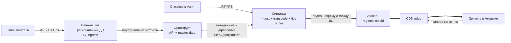
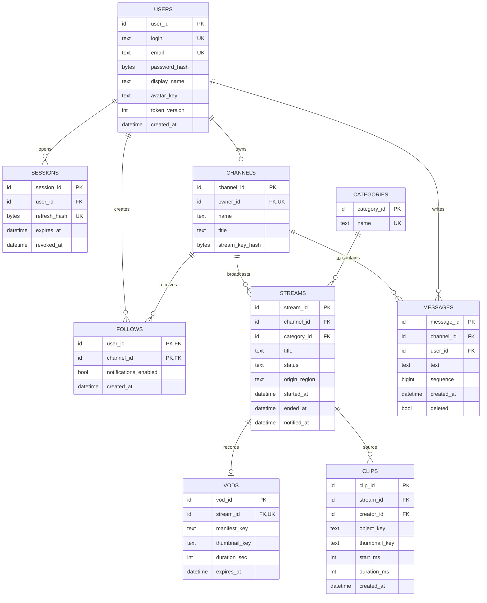
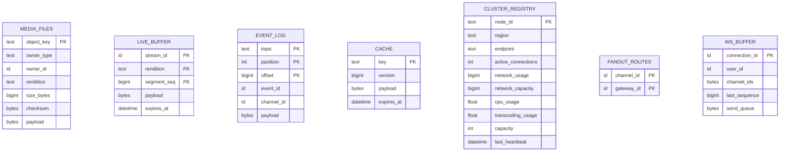
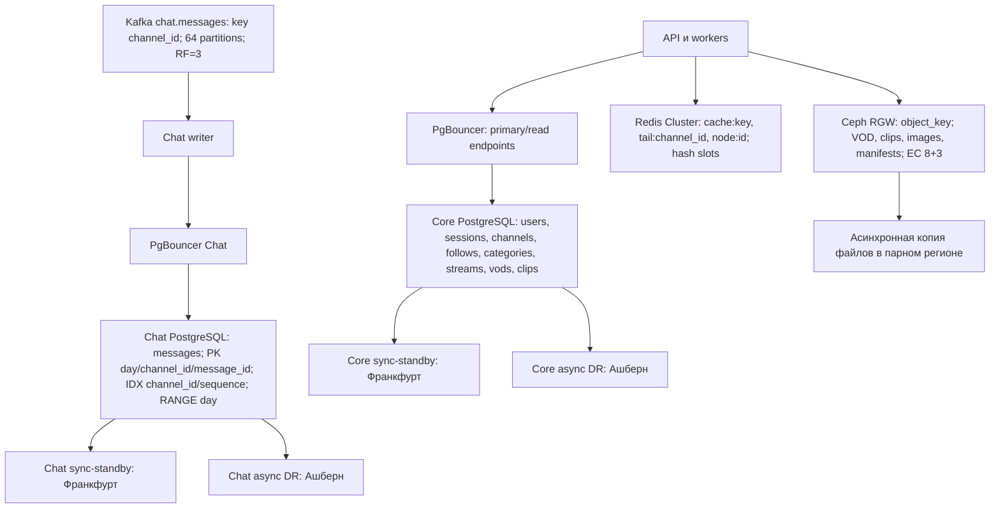

# Расчётно-пояснительная записка для курсовой работы по предмету «Проектирование высоконагруженных систем»

## 1. Тема и целевая аудитория

**Тип сервиса**: платформа интерактивных прямых трансляций (аналог Twitch).

**Основной функционал MVP**:

1. Регистрация и авторизация пользователей;
2. Создание канала и проведение прямой трансляции;
3. Просмотр прямых трансляций с адаптивным качеством видео;
4. Подписка на каналы и получение уведомлений о начале трансляции;
5. Общение в чате трансляции в реальном времени;
6. Просмотр каталога трансляций и поиск каналов;
7. Просмотр записей завершённых трансляций и создание коротких клипов.

**Ключевые продуктовые решения**:

1. Публичные трансляции можно смотреть без регистрации;
2. Качество видео автоматически изменяется в зависимости от пропускной способности сети пользователя;
3. Сообщения чата доставляются участникам трансляции в реальном времени;
4. Записи завершённых трансляций хранятся 7 суток, а созданные пользователями клипы — до их удаления.

**Ключевые функции, характеризующие сервис**:

1. Проведение и просмотр прямых видеотрансляций;
2. Общение зрителей и автора трансляции в реальном времени;

**Целевая аудитория**: около 105 млн пользователей в месяц и 35 млн пользователей в день по всему миру. По внутренним данным Twitch, сайт посещают в среднем 105 млн пользователей в месяц, около 70% зрителей находятся в возрасте от 18 до 34 лет.[[1]](#source1) По данным Amazon Ads, ежедневно Twitch посещают в среднем 35 млн пользователей со всего мира.[[2]](#source2)

## 2. Расчёт нагрузки

### 2.1. Продуктовые метрики

В расчётах используются опубликованные показатели Twitch: 105 млн MAU, 35 млн DAU, 2,5 млн одновременно активных зрителей, 7 млн стримеров в месяц и 1,3 трлн минут просмотра в год.[[1]](#source1)[[2]](#source2)[[3]](#source3)

Среднее время просмотра на одного дневного пользователя:

```
1,3 трлн / 365 / 35 млн ≈ 102 минуты в сутки
```

| Метрика | На одного DAU в сутки | Всего в сутки | Статус и обоснование |
|---|---:|---:|---|
| Месячная аудитория | — | 105 млн пользователей | Исходная метрика Twitch[[1]](#source1) |
| Дневная аудитория | — | 35 млн пользователей | Исходная метрика Amazon Ads[[2]](#source2) |
| Просмотр прямых трансляций | 102 минуты | 3,56 млрд минут | Расчёт по 1,3 трлн минут в год[[3]](#source3) |
| Открытие страниц | 6,57 | 230 млн | Исходная метрика Twitch; 230 млн / 35 млн DAU[[3]](#source3) |
| Авторизация / обновление сессии | 0,5 | 17,5 млн | Допущение: обновление сессии требуется половине DAU |
| Поиск | 1 | 35 млн | Допущение: один поиск на активного пользователя |
| Отправка сообщения в чат | 3 | 105 млн | Допущение: большинство зрителей только читает чат |
| Подписка / отписка от канала | 0,05 | 1,75 млн | Допущение: одно действие раз в 20 активных дней |
| Просмотр записи трансляции | 0,1 | 3,5 млн | Допущение: 10% DAU смотрят одну запись |
| Просмотр клипа | 0,6 | 21 млн | Допущение: 20% DAU смотрят по три клипа |
| Создание клипа | 0,01 | 350 тыс. | Допущение: 1% DAU создаёт один клип |
| Запуск трансляции | 0,029 | 1 млн | Допущение на основании 7 млн стримеров в месяц[[3]](#source3) |


Число открытий страниц взято из данных Twitch.[[3]](#source3) Остальные действия являются проектными допущениями.

Средний объём данных рассчитан по всей месячной аудитории:

| Тип данных | В среднем на пользователя | Объём | Расчёт |
|---|---:|---:|---|
| Профиль, подписки, чат и метаданные | около 87 записей | менее 0,001 Гбайт | 1 профиль, 50 подписок, 30 сообщений и служебные записи |
| Записи трансляций | 0,067 записи | 0,706 Гбайт | 7 млн записей / 105 млн MAU |
| Клипы | 1,22 клипа | 0,0137 Гбайт | 127,75 млн клипов / 105 млн MAU |
| **Итого** | — | **около 0,72 Гбайт** | Сумма типов данных |

Данные распределены неравномерно: обычный зритель хранит менее 0,1 Мбайт, а на активного стримера приходится около 10,6 Гбайт.

### 2.2. Технические метрики

Для расчётов приняты следующие допущения:

- 1 млн трансляций в сутки со средней длительностью 2,4 часа — около 100 тыс. одновременных трансляций;
- качества 360p, 720p и 1080p имеют битрейты 0,8, 3 и 6 Мбит/с; средний битрейт просмотра — 3,31 Мбит/с;
- полная ABR-лестница занимает 9,8 Мбит/с, или 4,41 Гбайт за час видео;
- записи хранятся 7 суток, сообщения чата — 30 суток; 365 суток для клипов — среднее время до удаления, а не обязательный TTL;
- просмотр записи длится в среднем 20 минут, просмотр клипа — 30 секунд;
- аватар есть у 10% пользователей; миниатюра есть у каждого VOD и клипа; средний файл изображения — 20 Кбайт;
- медиасегмент длится 2 секунды; накладные расходы сети составляют 10%;
- коэффициент пика равен 3 для API и чата и 1,5 для прямого видео.

#### Хранилище

| Тип данных | Количество | Логический объём, Тбайт |
|---|---:|---:|
| Профили, подписки, чат и метаданные | около 9,12 млрд записей | 1,79 |
| Буфер прямых трансляций за 10 минут | 100 тыс. трансляций | 73,50 |
| Записи трансляций за 7 суток | 7 млн записей | 74 088,00 |
| Клипы | 127,75 млн | 1 437,19 |
| Аватары и миниатюры | 145,25 млн файлов | 2,905 |
| Манифесты записей и клипов | 134,75 млн | 0,513 |
| **Итого** | — | **75 603,89 Тбайт (75,6 Пбайт)** |

Итоги рассчитаны до округления отдельных строк. Объём указан без индексов, репликации и резервных копий. Буфер live в таблице рассчитан для средней нагрузки; в пике он занимает 110,25 Тбайт. Основную часть хранилища занимают записи трансляций.

#### Сетевой трафик

Пропускная способность рассчитывается как произведение количества одновременных потоков на битрейт. Суточный объём: `трафик × 86 400 / 8`.

| Тип трафика | Средний, Гбит/с | Пиковый, Гбит/с | Гбайт/сутки |
|---|---:|---:|---:|
| Раздача прямых трансляций | 9 102,5 | 13 653,8 | 98 307 000 |
| Приём потоков стримеров | 660,0 | 990,0 | 7 128 000 |
| Записи трансляций и клипы | 203,5 | 610,6 | 2 198 254 |
| Чат и HTTP API | 10,0 | 30,0 | 108 000 |
| **Итого** | **9 976,0** | **15 284,4** | **107 741 254 (107,7 Пбайт)** |

Это глобальный трафик сервиса. Основной исходящий поток должен обслуживаться распределённой CDN.

#### RPS

Средний RPS рассчитывается по формуле `количество операций / 86 400`. Для пика используется коэффициент 3, а для прямого видео — 1,5.

| Метод или операция | Операций в сутки | Средний RPS | Пиковый RPS |
|---|---:|---:|---:|
| Получение страницы и метаданных трансляции | 230 млн | 2 662 | 7 986 |
| Авторизация / обновление сессии | 17,5 млн | 203 | 608 |
| Поиск | 35 млн | 405 | 1 215 |
| Подписки, управление трансляцией и создание клипа | 4,1 млн | 47 | 142 |
| Отправка сообщения чата | 105 млн | 1 215 | 3 646 |
| Доставка сообщения чата | 210 млрд | 2,43 млн | 7,29 млн |
| Плейлисты и сегменты прямого видео | 216 млрд | 2,50 млн | 3,75 млн |
| Сегменты записей и клипов | 2,415 млрд | 27 951 | 83 854 |

Для чата принят средний fan-out 2 000 получателей: 105 млн сообщений дают 210 млрд доставок в сутки. Это соответствует опубликованному Twitch порядку нагрузки — сотням миллиардов доставок сообщений в сутки.[[3]](#source3)

Таким образом, HTTP API обрабатывает около 3,3 тыс. RPS в среднем и 10 тыс. RPS в пике. Основная нагрузка приходится на CDN и доставку сообщений чата.

## 3. Глобальная балансировка нагрузки

### 3.1. Функциональное разбиение по доменам

| Домен | Трафик | Точка обработки |
|---|---|---|
| `www.twitch-clone.com` | Веб-приложение и статика | CDN; при промахе — origin |
| `api.twitch-clone.com` | Авторизация, каталог, поиск, подписки, метаданные | Ближайший региональный L7-вход; обработка — основной API во Франкфурте |
| `chat-{region}.twitch-clone.com` | WebSocket-чаты | L7 WebSocket gateway выбранного региона |
| `ingest-{region}.twitch-clone.com` | Приём RTMP/RTMPS | L7 ingest gateway ближайшего доступного региона |
| `video.twitch-clone.com` | HLS live, VOD, клипы | Ближайший CDN edge; при промахе — shield региона зрителя |
| `origin-{region}.twitch-clone.com` | Получение медиасегментов | Региональный media origin; доступ только от CDN/shield и соседних ДЦ |

Глобальный DNS выбирает ближайший здоровый регион. Соединение принимает прикладной L7-шлюз, который понимает HTTP, WebSocket или RTMP и принимает решение на основе Host, URI, Upgrade, stream key и состояния backend. Отдельного транспортного балансировщика перед ним нет: сетевые маршрутизаторы обеспечивают связность, но не выбирают backend приложения.

### 3.2. Расположение ДЦ и данных

| ДЦ | Назначение |
|---|---|
| Франкфурт | Центральный control plane: основной API, Core DB, Chat Master DB и Kafka; также европейские чат, ingest, транскодирование и media origin |
| Ашберн | Региональный L7-вход для Северной Америки, чат, ingest, транскодирование и media origin; аварийные реплики БД и резерв API |
| Сингапур | Региональный L7-вход, чат, ingest, транскодирование и media origin для Азии |
| Сан-Паулу | Региональный L7-вход, чат, ingest, транскодирование и media origin для Южной Америки |

Архитектура разделена на **control plane** и **media plane**.

- Управляющий трафик сначала приходит в ближайший региональный ДЦ. Региональный L7-шлюз выполняет TLS termination, базовую проверку, rate limit и затем по внутренней магистрали передаёт API-запрос во Франкфурт. Там находятся основной API и мастер-данные; ответ возвращается пользователю через тот же региональный ingress. Поэтому пользователь из Азии обращается по короткому пути до Сингапура, но бизнес-операция выполняется во Франкфурте.
- WebSocket-соединение чата завершается в ближайшем региональном ДЦ. Сообщение публикуется в центральный журнал Kafka во Франкфурте один раз, а региональные consumer groups получают событие для локальной рассылки зрителям. История записывается в Chat Master DB во Франкфурте.
- Медиатрафик не проходит через центральный control plane. Стример публикует поток в ближайший ingest-ДЦ, где поток транскодируется и получает `origin_region`. Запрошенные HLS-сегменты идут из региона-источника напрямую в регион зрителя, а затем в CDN.

Например, для стримера в Азии и зрителя в Северной Америке путь видео выглядит как **Сингапур → Ашберн → CDN edge → зритель**. Маршрут **Сингапур → Франкфурт → Ашберн** не используется: Франкфурт хранит метаданные трансляции, но не является обязательным транзитным узлом для видеобайтов. Реальный Twitch также разделяет ingest-точки и origin-центры и выбирает обработку потоков с учётом вычислительной и сетевой ёмкости.[[4]](#source4)

### 3.3. Геораспределение динамических запросов

Для каждого типа трафика используется свой маршрут:

| Трафик | Глобальная точка входа | Дальнейший маршрут |
|---|---|---|
| HTTP API | Ближайший региональный L7-шлюз | Региональный ДЦ → Франкфурт → основной API |
| WebSocket-чат | Ближайший доступный chat endpoint | Региональный gateway; события → Kafka во Франкфурте → региональные fan-out workers |
| RTMPS от стримера | Ближайший доступный ingest endpoint | Региональный ingest gateway → транскодер и live-буфер этого же региона |
| Live HLS | Ближайший CDN edge к зрителю | Edge → shield региона зрителя → напрямую origin-регион трансляции |
| VOD и клипы | Ближайший CDN edge к зрителю | Edge → региональный shield → ближайшая доступная копия объекта |



Все бизнес-методы HTTP API в штатном режиме в итоге обрабатывает Франкфурт, хотя внешнее соединение пользователя завершается в ближайшем региональном ДЦ:

| Тип запроса из раздела 2 | Средний RPS | Пиковый RPS | Основной ДЦ |
|---|---:|---:|---|
| Страница и метаданные трансляции | 2 662 | 7 986 | Франкфурт |
| Авторизация / обновление сессии | 203 | 608 | Франкфурт |
| Поиск | 405 | 1 215 | Франкфурт |
| Подписки, управление эфиром, создание клипа | 47 | 142 | Франкфурт |
| **Итого, округлённо** | **3 300** | **10 000** | **Франкфурт; резерв — Ашберн** |

Региональные соединения чата, ingest и доля запросов к media shield распределяются между четырьмя регионами. Для расчёта принимаются доли 35/35/20/10%; это проектное допущение, а не опубликованная география Twitch. Таблица описывает штатный пик; при перенаправлении доли меняются.

| ДЦ | Доля | Отправка чата, событий/с | Доставка чата, событий/с | WebSocket-соединения | RTMP-соединения | RTMP, Гбит/с |
|---|---:|---:|---:|---:|---:|---:|
| Франкфурт | 35% | 1 276 | 2 551 500 | 1 312 500 | 52 500 | 346,5 |
| Ашберн | 35% | 1 276 | 2 551 500 | 1 312 500 | 52 500 | 346,5 |
| Сингапур | 20% | 729 | 1 458 000 | 750 000 | 30 000 | 198,0 |
| Сан-Паулу | 10% | 365 | 729 000 | 375 000 | 15 000 | 99,0 |
| **Итого** | **100%** | **3 646** | **7 290 000** | **3 750 000** | **150 000** | **990,0** |

Число одновременно открытых соединений не является RPS. Одно сообщение приходит в Kafka один раз, а региональные fan-out workers доставляют его нужным gateway; до 7,29 млн индивидуальных доставок/с не направляются в мастер-БД как отдельные записи.

### 3.4. Выбор региона по задержке и загрузке

Выбор состоит из двух уровней.

1. **Глобальный DNS** по GeoIP и измеренной сетевой задержке направляет клиента в ближайший здоровый региональный ДЦ. TTL — 60 с. Если регион недоступен, возвращается следующий ближайший адрес.
2. **Routing Service во Франкфурте** выбирает основной и резервный регионы для долгоживущих chat/ingest-соединений. Он использует снимок `CLUSTER_REGISTRY`: heartbeat обновляется раз в 5 с, а данные старше 15 с считаются устаревшими.
3. Для чата учитываются активные WebSocket-соединения, CPU, сеть и скорость fan-out. Для ingest дополнительно проверяется свободная мощность транскодирования и локального live-буфера.
4. Выбирается ближайший доступный регион, где каждый показатель ниже 80% рабочего лимита. При перегрузке выбирается следующий регион; уже открытое соединение автоматически не переносится.
5. Клиент получает региональные имена, например `chat-eu` и `ingest-ap`. Внутри выбранного ДЦ L7-шлюз выбирает backend по состоянию прикладных сервисов, раздел 4.
6. При старте эфира во Франкфурте сохраняется `origin_region`. Это значение определяет источник live-сегментов, но не заставляет видеотрафик возвращаться во Франкфурт.

Если все регионы превысили 80%, используется оставшийся запас до жёсткого лимита. При его исчерпании новые подключения ограничиваются. Подробные параметры выбора и альтернативы описаны в разделе 7.1.

Порог относится к свободным L7-шлюзам, gateway и media-worker, а не к возможности занять аварийный резерв целиком. Регион обязан сохранять запас для отказа части прикладных узлов.

### 3.5. Прямая межрегиональная доставка видео

CDN использует Anycast для `www` и `video` и приводит зрителя к ближайшей точке присутствия. При промахе edge запрос поступает в shield **региона зрителя**. Shield читает `origin_region` из подписанного маршрута манифеста и обращается непосредственно к media origin региона-источника по частной межрегиональной магистрали.

Для одного сегмента действует request coalescing: первый промах создаёт межрегиональный запрос, остальные ожидают тот же результат. Полученный сегмент кешируется в региональном shield и CDN edge, поэтому межконтинентальная передача выполняется один раз на популярный сегмент, а не отдельно для каждого зрителя. Если источник и зритель находятся в одном регионе, межрегионального перехода нет.

Франкфурт участвует только в control plane: выдаёт метаданные, авторизует операции и хранит `origin_region`. Видеобайты через него проходят лишь тогда, когда сам Франкфурт является регионом источника или зрителя. VOD и клипы выдаются из ближайшей доступной объектной копии; live — из кольцевого буфера origin-региона.

| Видео в пике | Клиентский RPS | Origin RPS после CDN/shield | Клиентская полоса, Гбит/с | Origin-полоса, Гбит/с |
|---|---:|---:|---:|---:|
| Live | 3 750 000 | 750 000 при 20% промахов | 13 653,8 | 2 730,76 при доле байтов 20% |
| VOD и клипы | 83 854 | 4 193 при 5% промахов | 610,6 | 30,53 при доле байтов 5% |
| **Итого** | **3 833 854** | **754 193** | **14 264,4** | **2 761,29** |

Dоли запросов и доли байтов — разные величины. Для расчёта интерфейсов **дополнительно принято**, что origin получает 20% live-байтов и 5% VOD-байтов. Это не следует автоматически из cache hit и проверяется измерениями. Межрегиональный трафик source-origin → destination-shield входит в origin-полосу, а фоновая репликация VOD и запись ABR-потоков требуют отдельных внутренних каналов.

При штатном размещении потоков и объектов доли origin-нагрузки также принимаются 35/35/20/10%:

| ДЦ | Origin RPS | Origin-выдача, Гбит/с |
|---|---:|---:|
| Франкфурт | 263 967,55 | 966,45 |
| Ашберн | 263 967,55 | 966,45 |
| Сингапур | 150 838,60 | 552,26 |
| Сан-Паулу | 75 419,30 | 276,13 |

В таблице регион означает регион shield зрителя; конкретный источник сегмента может находиться в другом ДЦ. Это нагрузка origin/shield, а не сетевых интерфейсов CDN edge. При полном сбросе CDN-кеша расчётные доли могут быть превышены: request coalescing, ограничение параллелизма и admission control защищают origin; обслуживание всех 14,26 Тбит/с напрямую из этих пулов не обещается.

## 4. Локальная балансировка нагрузки

В каждом ДЦ используются только прикладные L7-шлюзы. Дополнительного транспортного прокси-слоя перед ними нет. Глобальный DNS возвращает несколько адресов здоровых L7-шлюзов региона, а клиент при ошибке пробует следующий адрес. Обычная сетевая маршрутизация доставляет пакеты до выбранного адреса, но не выбирает backend приложения.

### 4.1. Слои L7-маршрутизации

| Трафик | L7-точка входа | Прикладное решение |
|---|---|---|
| HTTP API | Региональный NGINX/Envoy ingress | TLS termination, rate limit и маршрутизация по Host/URI; запрос передаётся в API Gateway во Франкфурте |
| WebSocket | Региональный NGINX/Envoy ingress | Проверка HTTP Upgrade и выбор chat gateway по `least_conn`; соединение закрепляется до закрытия |
| RTMPS | RTMP-aware ingest gateway | TLS и RTMP handshake, проверка stream key, затем выбор media-worker по загрузке и `stream_id` |
| Live HLS | Региональный media shield | По `stream_id` и `origin_region` выбирается локальный кеш либо прямой запрос в регион-источник |
| VOD/клипы | Региональный media shield | По ключу объекта выбирается локальная/ближайшая копия Ceph RGW |

HTTP API проходит через два L7-уровня: ближайший региональный ingress защищает внешний периметр, а API Gateway во Франкфурте маршрутизирует запрос к бизнес-сервису. Это осознанный дополнительный переход ради единого control plane. Видеодоставка не использует API Gateway во Франкфурте.

Для WebSocket задаются `Upgrade`/`Connection`, idle timeout 120 с и ping раз в 30 с.[[5]](#source5) Сообщения одного канала могут обслуживаться разными gateway: региональный fan-out передаёт событие только тем gateway, у которых есть подписанные зрители.

RTMPS балансируется на прикладном уровне после разбора протокола. Ingest gateway учитывает не только число соединений, но и свободные профили транскодирования, сеть и место в live-буфере. После назначения поток остаётся на одном media-worker до завершения или переподключения OBS.

### 4.2. Правила выбора backend

1. L7-шлюз получает из service discovery только здоровые backend с актуальным heartbeat.
2. Короткие HTTP-запросы распределяются по `least_conn`; для повторного запроса не требуется попасть на тот же экземпляр, потому что состояние хранится во внешних БД и кешах.
3. WebSocket закрепляется за выбранным chat gateway до закрытия соединения. Новые соединения не направляются на узел, достигший лимита FD, send queue или event-loop lag.
4. RTMPS после проверки stream key направляется на media-worker с достаточной транскодирующей ёмкостью. `stream_id` сохраняет назначение, чтобы все пакеты одного эфира попадали на один worker.
5. Live-сегмент сначала ищется в destination-shield. При промахе используется consistent hash по `stream_id`, а запрос идёт напрямую в `origin_region`. Одновременные запросы одного ключа объединяются.
6. Health check исключает backend после трёх ошибок подряд; возвращает после двух успешных проверок. Переключение backend применяется к новым запросам и соединениям, но не переносит существующий TCP/WebSocket/RTMP-сеанс.

### 4.3. Рабочие лимиты и расчёт L7-пулов

| Пул | Ориентир конфигурации | Рабочие ограничения одного узла |
|---|---|---|
| Региональный ingress / API Gateway | 16 CPU, 64 Гбайт RAM, 2 × 25 GbE | 100 тыс. клиентских соединений; 100 тыс. HTTPS RPS; 10 тыс. TLS handshakes/с; 20 Гбит/с |
| WebSocket ingress | 16 CPU, 64 Гбайт RAM, 2 × 25 GbE | 100 тыс. клиентских WSS-соединений; 10 тыс. TLS handshakes/с; до 200 тыс. сообщений/с; 20 Гбит/с |
| RTMP-aware ingest gateway | 32 CPU, 128 Гбайт RAM, 2 × 100 GbE | До 160 Гбит/с проксируемого RTMPS-трафика; ёмкость media-worker проверяется отдельно |
| Media shield / origin | 32 CPU, 128 Гбайт RAM, 2 × 100 GbE | 100 тыс. HTTPS RPS; 10 тыс. TLS handshakes/с; до 20 Гбит/с на процессный узел |

Это проектные рабочие лимиты, а не гарантии производителя. В тесте NGINX 2019 года получено 31 485 новых TLS-соединений/с на 8 CPU без HT; для расчёта принято 10 тыс. с запасом.[[5]](#source5) Реальные пределы TLS, NIC, копирования буферов, event loop и RTMP-парсинга проверяются нагрузочным тестом.

Для каждого L7-пула берётся наиболее жёсткое ограничение, после чего добавляется резерв на отказ половины узлов:

```text
N = max(ceil(соединения / лимит соединений),
        ceil(RPS / лимит RPS),
        ceil(TLS CPS / лимит TLS CPS),
        ceil(трафик / лимит сети),
        ceil(сообщения в секунду / лимит сообщений))
Всего = N × 2.
```

Для центрального API верхняя оценка — 10 тыс. RPS, 10 тыс. TLS-соединений/с, 100 тыс. одновременных соединений и до 30 Гбит/с категории «API и чат». Поэтому API Gateway во Франкфурте требует `max(1, 1, 1, 2) × 2 = 4` узла. В Ашберне поддерживаются 4 резервных узла API, которые включаются после переключения мастер-данных.

Для европейского WebSocket-пула:

```text
max(ceil(1 312 500 / 100 000), ceil(851 / 10 000),
    ceil(10,5 / 20), ceil(2 551 500 / 200 000)) × 2
= max(14, 1, 1, 13) × 2 = 28 узлов.
```

| ДЦ | Региональный API ingress | WebSocket ingress | RTMP-aware ingest | Media shield / origin |
|---|---:|---:|---:|---:|
| Франкфурт | 2 + 4 узла центрального API | 28 | 6 | 98 |
| Ашберн | 2 + 4 резервных узла API | 28 | 6 | 98 |
| Сингапур | 2 | 16 | 4 | 56 |
| Сан-Паулу | 2 | 8 | 2 | 28 |
| **Всего** | **16** | **80** | **18** | **280** |

Числа включают резерв `N × 2`, повторно прибавлять его не нужно. Для media origin число узлов определяется прежде всего сетью: например, для европейской доли `ceil(966,45 / 20) × 2 = 98`. Для RTMPS используются региональные входящие полосы 346,5 / 346,5 / 198 / 99 Гбит/с и рабочий сетевой предел 160 Гбит/с на ingest gateway. Количество транскодеров, chat gateway, Ceph-серверов и CDN edge рассчитывается отдельно.

### 4.4. Доставка live-видео между ДЦ

Media shield региона зрителя работает как L7-кеш и межрегиональный клиент. Для каждого эфира центральный API во Франкфурте хранит только метаданные, включая `origin_region`; сами сегменты остаются в live-буфере региона стримера.

```text
Стример → ближайший ingest → regional media-worker → live buffer
Зритель → CDN edge → destination shield → origin_region → live buffer
```

Если стример находится в Сингапуре, а зритель — в Ашберне, destination shield Ашберна запрашивает отсутствующий сегмент непосредственно в Сингапуре по mTLS. После первого ответа сегмент остаётся в кеше Ашберна и CDN. Франкфурт не находится в data path и не расходует полосу на транзит этого видео.

При недоступности origin-региона shield сначала использует уже закешированные сегменты, затем обращается к синхронной копии live-буфера во второй стойке того же ДЦ. Межрегиональный failover активного эфира возможен только после переподключения стримера к резервному ingest: автоматически восстановить ещё не переданные видеопакеты невозможно.

### 4.5. Отказы и внутренние вызовы

HTTP/gRPC между сервисами распределяется клиентом по доступным экземплярам из service discovery с ограниченными retry, timeout и circuit breaker. Kafka, Redis Cluster и PostgreSQL используют собственные механизмы выбора узла из раздела 6.4; их трафик не направляется через публичные L7-прокси.

При отказе L7-шлюза текущие WebSocket/RTMP-соединения могут оборваться. Чат переподключается с exponential backoff и получает хвост по sequence; OBS подключается к резервному ingest; HLS-клиент повторяет GET через другой edge/shield. HTTP-клиент автоматически повторяет GET и явно идемпотентные операции. Запрос создания ресурса при неизвестном результате сначала проверяет idempotency key. Резерв мощности не сохраняет состояние уже установленного соединения.

## 5. Логическая схема БД

### 5.1. Основные сущности

Схема показывает данные без выбора СУБД и шардирования. ID основных сущностей — глобально уникальные 64-битные идентификаторы. Байты видео и изображений находятся в файловом хранилище; в карточках записаны ключи объектов.



`notified_at` отмечает обработку старта эфира. Worker выбирает новые старты из БД и формирует уведомления онлайн-подписчикам. Повторная отправка допустима; клиент удаляет дубликаты по `stream_id`. Постоянного inbox на каждого подписчика в MVP нет.

### 5.2. Файловые и временные данные



| Данные | Назначение и связь |
|---|---|
| `MEDIA_FILES` | Объекты VOD, клипов, аватаров, миниатюр и манифестов; связи по ключам из USERS/VODS/CLIPS |
| `LIVE_BUFFER` | Последние 10 минут сегментов STREAMS, с вариантами качества |
| `EVENT_LOG` | Сообщения чата для записи и рассылки; ключ упорядочивания — channel_id |
| `CACHE` | Последние 100 сообщений канала, карточки пользователей/каналов и live-манифесты |
| `CLUSTER_REGISTRY` | Heartbeat и загрузка регионов, L7-шлюзов, gateway и media-worker; используется Routing Service и service discovery |
| `FANOUT_ROUTES` | Региональная карта channel_id → gateway_ids в памяти fan-out worker; gateway хранит собственные сокеты |
| `WS_BUFFER` | Очередь отправки и состояние открытого сокета в gateway |
| CDN-кеш | Восстанавливаемая копия MEDIA_FILES и LIVE_BUFFER по URL/byte range; относится к глобальной доставке видео |

### 5.3. Размеры и QPS

Объёмы — логические, без индексов, реплик и backup. 1 Тбайт = 10¹² байт. Размеры строк и частота служебных чтений — проектные допущения. В таблице приведён глобальный пик: QPS чтения списка — один запрос, запись — одна изменённая строка; при batch физическое число SQL-запросов меньше.

| Таблица | Количество строк | Байт/строка | Объём, Тбайт | Чтение, QPS | Запись, строк/с |
|---|---:|---:|---:|---:|---:|
| USERS | 105 млн | 512 | 0,053760 | 1 408 | 4 |
| SESSIONS | до 105 млн | 160 | 0,016800 | 608 | 608 |
| CHANNELS | 7 млн | 384 | 0,002688 | 2 015 | 4 |
| FOLLOWS | 5,25 млрд | 64 | 0,336000 | 1 354 | 61 |
| CATEGORIES | 10 тыс. | 128 | 0,000001 | 10 | менее 1 |
| STREAMS | около 365 млн | 256 | 0,093440 | 800 | 70 |
| VODS | 7 млн | 256 | 0,001792 | 100 | 70 |
| CLIPS | 127,75 млн | 192 | 0,024528 | 300 | 24 |
| MESSAGES | 3,15 млрд за 30 суток | 400 | 1,260000 | 243 | 3 646 |
| **Итого** | **около 9,12 млрд** | — | **1,789** | — | — |

Обоснование:

- При 90% попаданий в кеш чтение карточки: `7 986 × 10% ≈ 800 QPS`. USERS дополнительно читает авторизацию: `800 + 608 = 1 408`. CHANNELS дополнительно обслуживает поиск: `800 + 1 215 = 2 015`.
- Для FOLLOWS принято открытие списка подписок в 10% просмотров страниц: около 799 QPS. Ещё около 555 QPS — сканирование 16 секций при обработке 35 стартов эфира/с. Размер страницы до 500 записей; крупные каналы потребуют дополнительных страниц и отдельного запаса.
- В среднем 50 подписок на MAU: `105 млн × 50 = 5,25 млрд`. Сессии ограничены одной на MAU в расчётной модели. Для регистрации принято 100 тыс. новых пользователей/сутки, или около 4/с в пике.
- Два открытия чата на DAU в сутки дают около 2 431/с в пике; 90% обслуживает кеш хвоста, около 243 чтений/с остаётся мастер-БД.
- Старт и завершение 1 млн эфиров/сутки дают около 70 изменений/с. Метаданные старых эфиров сохраняются, пока на них ссылаются VOD/клипы; 365 суток — средняя оценка для расчёта.
- Для VOD и клипов в записи учтены создание и последующее удаление. Счётчики зрителей обновляются агрегатами раз в 5 секунд, а не SQL-записью на каждый просмотр.

| Файлы / временные данные | Количество и размер | Объём | Пиковое чтение / запись |
|---|---|---:|---|
| VOD-файлы | 3,024 млрд минутных объектов; в среднем 24,5 Мбайт | 74 088 Тбайт | GET вместе с клипами — до 4 193/с после CDN/shield; VOD PUT — до 7 500/с |
| Клипы | 127,75 млн × 11,25 Мбайт | 1 437,19 Тбайт | GET входят в предыдущую строку; около 12 PUT/с |
| Аватары и миниатюры | 145,25 млн × 20 Кбайт | 2,905 Тбайт | До 800 GET/с после кеша и 51 PUT/с |
| VOD/clip-манифесты | 7 млн × 64 Кбайт + 127,75 млн × 512 байт | 0,513 Тбайт | GET входят в бюджет VOD; до 47 PUT/с |
| LIVE_BUFFER | До 135 млн 2-секундных сегментов | 110,25 Тбайт в пике | До 375 тыс. GET/с и 225 тыс. записей/с |
| Live-манифесты | До 450 тыс. × 4 КиБ | 1,843 Гбайт | До 375 тыс. GET/с и 225 тыс. обновлений/с |
| Кеш карточек, на регион | Лимит 5 млн × 1 Кбайт | До 5 Гбайт | До 25 тыс. GET/с и 2,5 тыс. SET/с |
| Кеш хвоста чата, на регион | До 150 тыс. каналов × 100 × 400 байт | До 6 Гбайт | 2 431 чтение/с и 3 646 добавлений/с |
| EVENT_LOG | 105 млн × 400 байт за 24 ч | 42 Гбайт | 3 646 записей/с; до 18 230 чтений событий/с: writer + четыре региона |
| CLUSTER_REGISTRY | До 10 тыс. × 256 байт | 2,56 Мбайт | До 2 тыс. heartbeat/с; снимок читается маршрутизатором раз в 5 с |
| FANOUT_ROUTES | До 3,75 млн пар channel_id/gateway_id × 16 байт, при одном чате на соединение | До 60 Мбайт глобально | До 14 584 локальных lookup/с и 4 862 изменений/с при подключении/отключении |
| Буферы L7-прокси | Лимит 32 КиБ на проксируемое клиентское соединение | До 122,88 Гбайт для 3,75 млн WSS-соединений | Передача до 7,29 млн WSS-сообщений/с; не отдельные SQL-запросы |
| WS_BUFFER | До 3,75 млн соединений, лимит 16 КиБ | До 61,44 Гбайт | До 7,29 млн постановок/отправок в секунду |
| CDN-кеш | Проектный лимит по всем PoP | 400 Тбайт | До 3,834 млн клиентских запросов/с; запись только при промахах |

Размеры двух Redis-кешей указаны на регион: при четырёх полных копиях это до 20 Гбайт карточек и 24 Гбайт хвостов без реплик и накладных расходов Redis. QPS в таблице остаётся глобальным.

Для origin-промахов приняты 20% live-запросов и 5% VOD/clip-запросов. Для расчёта сети отдельно приняты такие же доли байтов, раздел 3.5; это самостоятельное допущение, не следствие числа промахов. Это доли запросов, а не байтов; их необходимо уточнить измерениями. Для live половина запросов приходится на сегменты, половина — на плейлисты.

```text
Live origin: 3,75 млн × 20% = 750 тыс. запросов/с.
Запись live: 150 тыс. эфиров × 3 качества / 2 с = 225 тыс. сегментов/с.
VOD origin: 83 854 × 5% ≈ 4 193 GET/с.
```

### 5.4. Консистентность и горячие ключи

| Данные | Требование | Распределение нагрузки |
|---|---|---|
| Пользователи, сессии, подписки | Транзакции, уникальные login/email, read-after-write через primary | По user_id; у популярных каналов горячий обратный индекс подписчиков |
| Трансляции | Только один live-эфир на канал; атомарный старт/стоп | Чтения популярных каналов обслуживает кеш |
| Чат | Порядок внутри канала; подтверждение после надёжной записи в Kafka; история в SQL появляется асинхронно, цель lag до 5 с | Kafka key = channel_id; gateway выполняет fan-out своим зрителям; каждое сообщение сохраняется в SQL один раз |
| Файлы | Карточка готова после публикации файла и манифеста | Ключ объекта неизменяемый; популярные файлы кешируются |
| Кеши, поиск, счётчики | Устаревание карточек допустимо до 5 с; счётчики приблизительные | TTL, инвалидация, объединение одновременных промахов |
| Уведомления | Как минимум одна попытка, возможны дубликаты | Дедупликация по stream_id; сканирование подписчиков страницами |

При недоступности Kafka новые сообщения не подтверждаются как принятые. При недоступности мастер-БД writer повторяет запись, пока события сохраняются в журнале. Если отставание угрожает 24-часовому retention, приём новых сообщений ограничивается: молча терять историю нельзя.

## 6. Физическая схема БД

### 6.1. Размещение данных

Основные SQL-данные разделены на **Core PostgreSQL** и **Chat Master PostgreSQL**. Разделение изолирует запись чата от авторизации и каталога. Поиск каналов выполняется средствами PostgreSQL; отдельный поисковый кластер для MVP не требуется.

На физической схеме перечислены ключи доступа, секционирование и копии. Полный состав полей совпадает с логической схемой; новые производные поля и индексы приведены в таблице ниже.



Стрелки реплик показывают копирование данных. Chat writer на схеме — consumer потока; WebSocket-шлюзы публикуют в Kafka и потребляют его независимо от SQL writer.

### 6.2. Таблицы и индексы

| Данные | Хранилище и индексы | Шардирование / резервирование |
|---|---|---|
| USERS | Core PostgreSQL: PK `user_id`; UNIQUE `login`, `email` | Без горизонтального шардирования; primary + локальная sync-standby + async DR |
| SESSIONS | Core PostgreSQL: PK `session_id`; UNIQUE `refresh_hash`; IDX `user_id`, `expires_at` | То же; истёкшие строки удаляются пакетами |
| CHANNELS | Core PostgreSQL: PK `channel_id`; UNIQUE `owner_id`, `stream_key_hash`; GIN `search_vector` | `search_vector` — производное поле name/title; обновляется вместе с каналом |
| FOLLOWS | Core PostgreSQL: PK `(user_id, channel_id)`; IDX `(channel_id, user_id)` | 16 HASH-секций по user_id внутри одного primary; обратная выборка читает 16 индексов |
| CATEGORIES | Core PostgreSQL: PK `category_id`; UNIQUE `name` | Без шардирования, справочник кешируется целиком |
| STREAMS | Core PostgreSQL: PK `stream_id`; IDX `(channel_id, started_at DESC)`; частичный UNIQUE `channel_id WHERE status='live'`; IDX `(category_id, started_at DESC) WHERE live`; IDX необработанных стартов | Без шардирования; старые метаданные удаляются после исчезновения ссылок |
| VODS | Core PostgreSQL: PK `vod_id`; UNIQUE `stream_id`; IDX `expires_at` | Без шардирования; файл удаляется фоновым worker |
| CLIPS | Core PostgreSQL: PK `clip_id`; IDX `(stream_id, created_at DESC)`, `(creator_id, created_at DESC)`, `(channel_id, created_at DESC)` | `channel_id` денормализован из исходной трансляции для быстрого списка клипов канала |
| MESSAGES | Chat PostgreSQL: PK `(day, channel_id, message_id)`; IDX `(channel_id, sequence DESC)` | RANGE по UTC-дню; 30–31 суточная секция; отдельный primary + sync-standby + async DR |
| Кеш карточек и чата | Redis Cluster: `entity:type:id`, `tail:channel_id`; hash/string/ZSET | В каждом регионе 3 master + 3 replica; TTL и удаление старых сообщений |
| Реестр кластеров | Redis Cluster: `node:id`, региональный endpoint, CPU/соединения/сеть/транскодирование, TTL 15 с | Обновление каждые 5 с; во Франкфурт передаются heartbeat всех регионов; API использует локальный снимок реестра |
| Чат-события | Kafka: `chat.messages`, key `channel_id` | 64 partitions; RF=3, `acks=all`, `min.insync.replicas=2`; retention 24 ч |
| MEDIA_FILES | Ceph RGW, S3 API: уникальный `object_key` и диапазон байтов | Хеш объекта распределяет данные внутри региона; EC 8+3 по стойкам; async-копия в парный регион |
| LIVE_BUFFER и live-манифесты | NVMe + память media-серверов; `(stream_id, rendition, seq)` | Две копии в разных стойках; TTL 10 минут |
| FANOUT_ROUTES | Память регионального worker: map channel_id → gateway_ids | Разбиение по Kafka partition; восстановление регистрацией gateway, не новая постоянная БД |
| Буферы L7 | RAM NGINX/Envoy и ingest gateway; лимиты соединений, FD и очередей | Пулы раздела 4; состояние TCP не реплицируется |
| WS_BUFFER | Память gateway, map по connection_id | Не реплицируется: клиент переподключается и получает хвост чата |
| CDN-кеш | Внешняя CDN: URL/версия/byte range | Повторно заполняется из origin; не источник постоянных данных |

PostgreSQL поддерживает HASH/RANGE-секционирование и удаление старых данных целыми секциями.[[6]](#source6) Это не распределяет таблицу по серверам: горизонтального шардирования SQL в текущем MVP нет. Core содержит около 0,529 Тбайт строк, Chat Master — 1,26 Тбайт; нагрузка записи позволяет начать с отдельных primary и масштабировать чтение репликами. Окончательное количество дисков и CPU проверяется нагрузочным тестом.

Для сообщений `day` вычисляется из серверного `created_at`. При повторной обработке события сохраняются исходные `message_id` и `day`; вставка идемпотентна по PK. `sequence` берётся из offset Kafka-партиции. Один канал всегда попадает в одну партицию; число партиций без миграции порядка не меняется.

### 6.3. Чат, кеши и видео

Для чата работает одна consumer group записи истории и по одной группе рассылки на регион. Сообщения читаются регионами по одному разу, затем региональные workers по FANOUT_ROUTES выбирают gateway, а WebSocket-шлюзы отправляют сообщения своим клиентам через NGINX. Миллионы индивидуальных доставок не проходят через Kafka как отдельные события.

Chat writer сохраняет сообщения пакетами до 100 или раз в 50 мс и подтверждает consumer offset после SQL commit. Повторное чтение после сбоя не создаёт дубликатов. У текущего primary одна локальная синхронная реплика; межконтинентальная DR-реплика асинхронная.[[7]](#source7)

Redis хранит последние 100 сообщений канала по sequence и популярные карточки, но не всю историю. Кеш карточек — cache-aside с TTL до 5 с; от stampede защищает один выполняющийся запрос на ключ. Redis Cluster распределяет ключи по hash slots, клиент обрабатывает перенаправления.[[8]](#source8) Для Kafka порядок задан партицией, а RF и ISR определяют устойчивость журнала.[[9]](#source9)

Сегменты live имеют длину 2 секунды. Для VOD по 30 сегментов одного качества объединяются в минутный объект, а компактный манифест хранит индекс byte ranges. HLS-плейлист формируется из этого индекса. Это уменьшает число объектов до 3,024 млрд за 7 суток, сохраняя 2-секундную выдачу зрителю. Клипы создаются отдельными файлами и не зависят от удаления исходного VOD.

Ceph хранит бинарные данные с erasure coding 8+3: физический множитель одной копии — 11/8 = 1,375.[[10]](#source10) Вторую независимую региональную копию нужно учитывать дополнительно. Для 75,53 Пбайт логических медиаданных две копии с EC занимают примерно 207,7 Пбайт, без свободного места и backup. Для профиля EC по стойкам требуется не менее 11 доменов размещения.

### 6.4. Подключения и клиентские библиотеки

| Хранилище | Интеграция из Go | Балансировка и ограничение подключений |
|---|---|---|
| PostgreSQL | `pgx/v5`, `pgxpool` | PgBouncer transaction pooling; отдельные endpoints primary/read-only; до 300 активных server connections на БД |
| Redis Cluster | `redis/go-redis` | Подключение по slot map; атомарное обновление хвоста по sequence и ограничение до 100 сообщений |
| Kafka | `twmb/franz-go` | Bootstrap через несколько брокеров, далее соединение с leader партиции; idempotent producer |
| Ceph RGW | AWS SDK for Go v2, S3 API | Пул HTTPS keep-alive, несколько RGW за внутренним балансировщиком |

Записи, авторизация, refresh token и чтение сразу после изменения идут на primary. Остальные SQL-чтения могут обслуживаться локальной standby; при большом отставании запрос возвращается на primary. На соединения приложения устанавливаются лимиты и таймауты, чтобы всплеск запросов не создавал тысячи PostgreSQL-процессов.

### 6.5. Репликация и резервное копирование

| Компонент | Резервирование | Backup и восстановление |
|---|---|---|
| Core DB и Chat Master DB | Primary + sync-standby в другой стойке Франкфурта; async DR в Ашберне | Полный backup еженедельно, differential ежедневно, непрерывный WAL archive; хранение 30 суток в отдельном backup-bucket; PITR |
| Redis | Реплика на каждый master | Кеш восстанавливается из SQL/событий; для реестра достаточно новых heartbeat |
| Kafka | RF=3, минимум две ISR; журнал чата дополнительно копируется в DR-регион | Retention 24 ч для повторной обработки; это буфер, а не backup 30-дневной истории |
| Ceph: VOD | EC 8+3 и async-копия в парный регион | Откат ошибочного явного удаления в течение 24 ч; после планового TTL 7 суток восстановление не обещается |
| Ceph: клипы и изображения | EC и региональная копия | Versioning и защита удалённых версий 30 суток; доступ backup-оператора отделён от приложения |
| Live/CDN/WS-буферы | Live — две копии; остальное восстанавливается | Долговременные backup не нужны; live — из входящего потока, CDN — из origin, WS — после переподключения |

Реплика не заменяет backup при ошибочном удалении. При полном отказе Франкфурта резервная БД повышается в Ашберне только после fencing старого primary; затем включается резервный API. Межрегиональная репликация асинхронная, поэтому RPO зависит от фактического lag. Целевые показатели: до 5 с для DR-реплики и 5–15 минут на переключение; это требования к проекту, которые нужно проверить учениями.

Для SQL резервируется дополнительно 60–100% размера строк под индексы и служебные данные. При расчёте серверов отдельно добавляются WAL, backup и не менее 20% свободного диска. Раз в месяц выполняется пробное восстановление БД и выборочная проверка файлов.

## 7. Алгоритмы

Описаны алгоритмы, определяющие размещение соединений, порядок сообщений и нагрузку видеодоставки. Численные параметры ниже — проектные настройки, которые уточняются измерениями.

### 7.1. Выбор региона с учётом ёмкости

**Подход и блок:** ближайший региональный L7-вход и выбор доступного региона с admission control; Global DNS и Routing Service внутри API.

**Задача:** принять пользователя в ближайшем ДЦ, передать управляющий запрос во Франкфурт и вернуть chat/ingest endpoint, не отправляя новое соединение в перегруженный кластер.

**Вход и ограничения:** IP клиента, оценки RTT, health, активные соединения, CPU, сеть и доступная мощность транскодирования. Heartbeat — раз в 5 с, устаревание — через 15 с. Рабочий порог — 80%; жёсткий лимит ёмкости превышать нельзя. **Результат:** основной и резервный региональные endpoints либо отказ в новом подключении.

**Последовательность:**

1. Получить локальный снимок `CLUSTER_REGISTRY`, исключить устаревшие и неисправные узлы.
2. Рассчитать доступную ёмкость регионов отдельно для чата и ingest; проверить запас на отказ расчётной половины L7-шлюзов, gateway и media-worker.
3. Отсортировать допустимые регионы по RTT; при отсутствии RTT использовать географический порядок по IP.
4. Выбрать первый регион ниже 80% по каждому существенному показателю. Если несколько регионов отличаются по RTT не более чем на 20 мс, выбирать между ними случайно с весом свободной ёмкости — это распределяет всплеск при одинаковом снимке.
5. Вернуть основной и резервный endpoints. На L7-шлюзе и gateway дополнительно действует локальный жёсткий лимит соединений: устаревшая телеметрия не разрешает превысить его.
6. При отсутствии региона ниже рабочего порога использовать остаточную ёмкость до жёсткого лимита. Если её нет — вернуть retry-after со случайной задержкой.

**Структуры данных:** `CLUSTER_REGISTRY` в Redis, снимок health/load и таблица оценок RTT в Routing Service. Global DNS возвращает адреса L7-шлюзов выбранного региона; L7-шлюз получает здоровые backend из service discovery и использует `least_conn` либо закрепление по `stream_id`.

**Альтернативы:** фиксированный GeoDNS не реагирует на загрузку; DNS-веса обновляются с задержкой TTL и не переносят существующие соединения; выбор только по минимальному CPU игнорирует сеть и RTT.

**Обоснование и влияние:** четыре региона можно проверить за O(4). Порог 80% оставляет время на реакцию телеметрии; 15 с выявляют пропуск трёх heartbeat, но не обеспечивают мгновенное обнаружение. Допуск RTT 20 мс позволяет разделить поток без большого роста задержки; это проектный параметр. Жёсткие лимиты применяются локально, поэтому кратковременная неточность глобального снимка приводит к retry, а не к неограниченному приёму. Управляющий API-трафик после регионального входа идёт во Франкфурт, а media shield использует `origin_region` и обращается к источнику видео напрямую. Дополнительного SQL-запроса на каждое сообщение или отдельного HTTP-вызова Resolver нет. Нагрузки и ограничения отражены в разделах 3.4, 4 и таблице временных структур 5.3.

### 7.2. Упорядочивание, сохранение и рассылка чата

**Подход и блок:** журнал по `channel_id`, идемпотентная запись и двухступенчатый fan-out; Chat Service, Kafka и региональные gateway.

**Задача:** сохранить порядок сообщений канала и доставить их зрителям без SQL-записи на каждого получателя.

**Вход и ограничения:** сообщение до 400 байт в среднем со служебными полями, `user_id`, `channel_id`, стабильный `message_id`; права и rate limit проверяются gateway. Kafka имеет 64 партиции, RF=3, `acks=all`, `min.insync.replicas=2`; срок журнала — 24 часа, истории — 30 суток. **Результат:** подтверждённое событие, история и доставка подключённым зрителям; повторная доставка допускается.

**Последовательность:**

1. Gateway валидирует сообщение и публикует его в `chat.messages`, ключ — `channel_id`. Сообщение подтверждается клиенту после успешного подтверждения Kafka.
2. Сообщения одного канала попадают в одну партицию; разные каналы могут разделять партицию. Порядок задаётся offset, который становится `sequence`.
3. Одна consumer group записи сохраняет сообщения в PostgreSQL пакетами до 100 или раз в 50 мс. Offset подтверждается только после SQL commit. Повтор вставки пропускается по PK `(day, channel_id, message_id)`.
4. По одной consumer group на регион получает события. Работник fan-out смотрит локальную карту `channel_id → gateway_ids` и отправляет сообщение только gateway с подписанными зрителями. Gateway сам проходит по своим сокетам.
5. Клиент устраняет дубликаты по `message_id`. Кеш хвоста хранит порядок в ZSET и тела в HASH, обновляет их атомарно в одном Redis slot по hash tag channel_id и оставляет 100 последних сообщений. При разных повторных offset сохраняется первая принятая версия сообщения; после переподключения gateway передаёт последовательность хвоста, а клиент сортирует её по sequence.
6. Кеш хранит только 100 последних сообщений канала; лимит полезных данных остаётся 400 байт на сообщение в среднем, служебные структуры Redis требуют дополнительного резерва RAM. Если кеша нет, загружается история из Chat Master DB; пока writer отстаёт, текущая рассылка и кеш используют журнал Kafka.

**Структуры данных:** `MESSAGES`, `EVENT_LOG`, кеш хвоста, локальные socket maps gateway и региональная `FANOUT_ROUTES`. Карта маршрутов обновляется при появлении первого/уходе последнего зрителя канала на gateway и восстанавливается повторной регистрацией gateway.

**Альтернативы:** прямая рассылка отправителем всем зрителям создаёт глобальный fan-out на одном узле; отдельная запись на получателя увеличивает SQL-нагрузку до 7,29 млн/с; Redis Pub/Sub без долговечного журнала не позволяет восстановить пропущенные при отказе записи.

**Обоснование и влияние:** при среднем fan-out 2 000 сохраняется 3 646 исходных сообщений/с в пике, а 7,29 млн отправок/с обрабатывают gateway. При четырёх региональных группах и writer Kafka выполняет до `3 646 × 5 = 18 230` чтений событий/с. История чата занимает 1,26 Тбайт без индексов и копий. Эти значения входят в разделы 2, 5 и 6; `FANOUT_ROUTES` не является новой мастер-БД.

Порядок Kafka действует в пределах партиции, а не всего кластера. Число партиций и partitioner не меняются без отдельной миграции порядка. При риске исчерпать 24-часовой retention writer новые сообщения ограничиваются, чтобы не потерять историю.

### 7.3. Адаптивное видео и упаковка HLS

**Подход и блок:** HLS с тремя вариантами качества и выбором по измеренной скорости/буферу; транскодирование, packager и видеоплеер.

**Задача:** непрерывно воспроизводить поток при изменении сети, одновременно ограничивая нагрузку origin и число файлов VOD.

**Вход и ограничения:** исходный RTMP/RTMPS-поток, варианты 0,8 / 3 / 6 Мбит/с, сегменты по 2 с; у качеств одинаковые временные границы и согласованные ключевые кадры. Плеер знает размер загруженного сегмента, время его получения и длительность буфера. **Результат:** следующий сегмент выбранного качества и обновлённая оценка сети. HLS допускает варианты качества и byte ranges.[[11]](#source11)

**Последовательность:**

1. Транскодер создаёт три качества; packager публикует завершённый сегмент, затем новую версию live-манифеста. Незавершённый файл не появляется в плейлисте.
2. Плеер начинает с 360p и измеряет полезную скорость скачивания `v = bytes × 8 / seconds`. Оценка сглаживается: `estimate = 0,2 × v + 0,8 × previous_estimate`.
3. Выбирается максимальный битрейт не выше `0,7 × estimate`. При буфере меньше 4 с качество немедленно снижается; если ни один вариант не помещается, используется минимальный с возможной буферизацией.
4. Повышение разрешено после трёх успешных сегментов при буфере не менее 8 с. Гистерезис уменьшает частые переключения, но не гарантирует отсутствие остановок при недостаточной полосе.
5. CDN/shield кешируют неизменяемые сегменты по версии и диапазону. Одновременные промахи одного ключа объединяются в один запрос к origin; ожидание ограничено timeout.
6. Для VOD каждые 30 двухсекундных сегментов одного качества собираются в минутный объект; компактный индекс хранит byte ranges. Финальный VOD-плейлист публикуется после готовности объектов. Клиент продолжает загружать 2-секундные диапазоны.

**Структуры данных:** `STREAMS`, `VODS`, `MEDIA_FILES`, `LIVE_BUFFER`, live-манифесты и компактный индекс диапазонов; состояние ABR находится у клиента. Для клипа создаётся самостоятельный файл — удаление исходного VOD не должно удалить клип.

**Альтернативы:** фиксированное качество не адаптируется к сети; транскодирование на зрителя увеличивает вычисления пропорционально аудитории; отдельный объект на каждый 2-секундный VOD-сегмент даёт 90,72 млрд объектов вместо 3,024 млрд за 7 суток.

**Обоснование и влияние:** три качества ограничивают стоимость обработки потока; коэффициент 0,7 оставляет запас полосы, сглаживание 0,2 подавляет случайный скачок скорости, пороги 4/8 с предотвращают частые переключения. Это проектные параметры плеера, а не требования стандарта HLS. Для расчётного среднего просмотра приняты доли 20% для 360p, 55% для 720p и 25% для 1080p: `0,8 × 0,20 + 3 × 0,55 + 6 × 0,25 = 3,31 Мбит/с`. Это допущение о профиле аудитории, а не гарантия алгоритма ABR. Полная ABR-лестница равна 9,8 Мбит/с и 4,41 Гбайт/ч; отсюда 74 088 Тбайт VOD за 7 суток и 225 тыс. live-сегментов/с при 150 тыс. эфиров. Сегменты/плейлисты, прямой маршрут между регионами и промахи кеша учтены в разделах 2, 3.5, 4.4 и 5.3.

## 8. Технологии

| Технология | Область применения | Мотивация |
|---|---|---|
| Go | API, Routing Service, Chat Service и workers | Подходит для большого числа сетевых соединений; единый стек бизнес-сервисов |
| NGINX/Envoy | Региональный L7 ingress, API Gateway, WebSocket proxy и media shield | TLS, маршрутизация по Host/URI, HTTP Upgrade, keep-alive, health checks и `least_conn`; отдельный транспортный балансировщик не используется |
| RTMP-aware ingest gateway | Приём RTMPS и назначение media-worker | Разбирает RTMP handshake и stream key, учитывает ёмкость транскодирования и закрепляет эфир за worker |
| WebSocket/WSS | Чат | Постоянная двунаправленная связь; новые сообщения передаются без polling |
| RTMP/RTMPS | Приём трансляции от OBS | Поддерживаемый стримерами способ публикации; отдельный ingress-контур |
| HLS, H.264/AAC, FFmpeg | Транскодирование, упаковка и адаптивный просмотр | Общая лестница качеств на поток, HTTP-доставка через CDN, переключение качества на клиенте |
| Внешняя CDN и origin shield | Статика и видеодоставка | Кеширование и объединение промахов сокращают число обращений к origin; edge не входит в локальные серверы |
| PostgreSQL | Core DB и Chat Master DB | Транзакции, уникальность, индексы и секционирование; отдельная история чата изолирует её запись от API |
| PgBouncer | Соединения PostgreSQL | Transaction pooling ограничивает число серверных соединений и сглаживает всплески |
| Redis Cluster | Кеши и `CLUSTER_REGISTRY` | Быстрые чтения, TTL, hash slots и реплики; вся история сообщений в Redis не хранится |
| Apache Kafka | Журнал чата и региональная рассылка | Порядок по partition, replay и независимые consumer groups для истории и регионов |
| Ceph RGW, S3 API | VOD, клипы, изображения, backup | Объектные ключи, erasure coding, региональные копии; бинарные данные не загружают SQL |
| Локальные NVMe | Кольцевой live-буфер | Высокая скорость частых записей 2-секундных сегментов и ограниченный TTL |
| Prometheus и Grafana | Метрики, контроль ёмкости и алерты | Наблюдение за CPU, сетью, TCP, Kafka lag, SQL replication lag и промахами CDN; Routing Service использует оперативный реестр, а не запрос к Grafana |

Один компонент может использовать несколько технологий, но их роли разделены: PostgreSQL — источник постоянных бизнес-данных, Kafka — долговечный журнал передачи, Redis — восстанавливаемый кеш, Ceph — бинарные объекты. Резервирование и backup этих компонентов описаны в разделе 6.5.

## Список источников

1. <a id="source1"></a>[Twitch Ads — Reach the Twitch audience](https://twitchadvertising.tv/) — месячная аудитория.
2. <a id="source2"></a>[Amazon Ads — Twitch ads](https://advertising.amazon.com/library/guides/twitch-ads) — дневная аудитория.
3. <a id="source3"></a>[Twitch State of Engineering 2023](https://blog.twitch.tv/en/2023/09/28/twitch-state-of-engineering-2023/) — просмотры, число стримеров и порядок нагрузки чата.
4. <a id="source4"></a>[Twitch — Ingesting Live Video Streams at Global Scale](https://blog.twitch.tv/en/2022/04/26/ingesting-live-video-streams-at-global-scale/) — разделение ingest/origin и маршрутизация по доступным ресурсам.
5. <a id="source5"></a>[NGINX — Testing the Performance of NGINX Ingress Controller for Kubernetes](https://blog.nginx.org/blog/testing-performance-nginx-ingress-controller-kubernetes) и [NGINX — WebSocket proxying](https://nginx.org/en/docs/http/websocket.html) — тесты TLS и проксирование WebSocket.
6. <a id="source6"></a>[PostgreSQL — Table Partitioning](https://www.postgresql.org/docs/current/ddl-partitioning.html) — секционирование таблиц.
7. <a id="source7"></a>[PostgreSQL — Log-Shipping Standby Servers](https://www.postgresql.org/docs/current/warm-standby.html) — репликация и standby.
8. <a id="source8"></a>[Redis — Scale with Redis Cluster](https://redis.io/docs/latest/operate/oss_and_stack/management/scaling/) — распределение ключей и реплики.
9. <a id="source9"></a>[Apache Kafka — Design](https://kafka.apache.org/41/design/design/) — партиции и надёжная доставка.
10. <a id="source10"></a>[Ceph — Erasure code](https://docs.ceph.com/en/latest/rados/operations/erasure-code/) — избыточное хранение бинарных данных.

11. <a id="source11"></a>[RFC 8216 — HTTP Live Streaming](https://www.rfc-editor.org/rfc/rfc8216.html) — варианты качества, плейлисты и byte ranges.
