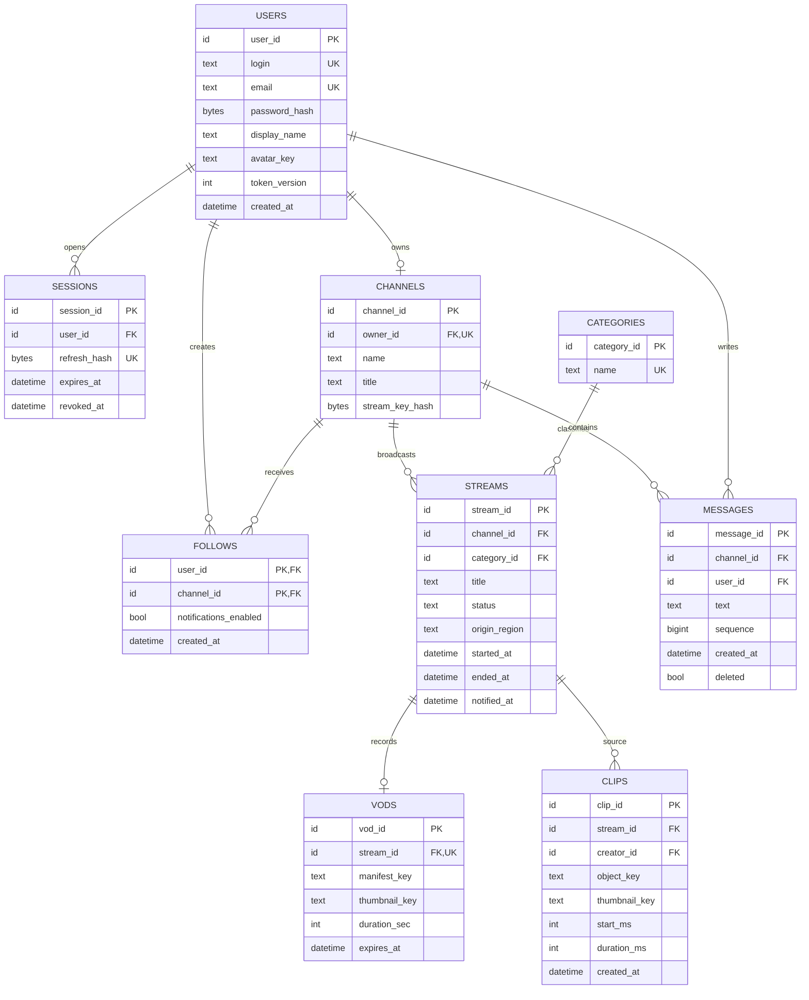
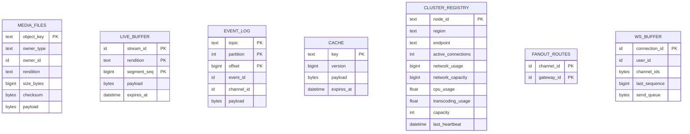
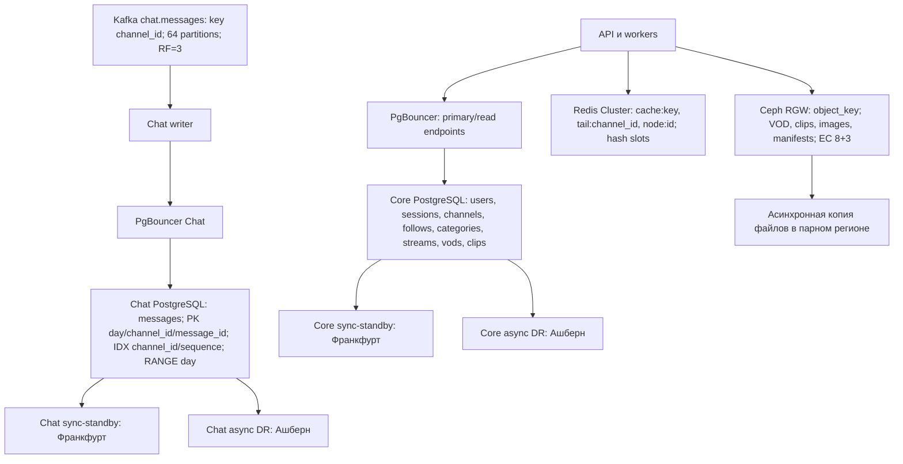
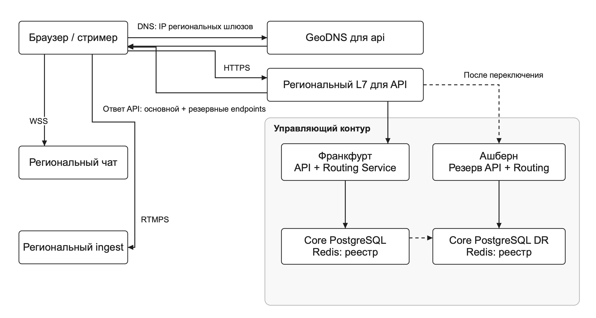
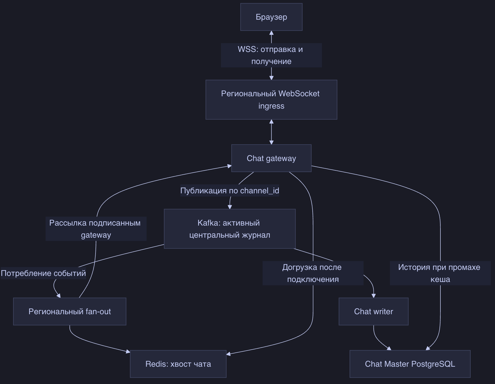
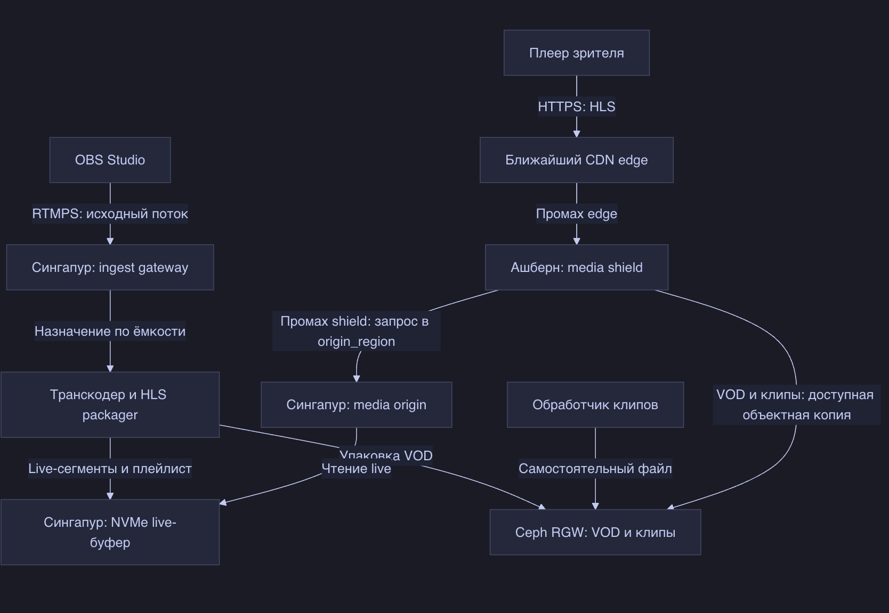

# Расчётно-пояснительная записка для курсовой работы по предмету «Проектирование высоконагруженных систем»

## 1. Тема и целевая аудитория

**Тип сервиса**: платформа интерактивных прямых трансляций (аналог Twitch).

**Основной функционал MVP**:

1. Регистрация и авторизация пользователей;
2. Создание канала и проведение прямой трансляции;
3. Просмотр прямых трансляций с адаптивным качеством видео;
4. Подписка на каналы и получение уведомлений о начале трансляции;
5. Общение в чате трансляции в реальном времени;
6. Просмотр каталога трансляций и поиск каналов;
7. Просмотр записей завершённых трансляций и создание коротких клипов.

**Ключевые продуктовые решения**:

1. Публичные трансляции можно смотреть без регистрации;
2. Качество видео автоматически изменяется в зависимости от пропускной способности сети пользователя;
3. Сообщения чата доставляются участникам трансляции в реальном времени;
4. Записи завершённых трансляций хранятся 7 суток, а созданные пользователями клипы — до их удаления.

**Ключевые функции, характеризующие сервис**:

1. Проведение и просмотр прямых видеотрансляций;
2. Общение зрителей и автора трансляции в реальном времени;

**Целевая аудитория**: около 105 млн пользователей в месяц и 35 млн пользователей в день по всему миру. По внутренним данным Twitch, сайт посещают в среднем 105 млн пользователей в месяц, около 70% зрителей находятся в возрасте от 18 до 34 лет.[[1]](#source1) По данным Amazon Ads, ежедневно Twitch посещают в среднем 35 млн пользователей со всего мира.[[2]](#source2)

## 2. Расчёт нагрузки

Ниже приведена оценка нагрузки проектируемого MVP. Публичные показатели Twitch используются как ориентир масштаба, а частоты действий, размеры объектов и коэффициенты пика задаются отдельно как проектные допущения. Источники относятся к разным периодам: DAU — к 2022 году, MAU и время просмотра — к 2023 году.[[1]](#source1)[[2]](#source2) Это расчётная модель, а не измеренная нагрузка действующего сервиса.

Во всех расчётах используются десятичные единицы: 1 Кбайт = 10³ байт, 1 Гбайт = 10⁹ байт, 1 Тбайт = 10¹² байт, 1 Пбайт = 10¹⁵ байт; 1 байт = 8 бит. В сутках 86 400 секунд. Промежуточные значения не округляются; результаты в таблицах округляются для чтения.

### 2.1. Продуктовые метрики

В расчётах используются опубликованные показатели Twitch: 105 млн MAU, 35 млн DAU, 2,5 млн одновременно активных зрителей, 7 млн стримеров в месяц и 1,3 трлн минут просмотра в год.[[1]](#source1)[[2]](#source2)[[3]](#source3)

Среднее время просмотра на одного дневного пользователя:

```
1,3 трлн / 365 / 35 млн ≈ 102 минуты в сутки
```

Проверка среднего числа одновременных зрителей: `1,3 трлн / (365 × 24 × 60) ≈ 2,47 млн`. Для дальнейшего расчёта принимается округлённая величина 2,5 млн зрителей, согласующаяся по порядку с показателем источника.[[3]](#source3)

| Метрика | На одного DAU в сутки | Всего в сутки | Статус и обоснование |
|---|---:|---:|---|
| Месячная аудитория | — | 105 млн пользователей | Исходная метрика Twitch[[1]](#source1) |
| Дневная аудитория | — | 35 млн пользователей | Исходная метрика Amazon Ads[[2]](#source2) |
| Просмотр прямых трансляций | 102 минуты | 3,56 млрд минут | Расчёт по 1,3 трлн минут в год[[3]](#source3) |
| Открытие страниц | 6,57 | 230 млн | Исходная метрика Twitch; 230 млн / 35 млн DAU[[3]](#source3) |
| Авторизация / обновление сессии | 0,5 | 17,5 млн | Допущение: обновление сессии требуется половине DAU |
| Поиск | 1 | 35 млн | Допущение: один поиск на активного пользователя |
| Отправка сообщения в чат | 3 | 105 млн | Допущение: большинство зрителей только читает чат |
| Подписка / отписка от канала | 0,05 | 1,75 млн | Допущение: одно действие раз в 20 активных дней |
| Просмотр записи трансляции | 0,1 | 3,5 млн | Допущение: 10% DAU смотрят одну запись |
| Просмотр клипа | 0,6 | 21 млн | Допущение: 20% DAU смотрят по три клипа |
| Создание клипа | 0,01 | 350 тыс. | Допущение: 1% DAU создаёт один клип |
| Запуск трансляции | 0,029 | 1 млн | Допущение на основании 7 млн стримеров в месяц[[3]](#source3) |


Число открытий страниц взято из данных Twitch для веб-приложения Twilight.[[3]](#source3) В модели MVP оно используется как бюджет операций получения страницы и метаданных: одно открытие соответствует одному такому API-запросу. Это упрощение; дополнительные запросы интерфейса и трафик других клиентов отдельно не моделируются.

Для остальных действий суточное количество рассчитывается как `DAU × доля пользователей × действий на пользователя`. Частоты являются допущениями, а не статистикой Twitch:

```text
Просмотр live: 1,3 × 10¹² / 365 ≈ 3,56 млрд минут/сутки.
Открытия страниц на DAU: 230 млн / 35 млн ≈ 6,57.
Авторизация: 35 млн × 50% × 1 = 17,5 млн операций/сутки.
Поиск: 35 млн × 1 = 35 млн операций/сутки.
Сообщения: 35 млн × 3 = 105 млн сообщений/сутки.
Подписка/отписка: 35 млн × 0,05 = 1,75 млн операций/сутки.
Просмотры VOD: 35 млн × 10% × 1 = 3,5 млн просмотров/сутки.
Просмотры клипов: 35 млн × 20% × 3 = 21 млн просмотров/сутки.
Создание клипов: 35 млн × 1% × 1 = 350 тыс. клипов/сутки.
```

Для получения 1 млн стартов эфира в сутки дополнительно принимается, что каждый из 7 млн месячных стримеров проводит в среднем 30/7 ≈ 4,29 эфира за условный 30-дневный месяц: `7 млн × (30/7) / 30 = 1 млн эфиров/сутки`. Само число месячных стримеров не определяет частоту эфиров. В пересчёте на DAU это `1 млн / 35 млн ≈ 0,029 старта/сутки`.

Средний объём данных рассчитан по всей месячной аудитории:

| Тип данных | В среднем на пользователя | Объём | Расчёт |
|---|---:|---:|---|
| Профиль, подписки, чат и метаданные | около 87 записей | менее 0,001 Гбайт | 1 профиль, 50 подписок, 30 сообщений и служебные записи |
| Записи трансляций | 0,067 записи | 0,706 Гбайт | 7 млн записей / 105 млн MAU |
| Клипы | 1,22 клипа | 0,0137 Гбайт | 127,75 млн клипов / 105 млн MAU |
| **Итого** | — | **около 0,72 Гбайт** | Сумма типов данных |

Данные распределены неравномерно: обычный зритель хранит менее 0,1 Мбайт, а на активного стримера приходится около 10,6 Гбайт.

Выкладки для этой таблицы по объёмам хранилища из §2.2:

```text
Структурированные записи: 9,11676 млрд / 105 млн ≈ 87 записей/MAU.
Их объём: 1,789 Тбайт × 1 000 / 105 млн ≈ 0,000017 Гбайт/MAU.
VOD: 7 млн / 105 млн ≈ 0,067 записи/MAU;
     74 088 Тбайт × 1 000 / 105 млн = 0,7056 Гбайт/MAU.
Клипы: 127,75 млн / 105 млн ≈ 1,22 клипа/MAU;
       1 437,1875 Тбайт × 1 000 / 105 млн ≈ 0,0137 Гбайт/MAU.
Итого без изображений, манифестов и live-буфера: около 0,72 Гбайт/MAU.
VOD на одного месячного стримера: 74 088 × 1 000 / 7 млн ≈ 10,6 Гбайт.
```

Это усреднение хранимых данных по месячной аудитории. Для зрителя без собственных видео профиль, 50 подписок и 30 сообщений занимают `512 + 50 × 64 + 30 × 400 = 15 712 байт`, то есть менее 0,1 Мбайт без индексов и служебных накладных расходов.

### 2.2. Технические метрики

Для расчётов приняты следующие допущения:

- 1 млн трансляций в сутки со средней длительностью 2,4 часа — около 100 тыс. одновременных трансляций;
- качества 360p, 720p и 1080p имеют битрейты 0,8, 3 и 6 Мбит/с; средний битрейт просмотра — 3,31 Мбит/с;
- полная ABR-лестница занимает 9,8 Мбит/с, или 4,41 Гбайт за час видео;
- записи хранятся 7 суток, сообщения чата — 30 суток; 365 суток для клипов — среднее время до удаления, а не обязательный TTL;
- просмотр записи длится в среднем 20 минут, просмотр клипа — 30 секунд;
- аватар есть у 10% пользователей; миниатюра есть у каждого VOD и клипа; средний файл изображения — 20 Кбайт;
- медиасегмент длится 2 секунды; накладные расходы сети составляют 10%;
- коэффициент пика равен 3 для API и чата и 1,5 для прямого видео.

Клипы хранятся и выдаются в одном качестве 720p с битрейтом 3 Мбит/с. Для live и VOD средний битрейт просмотра рассчитан при долях зрителей 20% / 55% / 25% для 360p / 720p / 1080p. Входящий поток стримера принимается равным 6 Мбит/с; каждый эфир сохраняется как VOD со всеми тремя качествами. Коэффициенты пика выбраны как запас для проектирования и требуют проверки по суточному профилю реального сервиса.

```text
Средний битрейт просмотра = 0,8 × 0,20 + 3 × 0,55 + 6 × 0,25
                         = 3,31 Мбит/с.
Битрейт полной ABR-лестницы = 0,8 + 3 + 6 = 9,8 Мбит/с.
Объём часа ABR-видео = 9,8 × 10⁶ × 3 600 / 8 / 10⁹ = 4,41 Гбайт.
Среднее число эфиров онлайн = 1 млн × 2,4 / 24 = 100 тыс.
Пиковое число эфиров онлайн = 100 тыс. × 1,5 = 150 тыс.
Пиковое число live-зрителей = 2,5 млн × 1,5 = 3,75 млн.
```

#### Хранилище

Для данных с ограниченным сроком хранения используется формула `число объектов = создание за сутки × срок хранения`. Для видео: `объём = длительность в секундах × битрейт / 8`. Предполагается установившаяся нагрузка: истёкшие записи удаляются с той же скоростью, с какой создаются новые.

| Тип данных | Количество | Логический объём, Тбайт |
|---|---:|---:|
| Профили, подписки, чат и метаданные | около 9,12 млрд записей | 1,79 |
| Буфер прямых трансляций за 10 минут | 100 тыс. трансляций | 73,50 |
| Записи трансляций за 7 суток | 7 млн записей | 74 088,00 |
| Клипы | 127,75 млн | 1 437,19 |
| Аватары и миниатюры | 145,25 млн файлов | 2,905 |
| Манифесты записей и клипов | 134,75 млн | 0,513 |
| **Итого** | — | **75 603,89 Тбайт (75,6 Пбайт)** |

Итоги рассчитаны до округления отдельных строк. Объём указан без индексов, репликации и резервных копий. Буфер live в таблице рассчитан для средней нагрузки; в пике он занимает 110,25 Тбайт. Основную часть хранилища занимают записи трансляций.

Выкладки для файловых данных:

```text
Live-буфер: 100 тыс. × 600 с × 9,8 × 10⁶ / 8 / 10¹² = 73,50 Тбайт.
Live-буфер в пике: 73,50 × 1,5 = 110,25 Тбайт.
Количество VOD: 1 млн эфиров/сутки × 7 суток = 7 млн записей.
Один VOD: 2,4 ч × 4,41 Гбайт/ч = 10,584 Гбайт.
Все VOD: 7 млн × 10,584 / 1 000 = 74 088 Тбайт.
Количество клипов: 350 тыс./сутки × 365 суток = 127,75 млн.
Один клип: 30 с × 3 × 10⁶ / 8 = 11,25 Мбайт.
Все клипы: 127,75 млн × 11,25 × 10⁶ / 10¹² = 1 437,1875 Тбайт.
Изображения: 105 млн × 10% + 7 млн + 127,75 млн = 145,25 млн файлов;
             145,25 млн × 20 × 10³ / 10¹² = 2,905 Тбайт.
Манифесты: (7 млн × 64 × 10³ + 127,75 млн × 512) / 10¹²
           = 0,513408 Тбайт.
```

Размеры манифестов — допущения: 64 Кбайт на набор плейлистов одного VOD и 512 байт на клип. Размеры структурированных записей раскрыты в §5.3. Их количество получается из 105 млн профилей, до 105 млн сессий, 7 млн каналов, 5,25 млрд подписок, 10 тыс. категорий, 365 млн метаданных эфиров, 7 млн VOD, 127,75 млн клипов и 3,15 млрд сообщений. При среднем размере строки соответственно 512 / 160 / 384 / 64 / 128 / 256 / 256 / 192 / 400 байт сумма `количество × размер строки` равна 1,78900928 Тбайт. Здесь `5,25 млрд = 105 млн × 50 подписок`, `365 млн = 1 млн эфиров × 365 суток`, `3,15 млрд = 105 млн сообщений × 30 суток`.

Общий логический объём: `1,78900928 + 73,50 + 74 088 + 1 437,1875 + 2,905 + 0,513408 = 75 603,89491728 Тбайт ≈ 75,6 Пбайт`. Физическая ёмкость с учётом избыточности хранения рассчитывается отдельно в разделе 6.

#### Сетевой трафик

Пропускная способность рассчитывается как произведение количества одновременных потоков на битрейт с коэффициентом сетевых накладных расходов 1,1. Суточный объём в Гбайт: `средний трафик в Гбит/с × 86 400 / 8`. Пиковую полосу нельзя умножать на полные сутки: пик не длится 24 часа.

| Тип трафика | Средний, Гбит/с | Пиковый, Гбит/с | Гбайт/сутки |
|---|---:|---:|---:|
| Раздача прямых трансляций | 9 102,5 | 13 653,8 | 98 307 000 |
| Приём потоков стримеров | 660,0 | 990,0 | 7 128 000 |
| Записи трансляций и клипы | 201,1 | 603,2 | 2 171 400 |
| Чат и HTTP API | 10,0 | 30,0 | 108 000 |
| **Итого** | **9 973,6** | **15 276,9** | **107 714 400 (107,7 Пбайт)** |

Это глобальный трафик сервиса. Основной исходящий поток должен обслуживаться распределённой CDN.

```text
Live-выдача: 2,5 млн зрителей × 3,31 Мбит/с × 1,1 = 9 102,5 Гбит/с.
Live-приём: 100 тыс. стримеров × 6 Мбит/с × 1,1 = 660 Гбит/с.
Просмотр VOD: 3,5 млн × 20 × 60 = 4,2 млрд секунд/сутки.
Просмотр клипов: 21 млн × 30 = 630 млн секунд/сутки.
VOD и клипы: (4,2 млрд × 3,31 × 10⁶ + 630 млн × 3 × 10⁶)
             × 1,1 / 8 / 10⁹ = 2 171 400 Гбайт/сутки;
             2 171 400 × 8 / 86 400 ≈ 201,06 Гбит/с.
Пики: live-выдача 9 102,5 × 1,5 = 13 653,75 Гбит/с;
      live-приём 660 × 1,5 = 990 Гбит/с;
      VOD и клипы 201,0556 × 3 ≈ 603,17 Гбит/с.
```

Для чата принят средний размер передаваемого сообщения 400 байт, включая прикладные поля. При среднем fan-out 2 000 получателей исходящая доставка занимает `105 млн × 2 000 × 400 × 8 × 1,1 / 86 400 / 10⁹ ≈ 8,56 Гбит/с`; приём исходных сообщений — ещё около 0,004 Гбит/с. Для HTTP API принимается средний суммарный размер запроса и ответа 4,7 Кбайт: `286,6 млн операций/сутки × 4 700 × 8 × 1,1 / 86 400 / 10⁹ ≈ 0,137 Гбит/с`. Суммарно получается около 8,70 Гбит/с. В таблице заложен округлённый бюджет 10 Гбит/с с дополнительным запасом на служебный трафик; его пик — `10 × 3 = 30 Гбит/с`. Статика и изображения в этот бюджет API не входят; отдельная оценка их CDN-трафика здесь не выполнена.

Сумма строк описывает объём на перечисленных границах сервиса, включая входящий ingest и исходящую выдачу. Внутренние пересылки, репликация и загрузка origin в CDN требуют отдельного расчёта и сюда не добавлены.

#### RPS

Средний RPS рассчитывается по формуле `количество операций / 86 400`. Для пика используется коэффициент 3, а для прямого видео — 1,5.

| Метод или операция | Операций в сутки | Средний RPS | Пиковый RPS |
|---|---:|---:|---:|
| Получение страницы и метаданных трансляции | 230 млн | 2 662 | 7 986 |
| Авторизация / обновление сессии | 17,5 млн | 203 | 608 |
| Поиск | 35 млн | 405 | 1 215 |
| Подписки, управление трансляцией и создание клипа | 4,1 млн | 47 | 142 |
| Отправка сообщения чата | 105 млн | 1 215 | 3 646 |
| Доставка сообщения чата | 210 млрд | 2,43 млн | 7,29 млн |
| Плейлисты и сегменты прямого видео | 216 млрд | 2,50 млн | 3,75 млн |
| Сегменты записей и клипов | 2,415 млрд | 27 951 | 83 854 |

Для чата принят средний fan-out 2 000 получателей: 105 млн сообщений дают 210 млрд доставок в сутки. Это соответствует опубликованному Twitch порядку нагрузки — сотням миллиардов доставок сообщений в сутки.[[3]](#source3)

Выкладки для операций API и чата:

```text
Страницы: 230 млн / 86 400 ≈ 2 662,04 RPS; пик × 3 ≈ 7 986.
Авторизация: 17,5 млн / 86 400 ≈ 202,55 RPS; пик × 3 ≈ 608.
Поиск: 35 млн / 86 400 ≈ 405,09 RPS; пик × 3 ≈ 1 215.
Прочие записи API: 1,75 млн подписок + 1 млн стартов эфира
                  + 1 млн завершений + 0,35 млн клипов = 4,1 млн/сутки;
                  4,1 млн / 86 400 ≈ 47,45 RPS; пик × 3 ≈ 142.
Приём чата: 105 млн / 86 400 ≈ 1 215,28 событий/с; пик ≈ 3 646.
Доставка чата: 105 млн × 2 000 = 210 млрд событий/сутки;
              210 млрд / 86 400 ≈ 2,43 млн событий/с; пик ≈ 7,29 млн.
Всего HTTP API: (230 + 17,5 + 35 + 4,1) млн / 86 400
                ≈ 3 317 RPS; пик ≈ 9 951 RPS.
```

Для HLS предполагается, что каждый зритель скачивает один сегмент выбранного качества раз в 2 секунды. Для live он также обновляет media playlist раз в 2 секунды. Три качества не утраивают клиентский RPS: одновременно скачивается одно качество.

```text
Live на зрителя: 1/2 запроса сегмента + 1/2 запроса плейлиста = 1 запрос/с.
Live в среднем: 2,5 млн × 1 = 2,5 млн RPS;
                2,5 млн × 86 400 = 216 млрд запросов/сутки.
Live в пике: 2,5 млн × 1,5 = 3,75 млн RPS.
VOD-сегменты: 3,5 млн просмотров × (20 × 60 / 2) = 2,1 млрд/сутки.
Клип-сегменты: 21 млн просмотров × (30 / 2) = 315 млн/сутки.
Всего VOD/clip-сегментов: 2,415 млрд / 86 400 ≈ 27 951,39 RPS;
                         пик × 3 ≈ 83 854 RPS.
```

Начальные запросы master playlist и статических VOD/clip-плейлистов здесь опущены: их число зависит от плеера. Для масштаба, по одному плейлисту на каждый просмотр VOD/клипа — `(3,5 + 21) млн / 86 400 ≈ 284 RPS` в среднем. Видеозапросы в таблице относятся к клиентской стороне CDN, а после кеширования нагрузка на origin ниже (§3.5). Приём и доставка сообщений чата считаются событиями WebSocket, а не отдельными HTTP-запросами.

Таким образом, HTTP API обрабатывает около 3,3 тыс. RPS в среднем и 10 тыс. RPS в пике. Основная нагрузка приходится на CDN и доставку сообщений чата.

## 3. Глобальная балансировка нагрузки

### 3.1. Функциональное разбиение по доменам

| Домен | Трафик | Точка обработки |
|---|---|---|
| `www.twitch-clone.com` | Веб-приложение и статика | CDN; при промахе — origin |
| `api.twitch-clone.com` | Авторизация, каталог, поиск, подписки, метаданные | Региональный L7-вход по GeoDNS, далее активный API (штатно во Франкфурте) |
| `chat-{region}.twitch-clone.com` | WebSocket-чаты | L7 WebSocket ingress региона, назначенного Routing Service |
| `ingest-{region}.twitch-clone.com` | Приём RTMP/RTMPS | L7 ingest gateway региона, назначенного Routing Service |
| `video.twitch-clone.com` | HLS live, VOD, клипы | Ближайший CDN edge; при промахе — shield региона зрителя |

Имена `chat-{region}` и `ingest-{region}` разрешаются в адреса шлюзов указанного региона. Клиент подключается к одному из региональных endpoints, выданных Routing Service через API. Регион API-входа может отличаться от региона чата или ingest.

Соединение принимает прикладной L7-шлюз, который понимает HTTP, WebSocket или RTMP и принимает решение на основе Host, URI, Upgrade, stream key и состояния backend. Отдельного транспортного балансировщика перед ним нет: сетевые маршрутизаторы обеспечивают связность, но не выбирают backend приложения.

### 3.2. Расположение ДЦ и данных

| ДЦ | Назначение |
|---|---|
| Франкфурт | Центральный control plane: основной API, Routing Service, Core DB, Chat Master DB и Kafka; также европейские чат, ingest, транскодирование и media origin |
| Ашберн | Региональный L7-вход для Северной Америки, чат, ingest, транскодирование и media origin; аварийные реплики БД, резерв Kafka, API и Routing Service |
| Сингапур | Региональный L7-вход, чат, ingest, транскодирование и media origin для Азии |
| Сан-Паулу | Региональный L7-вход, чат, ingest, транскодирование и media origin для Южной Америки |

Архитектура разделена на **control plane** и **media plane**.

- Управляющий трафик сначала приходит в региональный ДЦ. Региональный L7-шлюз выполняет TLS termination, базовую проверку, rate limit и затем по внутренней магистрали передаёт API-запрос во Франкфурт. Там находятся основной API и мастер-данные; ответ возвращается пользователю через тот же региональный ingress. Например, GeoDNS может выбрать Сингапур для API-входа, а Routing Service — Ашберн для чата при исчерпании ёмкости в Сингапуре. При отказе Франкфурта региональные L7-шлюзы передают управляющие запросы активному API в Ашберне после его восстановления.
- WebSocket-соединение чата завершается в ДЦ, выбранном по списку Routing Service. Сообщение публикуется в центральный журнал Kafka во Франкфурте один раз, а региональные consumer groups получают событие для локальной рассылки зрителям. История записывается в Chat Master DB во Франкфурте.
- Медиатрафик не проходит через центральный control plane. Стример публикует поток на доступный ingest endpoint из списка Routing Service. Поток транскодируется в регионе фактического приёма, который сохраняется как `origin_region`. Запрошенные HLS-сегменты идут из региона-источника напрямую в регион зрителя, а затем в CDN.


### 3.3. Геораспределение динамических запросов

Для каждого типа трафика используется свой маршрут:

| Трафик | Глобальная точка входа | Дальнейший маршрут |
|---|---|---|
| HTTP API | Региональный L7-шлюз по GeoDNS | Региональный ingress → активный API (штатно Франкфурт, резерв Ашберн) |
| WebSocket-чат | Первый доступный chat endpoint из списка Routing Service | Региональный gateway; события → Kafka во Франкфурте → региональные fan-out workers |
| RTMPS от стримера | Ingest endpoint из списка Routing Service | Региональный ingest gateway → транскодер и live-буфер этого же региона |
| Live HLS | Ближайший CDN edge к зрителю | Edge → shield региона зрителя → напрямую origin-регион трансляции |
| VOD и клипы | Ближайший CDN edge к зрителю | Edge → региональный shield → ближайшая доступная копия объекта |


Все бизнес-методы HTTP API в штатном режиме в итоге обрабатывает Франкфурт, а внешнее соединение пользователя завершается на региональном L7-входе, выбранном GeoDNS:

| Тип запроса из раздела 2 | Средний RPS | Пиковый RPS | Основной ДЦ |
|---|---:|---:|---|
| Страница и метаданные трансляции | 2 662 | 7 986 | Франкфурт |
| Авторизация / обновление сессии | 203 | 608 | Франкфурт |
| Поиск | 405 | 1 215 | Франкфурт |
| Подписки, управление эфиром, создание клипа | 47 | 142 | Франкфурт |
| **Итого, округлённо** | **3 300** | **10 000** | **Франкфурт; резерв — Ашберн** |

Региональные соединения чата, ingest и доля запросов к media shield распределяются между четырьмя регионами. Для расчёта принимаются доли 35/35/20/10%; это проектное допущение, а не опубликованная география Twitch. Таблица описывает штатный пик. Фактические доли чата и ingest зависят от назначений Routing Service и переподключений, доля media shield — от маршрутизации CDN.

| ДЦ | Доля | Отправка чата, событий/с | Доставка чата, событий/с | WebSocket-соединения | RTMP-соединения | RTMP, Гбит/с |
|---|---:|---:|---:|---:|---:|---:|
| Франкфурт | 35% | 1 276 | 2 551 500 | 1 312 500 | 52 500 | 346,5 |
| Ашберн | 35% | 1 276 | 2 551 500 | 1 312 500 | 52 500 | 346,5 |
| Сингапур | 20% | 729 | 1 458 000 | 750 000 | 30 000 | 198,0 |
| Сан-Паулу | 10% | 365 | 729 000 | 375 000 | 15 000 | 99,0 |
| **Итого** | **100%** | **3 646** | **7 290 000** | **3 750 000** | **150 000** | **990,0** |

Число одновременно открытых соединений не является RPS. Одно сообщение приходит в Kafka один раз, а региональные fan-out workers доставляют его нужным gateway; до 7,29 млн индивидуальных доставок/с не направляются в мастер-БД как отдельные записи.

### 3.4. Выбор региона по задержке и загрузке

### 3.4. Выбор региона по задержке, доступности и прикладной ёмкости

Глобальная маршрутизация разделена на два уровня, которые решают разные задачи: GeoDNS выбирает точку входа для первоначального HTTP API-запроса, а Routing Service назначает регион для долгоживущего WebSocket- или RTMPS-соединения.

1. **Глобальный DNS (GeoDNS)** для `api.twitch-clone.com` выбирает ближайший доступный региональный L7-вход по GeoIP, оценке сетевой задержки и состоянию входных шлюзов. В DNS-ответе возвращаются IP-адреса L7-шлюзов выбранного региона. TTL — 60 с. GeoDNS не назначает конкретные chat gateway или media-worker и не определяет размещение пользовательской сессии.

2. **Routing Service** вызывается через API при подключении к чату или подготовке новой трансляции. В штатном режиме он работает во Франкфурте, резервный экземпляр предусмотрен в Ашберне. Сервис получает актуальный снимок `CLUSTER_REGISTRY`, где heartbeat обновляется каждые 5 с, а сведения старше 15 с считаются устаревшими. Routing Service не перенаправляет первоначальный HTTP-запрос: он возвращает клиенту адреса регионов для последующего прямого подключения.

3. **Оценка прикладной ёмкости** выполняется отдельно для каждого типа соединения:
   - Для чата учитываются количество открытых WebSocket-соединений, загрузка CPU и сети, скорость fan-out и свободная ёмкость gateway.
   - Для ingest учитываются доступность RTMPS-шлюзов, свободная мощность транскодирования, пропускная способность сети и ёмкость локального live-буфера.

4. **Выбор основного региона** выполняется среди доступных регионов, у которых существенные показатели загрузки ниже 80% рабочих лимитов. Допустимые регионы упорядочиваются по оценке RTT. При отсутствии подходящего региона ниже рабочего порога может использоваться оставшаяся ёмкость до жёсткого лимита. Если все регионы исчерпали доступную мощность, новое подключение отклоняется с рекомендацией повторной попытки.

5. **Выдача endpoints.** Routing Service возвращает упорядоченный список основного и резервных региональных адресов отдельно для чата и ingest. Например, для чата — `chat-ap` → `chat-us`, для ingest — `ingest-ap` → `ingest-us`. Браузер подключается по WSS к первому доступному chat endpoint. При обрыве соединения он пробует следующий адрес из сохранённого списка. Для ingest адреса выдаются при настройке трансляции; автоматическое переключение зависит от возможностей программы вещания, иначе стример выбирает резервный адрес вручную.

6. **Локальная балансировка.** После подключения к выбранному региону прикладной L7-шлюз выбирает конкретный backend по правилам раздела 4. WebSocket-соединение сохраняется на выбранном gateway до завершения или разрыва. Входящий RTMPS-поток закрепляется за media-worker на время работы соединения. Уже установленные соединения автоматически между регионами не перемещаются.

7. **Привязка источника видео.** При начале трансляции сохраняется `origin_region`, соответствующий региону фактического приёма потока. Он используется для маршрутизации HLS-сегментов и не требует передачи видеотрафика через Франкфурт. При успешном переподключении стримера к резервному ingest значение обновляется.

Таким образом, GeoDNS обеспечивает первичную доступность API-входа, а Routing Service — размещение новых долгоживущих соединений с учётом ограничений прикладных ресурсов. Это позволяет независимо выбирать регионы для API, чата и ingest.

**Переподключение и устаревание адресов.** Клиент сохраняет полученный список endpoints. При отказе основного региона он пытается подключиться к резервному без обязательного повторного обращения к Routing Service. Используются exponential backoff и jitter. После восстановления доступа к API клиент обновляет список. Успешно работающие соединения сохраняются до завершения или обрыва.

**Ограничения DNS-переключения.** Если региональный L7-вход перестал отвечать, GeoDNS исключает его из последующих ответов после обнаружения отказа. Однако TTL 60 с не гарантирует переключение за 60 секунд: клиент или рекурсивный резолвер может продолжать использовать закешированный адрес. Поэтому время восстановления первоначального API-доступа зависит также от таймаутов, повторных попыток и доступности резервного входа.

**Отказ управляющего региона.** При потере Франкфурта Routing Service восстанавливается в Ашберне вместе с резервным API по процедуре §6.5 и §9.4. Реестр доступности и загрузки формируется из актуальных heartbeat региональных компонентов. До восстановления управляющего контура ранее полученные chat/ingest endpoints могут использоваться клиентами, но выдача новых назначений через API временно недоступна.

### 3.5. Прямая межрегиональная доставка видео

CDN использует Anycast для `www` и `video` и приводит зрителя к ближайшей точке присутствия. При промахе edge запрос поступает в shield **региона зрителя**. Shield читает `origin_region` из подписанного маршрута манифеста и обращается непосредственно к media origin региона-источника по частной межрегиональной магистрали.

Для одного сегмента действует request coalescing: первый промах создаёт межрегиональный запрос, остальные ожидают тот же результат. Полученный сегмент кешируется в региональном shield и CDN edge, поэтому межконтинентальная передача выполняется один раз на популярный сегмент, а не отдельно для каждого зрителя. Если источник и зритель находятся в одном регионе, межрегионального перехода нет.

Управляющий контур во Франкфурте выдаёт метаданные, авторизует операции и хранит `origin_region`. Видеобайты через него проходят лишь тогда, когда сам Франкфурт является регионом источника или зрителя. VOD и клипы выдаются из ближайшей доступной объектной копии; live — из кольцевого буфера origin-региона.

| Видео в пике | Клиентский RPS | Origin RPS после CDN/shield | Клиентская полоса, Гбит/с | Origin-полоса, Гбит/с |
|---|---:|---:|---:|---:|
| Live | 3 750 000 | 750 000 при 20% промахов | 13 653,8 | 2 730,75 при доле байтов 20% |
| VOD и клипы | 83 854 | 4 193 при 5% промахов | 603,2 | 30,16 при доле байтов 5% |
| **Итого** | **3 833 854** | **754 193** | **14 256,9** | **2 760,91** |

Dоли запросов и доли байтов — разные величины. Для расчёта интерфейсов **дополнительно принято**, что origin получает 20% live-байтов и 5% VOD-байтов. Это не следует автоматически из cache hit и проверяется измерениями. Межрегиональный трафик source-origin → destination-shield входит в origin-полосу, а фоновая репликация VOD и запись ABR-потоков требуют отдельных внутренних каналов.

При штатном размещении потоков и объектов доли origin-нагрузки также принимаются 35/35/20/10%:

| ДЦ | Origin RPS | Origin-выдача, Гбит/с |
|---|---:|---:|
| Франкфурт | 263 967,55 | 966,32 |
| Ашберн | 263 967,55 | 966,32 |
| Сингапур | 150 838,60 | 552,18 |
| Сан-Паулу | 75 419,30 | 276,09 |

В таблице регион означает регион shield зрителя; конкретный источник сегмента может находиться в другом ДЦ. Это нагрузка origin/shield, а не сетевых интерфейсов CDN edge. При полном сбросе CDN-кеша расчётные доли могут быть превышены: request coalescing, ограничение параллелизма и admission control защищают origin; обслуживание всех 14,26 Тбит/с напрямую из этих пулов не обещается.

### 3.6. Переключение при отказе региона
GeoDNS исключает недоступный региональный L7-вход API из новых DNS-ответов после обнаружения отказа. Закешированный ответ и таймауты клиента могут задержать восстановление API-доступа даже при TTL 60 с. Routing Service отдельно исключает регионы с недоступной или устаревшей (старше 15 с) телеметрией нужного сервиса из новых назначений.

После обрыва WSS или RTMPS клиент устанавливает новое соединение по сохранённому списку endpoints с учётом возможностей программы вещания. Список обновляется после восстановления доступа к API.

- Чат: клиент подключается к резервному региональному gateway, повторно подписывается на канал и получает хвост сообщений; дубликаты исключаются по message_id.
- Прямая трансляция: программа вещания переподключается к резервному ingest автоматически, если поддерживает переключение, либо стример меняет адрес вручную. После успешного переподключения обновляется `origin_region`, и media shield получает новые сегменты непосредственно из этого региона. До возобновления публикации возможен перерыв: непереданные видеопакеты и недоступный live-буфер потерянного ДЦ восстановить нельзя.
- Просмотр видео: при отказе edge или регионального shield CDN направляет повторные запросы в доступную точку обслуживания. VOD и клипы выдаются из доступной объектной копии; продолжение live зависит от доступности origin или переподключения стримера.
- Основной control plane: при полном отказе Франкфурта выполняется аварийное переключение на Ашберн по §6.5: изоляция прежнего primary от записи (fencing), повышение резервных БД и запуск резервного API и Routing Service. Региональные L7-шлюзы переключают управляющие запросы на Ашберн. Центральная Kafka также требует восстановления по §6.5; до этого полноценная доставка новых сообщений чата недоступна. Целевое время переключения control plane — 5–15 минут; допустимая потеря данных определяется задержкой асинхронной репликации.

## 4. Локальная балансировка нагрузки

В каждом ДЦ используются только прикладные L7-шлюзы. Дополнительного транспортного прокси-слоя перед ними нет. Для имени API GeoDNS возвращает адреса здоровых L7-шлюзов выбранного региона. Имена чата и ingest указывают на шлюзы региона, заданного в endpoint. Обычная сетевая маршрутизация доставляет пакеты до выбранного адреса, но не выбирает backend приложения.

### 4.1. Слои L7-маршрутизации

| Трафик | L7-точка входа | Прикладное решение |
|---|---|---|
| HTTP API | Региональный NGINX/Envoy ingress | TLS termination, rate limit и маршрутизация по Host/URI; запрос передаётся в активный API Gateway (штатно во Франкфурте) |
| WebSocket | Региональный NGINX/Envoy ingress | Проверка HTTP Upgrade и выбор chat gateway по `least_conn`; соединение закрепляется до закрытия |
| RTMPS | RTMP-aware ingest gateway | TLS и RTMP handshake, проверка stream key, затем выбор media-worker по загрузке и `stream_id` |
| Live HLS | Региональный media shield | По `stream_id` и `origin_region` выбирается локальный кеш либо прямой запрос в регион-источник |
| VOD/клипы | Региональный media shield | По ключу объекта выбирается локальная/ближайшая копия Ceph RGW |

HTTP API проходит через два L7-уровня: региональный ingress, выбранный GeoDNS, защищает внешний периметр, а активный API Gateway маршрутизирует запрос к бизнес-сервису. Это осознанный дополнительный переход ради единого control plane. Видеодоставка не использует API Gateway во Франкфурте.

Для WebSocket задаются `Upgrade`/`Connection`, idle timeout 120 с и ping раз в 30 с.[[5]](#source5) Сообщения одного канала могут обслуживаться разными gateway: региональный fan-out передаёт событие только тем gateway, у которых есть подписанные зрители.

RTMPS балансируется на прикладном уровне после разбора протокола. Ingest gateway учитывает не только число соединений, но и свободные профили транскодирования, сеть и место в live-буфере. После назначения поток остаётся на одном media-worker до завершения или переподключения OBS.

### 4.2. Правила выбора backend

1. L7-шлюз получает из service discovery только здоровые backend с актуальным heartbeat.
2. Короткие HTTP-запросы распределяются по `least_conn`; для повторного запроса не требуется попасть на тот же экземпляр, потому что состояние хранится во внешних БД и кешах.
3. WebSocket закрепляется за выбранным chat gateway до закрытия соединения. Новые соединения не направляются на узел, достигший лимита FD, send queue или event-loop lag.
4. RTMPS после проверки stream key направляется на media-worker с достаточной транскодирующей ёмкостью. `stream_id` сохраняет назначение, чтобы все пакеты одного эфира попадали на один worker.
5. Live-сегмент сначала ищется в destination-shield. При промахе используется consistent hash по `stream_id`, а запрос идёт напрямую в `origin_region`. Одновременные запросы одного ключа объединяются.
6. Health check исключает backend после трёх ошибок подряд; возвращает после двух успешных проверок. Переключение backend применяется к новым запросам и соединениям, но не переносит существующий TCP/WebSocket/RTMP-сеанс.

### 4.3. Рабочие лимиты и расчёт L7-пулов

| Пул | Ориентир конфигурации | Рабочие ограничения одного узла |
|---|---|---|
| Региональный ingress / API Gateway | 16 CPU, 64 Гбайт RAM, 2 × 25 GbE | 100 тыс. клиентских соединений; 100 тыс. HTTPS RPS; 10 тыс. TLS handshakes/с; 20 Гбит/с |
| WebSocket ingress | 16 CPU, 64 Гбайт RAM, 2 × 25 GbE | 100 тыс. клиентских WSS-соединений; 10 тыс. TLS handshakes/с; до 200 тыс. сообщений/с; 20 Гбит/с |
| RTMP-aware ingest gateway | 32 CPU, 128 Гбайт RAM, 2 × 100 GbE | До 160 Гбит/с проксируемого RTMPS-трафика; ёмкость media-worker проверяется отдельно |
| Media shield / origin | 32 CPU, 128 Гбайт RAM, 2 × 100 GbE | 100 тыс. HTTPS RPS; 10 тыс. TLS handshakes/с; до 20 Гбит/с на процессный узел |

Это проектные рабочие лимиты, а не гарантии производителя. В тесте NGINX 2019 года получено 31 485 новых TLS-соединений/с на 8 CPU без HT; для расчёта принято 10 тыс. с запасом.[[5]](#source5) Реальные пределы TLS, NIC, копирования буферов, event loop и RTMP-парсинга проверяются нагрузочным тестом.

Для каждого L7-пула берётся наиболее жёсткое ограничение, после чего добавляется резерв на отказ половины узлов:

```text
N = max(ceil(соединения / лимит соединений),
        ceil(RPS / лимит RPS),
        ceil(TLS CPS / лимит TLS CPS),
        ceil(трафик / лимит сети),
        ceil(сообщения в секунду / лимит сообщений))
Всего = N × 2.
```

Резервирование L7-балансировщиков. Каждый региональный L7-пул работает по схеме active-active: все его экземпляры одновременно принимают трафик. Экземпляры распределяются между двумя независимыми стойками с раздельным питанием и сетевым подключением. Половина пула рассчитана на полную пиковую нагрузку соответствующего региона, поэтому отказ одного балансировщика или одной стойки компенсируется оставшимися экземплярами.

GeoDNS возвращает для имени API несколько адресов здоровых L7-балансировщиков выбранного региона. Региональные имена чата и ingest возвращают здоровые адреса в пределах указанного региона. Внешние проверки доступности проверяют каждый адрес на уровне обслуживаемого протокола; после трёх последовательных неудачных проверок адрес исключается из DNS-ответов, после двух успешных — возвращается. Интервал проверок — 5 с, TTL DNS — 60 с. Конфигурация маршрутизации и TLS-сертификаты заранее доставляются на все экземпляры, поэтому оставшиеся балансировщики готовы принимать новые подключения без ручной настройки.

Для центрального API верхняя оценка — 10 тыс. RPS, 10 тыс. TLS-соединений/с, 100 тыс. одновременных соединений и до 30 Гбит/с категории «API и чат». Поэтому API Gateway во Франкфурте требует `max(1, 1, 1, 2) × 2 = 4` узла. В Ашберне поддерживаются 4 резервных узла API, которые включаются после переключения мастер-данных.

Для европейского WebSocket-пула:

```text
max(ceil(1 312 500 / 100 000), ceil(851 / 10 000),
    ceil(10,5 / 20), ceil(2 551 500 / 200 000)) × 2
= max(14, 1, 1, 13) × 2 = 28 узлов.
```

| ДЦ | Региональный API ingress | WebSocket ingress | RTMP-aware ingest | Media shield / origin |
|---|---:|---:|---:|---:|
| Франкфурт | 2 + 4 узла центрального API | 28 | 6 | 98 |
| Ашберн | 2 + 4 резервных узла API | 28 | 6 | 98 |
| Сингапур | 2 | 16 | 4 | 56 |
| Сан-Паулу | 2 | 8 | 2 | 28 |
| **Всего** | **16** | **80** | **18** | **280** |

Числа включают резерв `N × 2`, повторно прибавлять его не нужно. Для media origin число узлов определяется прежде всего сетью: например, для европейской доли `ceil(966,32 / 20) × 2 = 98`. Для RTMPS используются региональные входящие полосы 346,5 / 346,5 / 198 / 99 Гбит/с и рабочий сетевой предел 160 Гбит/с на ingest gateway. Количество транскодеров, chat gateway, Ceph-серверов и CDN edge рассчитывается отдельно.

### 4.4. Доставка live-видео между ДЦ

Media shield региона зрителя работает как L7-кеш и межрегиональный клиент. Для каждого эфира центральный API во Франкфурте хранит только метаданные, включая `origin_region`; сами сегменты остаются в live-буфере региона стримера.

```text
Стример → ingest endpoint из списка Routing Service → regional media-worker → live buffer
Зритель → CDN edge → destination shield → origin_region → live buffer
```

Если стример находится в Сингапуре, а зритель — в Ашберне, destination shield Ашберна запрашивает отсутствующий сегмент непосредственно в Сингапуре по mTLS. После первого ответа сегмент остаётся в кеше Ашберна и CDN. Франкфурт не находится в data path и не расходует полосу на транзит этого видео.

При недоступности origin-региона shield сначала использует уже закешированные сегменты, затем обращается к синхронной копии live-буфера во второй стойке того же ДЦ. Межрегиональный failover активного эфира возможен только после переподключения стримера к резервному ingest: автоматически восстановить ещё не переданные видеопакеты невозможно.

### 4.5. Отказы и внутренние вызовы

HTTP/gRPC между сервисами распределяется клиентом по доступным экземплярам из service discovery с ограниченными retry, timeout и circuit breaker. Kafka, Redis Cluster и PostgreSQL используют собственные механизмы выбора узла из раздела 6.4; их трафик не направляется через публичные L7-прокси.

При отказе L7-шлюза текущие WebSocket/RTMP-соединения могут оборваться. Клиент может повторить подключение к другому адресу шлюза того же регионального endpoint, если этот адрес доступен в DNS-ответе. При недоступности endpoint используется следующий адрес из списка Routing Service с учётом возможностей клиента. Исключение отказавшего адреса из DNS влияет на новые DNS-ответы, поэтому клиент с закешированным списком должен пробовать следующий адрес при ошибке или тайм-ауте соединения. Состояние TCP/TLS-соединений между балансировщиками не реплицируется: отказоустойчивость обеспечивается повторным подключением. Чат переподключается с exponential backoff и получает хвост по `sequence`. HLS-клиент повторяет GET через другой edge/shield. HTTP-клиент автоматически повторяет GET и явно идемпотентные операции. Запрос создания ресурса при неизвестном результате сначала проверяет idempotency key. Резерв мощности не сохраняет состояние уже установленного соединения.

## 5. Логическая схема БД

### 5.1. Основные сущности

Схема показывает данные без выбора СУБД и шардирования. ID основных сущностей — глобально уникальные 64-битные идентификаторы. Байты видео и изображений находятся в файловом хранилище; в карточках записаны ключи объектов.



`notified_at` отмечает обработку старта эфира. Worker выбирает новые старты из БД и формирует уведомления онлайн-подписчикам. Повторная отправка допустима; клиент удаляет дубликаты по `stream_id`. Постоянного inbox на каждого подписчика в MVP нет.

### 5.2. Файловые и временные данные



| Данные | Назначение и связь |
|---|---|
| `MEDIA_FILES` | Объекты VOD, клипов, аватаров, миниатюр и манифестов; связи по ключам из USERS/VODS/CLIPS |
| `LIVE_BUFFER` | Последние 10 минут сегментов STREAMS, с вариантами качества |
| `EVENT_LOG` | Сообщения чата для записи и рассылки; ключ упорядочивания — channel_id |
| `CACHE` | Последние 100 сообщений канала, карточки пользователей/каналов и live-манифесты |
| `CLUSTER_REGISTRY` | Heartbeat и загрузка регионов, L7-шлюзов, gateway и media-worker; используется Routing Service и service discovery |
| `FANOUT_ROUTES` | Региональная карта channel_id → gateway_ids в памяти fan-out worker; gateway хранит собственные сокеты |
| `WS_BUFFER` | Очередь отправки и состояние открытого сокета в gateway |
| CDN-кеш | Восстанавливаемая копия MEDIA_FILES и LIVE_BUFFER по URL/byte range; относится к глобальной доставке видео |

### 5.3. Размеры и QPS

Объёмы — логические, без индексов, реплик и backup. 1 Тбайт = 10¹² байт. Размеры строк и частота служебных чтений — проектные допущения. В таблице приведён глобальный пик: QPS чтения списка — один запрос, запись — одна изменённая строка; при batch физическое число SQL-запросов меньше.

| Таблица | Количество строк | Байт/строка | Объём, Тбайт | Чтение, QPS | Запись, строк/с |
|---|---:|---:|---:|---:|---:|
| USERS | 105 млн | 512 | 0,053760 | 1 408 | 4 |
| SESSIONS | до 105 млн | 160 | 0,016800 | 608 | 608 |
| CHANNELS | 7 млн | 384 | 0,002688 | 2 015 | 4 |
| FOLLOWS | 5,25 млрд | 64 | 0,336000 | 1 354 | 61 |
| CATEGORIES | 10 тыс. | 128 | 0,000001 | 10 | менее 1 |
| STREAMS | около 365 млн | 256 | 0,093440 | 800 | 70 |
| VODS | 7 млн | 256 | 0,001792 | 100 | 70 |
| CLIPS | 127,75 млн | 192 | 0,024528 | 300 | 24 |
| MESSAGES | 3,15 млрд за 30 суток | 400 | 1,260000 | 243 | 3 646 |
| **Итого** | **около 9,12 млрд** | — | **1,789** | — | — |

Обоснование:

- При 90% попаданий в кеш чтение карточки: `7 986 × 10% ≈ 800 QPS`. USERS дополнительно читает авторизацию: `800 + 608 = 1 408`. CHANNELS дополнительно обслуживает поиск: `800 + 1 215 = 2 015`.
- Для FOLLOWS принято открытие списка подписок в 10% просмотров страниц: около 799 QPS. Ещё около 555 QPS — сканирование 16 секций при обработке 35 стартов эфира/с. Размер страницы до 500 записей; крупные каналы потребуют дополнительных страниц и отдельного запаса.
- В среднем 50 подписок на MAU: `105 млн × 50 = 5,25 млрд`. Сессии ограничены одной на MAU в расчётной модели. Для регистрации принято 100 тыс. новых пользователей/сутки, или около 4/с в пике.
- Два открытия чата на DAU в сутки дают около 2 431/с в пике; 90% обслуживает кеш хвоста, около 243 чтений/с остаётся мастер-БД.
- Старт и завершение 1 млн эфиров/сутки дают около 70 изменений/с. Метаданные старых эфиров сохраняются, пока на них ссылаются VOD/клипы; 365 суток — средняя оценка для расчёта.
- Для VOD и клипов в записи учтены создание и последующее удаление. Счётчики зрителей обновляются агрегатами раз в 5 секунд, а не SQL-записью на каждый просмотр.

| Файлы / временные данные | Количество и размер | Объём | Пиковое чтение / запись |
|---|---|---:|---|
| VOD-файлы | 3,024 млрд минутных объектов; в среднем 24,5 Мбайт | 74 088 Тбайт | GET вместе с клипами — до 4 193/с после CDN/shield; VOD PUT — до 7 500/с |
| Клипы | 127,75 млн × 11,25 Мбайт | 1 437,19 Тбайт | GET входят в предыдущую строку; около 12 PUT/с |
| Аватары и миниатюры | 145,25 млн × 20 Кбайт | 2,905 Тбайт | До 800 GET/с после кеша и 51 PUT/с |
| VOD/clip-манифесты | 7 млн × 64 Кбайт + 127,75 млн × 512 байт | 0,513 Тбайт | GET входят в бюджет VOD; до 47 PUT/с |
| LIVE_BUFFER | До 135 млн 2-секундных сегментов | 110,25 Тбайт в пике | До 375 тыс. GET/с и 225 тыс. записей/с |
| Live-манифесты | До 450 тыс. × 4 КиБ | 1,843 Гбайт | До 375 тыс. GET/с и 225 тыс. обновлений/с |
| Кеш карточек, на регион | Лимит 5 млн × 1 Кбайт | До 5 Гбайт | До 25 тыс. GET/с и 2,5 тыс. SET/с |
| Кеш хвоста чата, на регион | До 150 тыс. каналов × 100 × 400 байт | До 6 Гбайт | 2 431 чтение/с и 3 646 добавлений/с |
| EVENT_LOG | 105 млн × 400 байт за 24 ч | 42 Гбайт | 3 646 записей/с; до 18 230 чтений событий/с: writer + четыре региона |
| CLUSTER_REGISTRY | До 10 тыс. × 256 байт | 2,56 Мбайт | До 2 тыс. heartbeat/с; снимок читается маршрутизатором раз в 5 с |
| FANOUT_ROUTES | До 3,75 млн пар channel_id/gateway_id × 16 байт, при одном чате на соединение | До 60 Мбайт глобально | До 14 584 локальных lookup/с и 4 862 изменений/с при подключении/отключении |
| Буферы L7-прокси | Лимит 32 КиБ на проксируемое клиентское соединение | До 122,88 Гбайт для 3,75 млн WSS-соединений | Передача до 7,29 млн WSS-сообщений/с; не отдельные SQL-запросы |
| WS_BUFFER | До 3,75 млн соединений, лимит 16 КиБ | До 61,44 Гбайт | До 7,29 млн постановок/отправок в секунду |
| CDN-кеш | Проектный лимит по всем PoP | 400 Тбайт | До 3,834 млн клиентских запросов/с; запись только при промахах |

Размеры двух Redis-кешей указаны на регион: при четырёх полных копиях это до 20 Гбайт карточек и 24 Гбайт хвостов без реплик и накладных расходов Redis. QPS в таблице остаётся глобальным.

Для origin-промахов приняты 20% live-запросов и 5% VOD/clip-запросов. Для расчёта сети отдельно приняты такие же доли байтов, раздел 3.5; это самостоятельное допущение, не следствие числа промахов. Это доли запросов, а не байтов; их необходимо уточнить измерениями. Для live половина запросов приходится на сегменты, половина — на плейлисты.

```text
Live origin: 3,75 млн × 20% = 750 тыс. запросов/с.
Запись live: 150 тыс. эфиров × 3 качества / 2 с = 225 тыс. сегментов/с.
VOD origin: 83 854 × 5% ≈ 4 193 GET/с.
```

### 5.4. Консистентность и горячие ключи

| Данные | Требование | Распределение нагрузки |
|---|---|---|
| Пользователи, сессии, подписки | Транзакции, уникальные login/email, read-after-write через primary | По user_id; у популярных каналов горячий обратный индекс подписчиков |
| Трансляции | Только один live-эфир на канал; атомарный старт/стоп | Чтения популярных каналов обслуживает кеш |
| Чат | Порядок внутри канала; подтверждение после надёжной записи в Kafka; история в SQL появляется асинхронно, цель lag до 5 с | Kafka key = channel_id; gateway выполняет fan-out своим зрителям; каждое сообщение сохраняется в SQL один раз |
| Файлы | Карточка готова после публикации файла и манифеста | Ключ объекта неизменяемый; популярные файлы кешируются |
| Кеши, поиск, счётчики | Устаревание карточек допустимо до 5 с; счётчики приблизительные | TTL, инвалидация, объединение одновременных промахов |
| Уведомления | Как минимум одна попытка, возможны дубликаты | Дедупликация по stream_id; сканирование подписчиков страницами |

При недоступности Kafka новые сообщения не подтверждаются как принятые. При недоступности мастер-БД writer повторяет запись, пока события сохраняются в журнале. Если отставание угрожает 24-часовому retention, приём новых сообщений ограничивается: молча терять историю нельзя.

## 6. Физическая схема БД

### 6.1. Размещение данных

Основные SQL-данные разделены на **Core PostgreSQL** и **Chat Master PostgreSQL**. Разделение изолирует запись чата от авторизации и каталога. Поиск каналов выполняется средствами PostgreSQL; отдельный поисковый кластер для MVP не требуется.

На физической схеме перечислены ключи доступа, секционирование и копии. Полный состав полей совпадает с логической схемой; новые производные поля и индексы приведены в таблице ниже.



Стрелки реплик показывают копирование данных. Chat writer на схеме — consumer потока; WebSocket-шлюзы публикуют в Kafka и потребляют его независимо от SQL writer.

### 6.2. Таблицы и индексы

| Данные | Хранилище и индексы | Шардирование / резервирование |
|---|---|---|
| USERS | Core PostgreSQL: PK `user_id`; UNIQUE `login`, `email` | Без горизонтального шардирования; primary + локальная sync-standby + async DR |
| SESSIONS | Core PostgreSQL: PK `session_id`; UNIQUE `refresh_hash`; IDX `user_id`, `expires_at` | То же; истёкшие строки удаляются пакетами |
| CHANNELS | Core PostgreSQL: PK `channel_id`; UNIQUE `owner_id`, `stream_key_hash`; GIN `search_vector` | `search_vector` — производное поле name/title; обновляется вместе с каналом |
| FOLLOWS | Core PostgreSQL: PK `(user_id, channel_id)`; IDX `(channel_id, user_id)` | 16 HASH-секций по user_id внутри одного primary; обратная выборка читает 16 индексов |
| CATEGORIES | Core PostgreSQL: PK `category_id`; UNIQUE `name` | Без шардирования, справочник кешируется целиком |
| STREAMS | Core PostgreSQL: PK `stream_id`; IDX `(channel_id, started_at DESC)`; частичный UNIQUE `channel_id WHERE status='live'`; IDX `(category_id, started_at DESC) WHERE live`; IDX необработанных стартов | Без шардирования; старые метаданные удаляются после исчезновения ссылок |
| VODS | Core PostgreSQL: PK `vod_id`; UNIQUE `stream_id`; IDX `expires_at` | Без шардирования; файл удаляется фоновым worker |
| CLIPS | Core PostgreSQL: PK `clip_id`; IDX `(stream_id, created_at DESC)`, `(creator_id, created_at DESC)`, `(channel_id, created_at DESC)` | `channel_id` денормализован из исходной трансляции для быстрого списка клипов канала |
| MESSAGES | Chat PostgreSQL: PK `(day, channel_id, message_id)`; IDX `(channel_id, sequence DESC)` | RANGE по UTC-дню; 30–31 суточная секция; отдельный primary + sync-standby + async DR |
| Кеш карточек и чата | Redis Cluster: `entity:type:id`, `tail:channel_id`; hash/string/ZSET | В каждом регионе 3 master + 3 replica; TTL и удаление старых сообщений |
| Реестр кластеров | Redis Cluster: `node:id`, региональный endpoint, CPU/соединения/сеть/транскодирование, TTL 15 с | Обновление каждые 5 с; во Франкфурт передаются heartbeat всех регионов; API использует локальный снимок реестра |
| Чат-события | Kafka: `chat.messages`, key `channel_id` | 64 partitions; RF=3, `acks=all`, `min.insync.replicas=2`; retention 24 ч |
| MEDIA_FILES | Ceph RGW, S3 API: уникальный `object_key` и диапазон байтов | Хеш объекта распределяет данные внутри региона; EC 8+3 по стойкам; async-копия в парный регион |
| LIVE_BUFFER и live-манифесты | NVMe + память media-серверов; `(stream_id, rendition, seq)` | Две копии в разных стойках; TTL 10 минут |
| FANOUT_ROUTES | Память регионального worker: map channel_id → gateway_ids | Разбиение по Kafka partition; восстановление регистрацией gateway, не новая постоянная БД |
| Буферы L7 | RAM NGINX/Envoy и ingest gateway; лимиты соединений, FD и очередей | Пулы раздела 4; состояние TCP не реплицируется |
| WS_BUFFER | Память gateway, map по connection_id | Не реплицируется: клиент переподключается и получает хвост чата |
| CDN-кеш | Внешняя CDN: URL/версия/byte range | Повторно заполняется из origin; не источник постоянных данных |

PostgreSQL поддерживает HASH/RANGE-секционирование и удаление старых данных целыми секциями.[[6]](#source6) Это не распределяет таблицу по серверам: горизонтального шардирования SQL в текущем MVP нет. Core содержит около 0,529 Тбайт строк, Chat Master — 1,26 Тбайт; нагрузка записи позволяет начать с отдельных primary и масштабировать чтение репликами. Окончательное количество дисков и CPU проверяется нагрузочным тестом.

Для сообщений `day` вычисляется из серверного `created_at`. При повторной обработке события сохраняются исходные `message_id` и `day`; вставка идемпотентна по PK. `sequence` берётся из offset Kafka-партиции. Один канал всегда попадает в одну партицию; число партиций без миграции порядка не меняется.

### 6.3. Чат, кеши и видео

Для чата работает одна consumer group записи истории и по одной группе рассылки на регион. Сообщения читаются регионами по одному разу, затем региональные workers по FANOUT_ROUTES выбирают gateway, а WebSocket-шлюзы отправляют сообщения своим клиентам через NGINX. Миллионы индивидуальных доставок не проходят через Kafka как отдельные события.

Chat writer сохраняет сообщения пакетами до 100 или раз в 50 мс и подтверждает consumer offset после SQL commit. Повторное чтение после сбоя не создаёт дубликатов. У текущего primary одна локальная синхронная реплика; межконтинентальная DR-реплика асинхронная.[[7]](#source7)

Redis хранит последние 100 сообщений канала по sequence и популярные карточки, но не всю историю. Кеш карточек — cache-aside с TTL до 5 с; от stampede защищает один выполняющийся запрос на ключ. Redis Cluster распределяет ключи по hash slots, клиент обрабатывает перенаправления.[[8]](#source8) Для Kafka порядок задан партицией, а RF и ISR определяют устойчивость журнала.[[9]](#source9)

Сегменты live имеют длину 2 секунды. Для VOD по 30 сегментов одного качества объединяются в минутный объект, а компактный манифест хранит индекс byte ranges. HLS-плейлист формируется из этого индекса. Это уменьшает число объектов до 3,024 млрд за 7 суток, сохраняя 2-секундную выдачу зрителю. Клипы создаются отдельными файлами и не зависят от удаления исходного VOD.

Ceph хранит бинарные данные с erasure coding 8+3: физический множитель одной копии — 11/8 = 1,375.[[10]](#source10) Вторую независимую региональную копию нужно учитывать дополнительно. Для 75,53 Пбайт логических медиаданных две копии с EC занимают примерно 207,7 Пбайт, без свободного места и backup. Для профиля EC по стойкам требуется не менее 11 доменов размещения.

### 6.4. Подключения и клиентские библиотеки

| Хранилище | Интеграция из Go | Балансировка и ограничение подключений |
|---|---|---|
| PostgreSQL | `pgx/v5`, `pgxpool` | PgBouncer transaction pooling; отдельные endpoints primary/read-only; до 300 активных server connections на БД |
| Redis Cluster | `redis/go-redis` | Подключение по slot map; атомарное обновление хвоста по sequence и ограничение до 100 сообщений |
| Kafka | `twmb/franz-go` | Bootstrap через несколько брокеров, далее соединение с leader партиции; idempotent producer |
| Ceph RGW | AWS SDK for Go v2, S3 API | Пул HTTPS keep-alive, несколько RGW за внутренним балансировщиком |

Записи, авторизация, refresh token и чтение сразу после изменения идут на primary. Остальные SQL-чтения могут обслуживаться локальной standby; при большом отставании запрос возвращается на primary. На соединения приложения устанавливаются лимиты и таймауты, чтобы всплеск запросов не создавал тысячи PostgreSQL-процессов.

### 6.5. Репликация и резервное копирование

| Компонент | Резервирование | Backup и восстановление |
|---|---|---|
| Core DB и Chat Master DB | Primary + sync-standby в другой стойке Франкфурта; async DR в Ашберне | Полный backup еженедельно, differential ежедневно, непрерывный WAL archive; хранение 30 суток в отдельном backup-bucket; PITR |
| Redis | Реплика на каждый master | Кеш восстанавливается из SQL/событий; для реестра достаточно новых heartbeat |
| Kafka | RF=3, минимум две ISR; журнал чата дополнительно копируется в DR-регион | Retention 24 ч для повторной обработки; это буфер, а не backup 30-дневной истории |
| Ceph: VOD | EC 8+3 и async-копия в парный регион | Откат ошибочного явного удаления в течение 24 ч; после планового TTL 7 суток восстановление не обещается |
| Ceph: клипы и изображения | EC и региональная копия | Versioning и защита удалённых версий 30 суток; доступ backup-оператора отделён от приложения |
| Live/CDN/WS-буферы | Live — две копии; остальное восстанавливается | Долговременные backup не нужны; live — из входящего потока, CDN — из origin, WS — после переподключения |

Реплика не заменяет backup при ошибочном удалении. При полном отказе Франкфурта резервная БД повышается в Ашберне только после fencing старого primary; затем включается резервный API. Межрегиональная репликация асинхронная, поэтому RPO зависит от фактического lag. Целевые показатели: до 5 с для DR-реплики и 5–15 минут на переключение; это требования к проекту, которые нужно проверить учениями.

Для SQL резервируется дополнительно 60–100% размера строк под индексы и служебные данные. При расчёте серверов отдельно добавляются WAL, backup и не менее 20% свободного диска. Раз в месяц выполняется пробное восстановление БД и выборочная проверка файлов.

## 7. Алгоритмы

Описаны алгоритмы, определяющие размещение соединений, порядок сообщений и нагрузку видеодоставки. Численные параметры ниже — проектные настройки, которые уточняются измерениями.

### 7.1. Выбор региона с учётом ёмкости

GeoDNS выбирает доступный региональный L7-вход для первоначального запроса к `api.twitch-clone.com`. Региональный шлюз передаёт запрос активному API во Франкфурте или, после аварийного переключения, в Ашберне. При подключении к чату или подготовке эфира API вызывает Routing Service.

**Входные данные.** Routing Service использует оценки RTT и снимок `CLUSTER_REGISTRY` в Redis. Heartbeat обновляется каждые 5 с, данные старше 15 с считаются устаревшими.

1. Исключить недоступные регионы и регионы без актуальных данных для запрошенного типа соединения.
2. Оценить ёмкость. Для чата учитываются открытые WebSocket-соединения, CPU, сеть, скорость fan-out и свободная ёмкость gateway. Для ingest проверяются RTMPS-шлюзы, мощность транскодирования, сеть и место в live-буфере.
3. Упорядочить по оценке RTT регионы, где существенные показатели ниже 80% рабочих лимитов. Если таких регионов нет, упорядочить по RTT доступные регионы с остаточной ёмкостью до жёсткого лимита. Если ёмкость исчерпана, отклонить новое подключение и рекомендовать повторную попытку.
4. Вернуть упорядоченный список региональных endpoints для запрошенного типа соединения. Первый адрес служит основным, последующие — резервными. Клиент открывает отдельное прямое соединение с выбранным endpoint.
5. Региональный L7-шлюз выбирает конкретный backend по правилам §4. Локальные жёсткие лимиты действуют независимо от актуальности снимка Routing Service.

Рабочий порог оставляет запас между обновлениями телеметрии. При обрыве клиент может попробовать сохранённый резервный endpoint без повторного запроса к Routing Service (§3.4).

### 7.2. Упорядочивание, сохранение и рассылка чата

**Подход и блок:** журнал по `channel_id`, идемпотентная запись и двухступенчатый fan-out; Chat Service, Kafka и региональные gateway.

**Задача:** сохранить порядок сообщений канала и доставить их зрителям без SQL-записи на каждого получателя.

**Вход и ограничения:** сообщение до 400 байт в среднем со служебными полями, `user_id`, `channel_id`, стабильный `message_id`; права и rate limit проверяются gateway. Kafka имеет 64 партиции, RF=3, `acks=all`, `min.insync.replicas=2`; срок журнала — 24 часа, истории — 30 суток. **Результат:** подтверждённое событие, история и доставка подключённым зрителям; повторная доставка допускается.

**Последовательность:**

1. Gateway валидирует сообщение и публикует его в `chat.messages`, ключ — `channel_id`. Сообщение подтверждается клиенту после успешного подтверждения Kafka.
2. Сообщения одного канала попадают в одну партицию; разные каналы могут разделять партицию. Порядок задаётся offset, который становится `sequence`.
3. Одна consumer group записи сохраняет сообщения в PostgreSQL пакетами до 100 или раз в 50 мс. Offset подтверждается только после SQL commit. Повтор вставки пропускается по PK `(day, channel_id, message_id)`.
4. По одной consumer group на регион получает события. Работник fan-out смотрит локальную карту `channel_id → gateway_ids` и отправляет сообщение только gateway с подписанными зрителями. Gateway сам проходит по своим сокетам.
5. Клиент устраняет дубликаты по `message_id`. Кеш хвоста хранит порядок в ZSET и тела в HASH, обновляет их атомарно в одном Redis slot по hash tag channel_id и оставляет 100 последних сообщений. При разных повторных offset сохраняется первая принятая версия сообщения; после переподключения gateway передаёт последовательность хвоста, а клиент сортирует её по sequence.
6. Кеш хранит только 100 последних сообщений канала; лимит полезных данных остаётся 400 байт на сообщение в среднем, служебные структуры Redis требуют дополнительного резерва RAM. Если кеша нет, загружается история из Chat Master DB; пока writer отстаёт, текущая рассылка и кеш используют журнал Kafka.

**Структуры данных:** `MESSAGES`, `EVENT_LOG`, кеш хвоста, локальные socket maps gateway и региональная `FANOUT_ROUTES`. Карта маршрутов обновляется при появлении первого/уходе последнего зрителя канала на gateway и восстанавливается повторной регистрацией gateway.

**Альтернативы:** прямая рассылка отправителем всем зрителям создаёт глобальный fan-out на одном узле; отдельная запись на получателя увеличивает SQL-нагрузку до 7,29 млн/с; Redis Pub/Sub без долговечного журнала не позволяет восстановить пропущенные при отказе записи.

**Обоснование и влияние:** при среднем fan-out 2 000 сохраняется 3 646 исходных сообщений/с в пике, а 7,29 млн отправок/с обрабатывают gateway. При четырёх региональных группах и writer Kafka выполняет до `3 646 × 5 = 18 230` чтений событий/с. История чата занимает 1,26 Тбайт без индексов и копий. Эти значения входят в разделы 2, 5 и 6; `FANOUT_ROUTES` не является новой мастер-БД.

Порядок Kafka действует в пределах партиции, а не всего кластера. Число партиций и partitioner не меняются без отдельной миграции порядка. При риске исчерпать 24-часовой retention writer новые сообщения ограничиваются, чтобы не потерять историю.

### 7.3. Адаптивное видео и упаковка HLS

**Подход и блок:** HLS с тремя вариантами качества и выбором по измеренной скорости/буферу; транскодирование, packager и видеоплеер.

**Задача:** непрерывно воспроизводить поток при изменении сети, одновременно ограничивая нагрузку origin и число файлов VOD.

**Вход и ограничения:** исходный RTMP/RTMPS-поток, варианты 0,8 / 3 / 6 Мбит/с, сегменты по 2 с; у качеств одинаковые временные границы и согласованные ключевые кадры. Плеер знает размер загруженного сегмента, время его получения и длительность буфера. **Результат:** следующий сегмент выбранного качества и обновлённая оценка сети. HLS допускает варианты качества и byte ranges.[[11]](#source11)

**Последовательность:**

1. Транскодер создаёт три качества; packager публикует завершённый сегмент, затем новую версию live-манифеста. Незавершённый файл не появляется в плейлисте.
2. Плеер начинает с 360p и измеряет полезную скорость скачивания `v = bytes × 8 / seconds`. Оценка сглаживается: `estimate = 0,2 × v + 0,8 × previous_estimate`.
3. Выбирается максимальный битрейт не выше `0,7 × estimate`. При буфере меньше 4 с качество немедленно снижается; если ни один вариант не помещается, используется минимальный с возможной буферизацией.
4. Повышение разрешено после трёх успешных сегментов при буфере не менее 8 с. Гистерезис уменьшает частые переключения, но не гарантирует отсутствие остановок при недостаточной полосе.
5. CDN/shield кешируют неизменяемые сегменты по версии и диапазону. Одновременные промахи одного ключа объединяются в один запрос к origin; ожидание ограничено timeout.
6. Для VOD каждые 30 двухсекундных сегментов одного качества собираются в минутный объект; компактный индекс хранит byte ranges. Финальный VOD-плейлист публикуется после готовности объектов. Клиент продолжает загружать 2-секундные диапазоны.

**Структуры данных:** `STREAMS`, `VODS`, `MEDIA_FILES`, `LIVE_BUFFER`, live-манифесты и компактный индекс диапазонов; состояние ABR находится у клиента. Для клипа создаётся самостоятельный файл — удаление исходного VOD не должно удалить клип.

**Альтернативы:** фиксированное качество не адаптируется к сети; транскодирование на зрителя увеличивает вычисления пропорционально аудитории; отдельный объект на каждый 2-секундный VOD-сегмент даёт 90,72 млрд объектов вместо 3,024 млрд за 7 суток.

**Обоснование и влияние:** три качества ограничивают стоимость обработки потока; коэффициент 0,7 оставляет запас полосы, сглаживание 0,2 подавляет случайный скачок скорости, пороги 4/8 с предотвращают частые переключения. Это проектные параметры плеера, а не требования стандарта HLS. Для расчётного среднего просмотра приняты доли 20% для 360p, 55% для 720p и 25% для 1080p: `0,8 × 0,20 + 3 × 0,55 + 6 × 0,25 = 3,31 Мбит/с`. Это допущение о профиле аудитории, а не гарантия алгоритма ABR. Полная ABR-лестница равна 9,8 Мбит/с и 4,41 Гбайт/ч; отсюда 74 088 Тбайт VOD за 7 суток и 225 тыс. live-сегментов/с при 150 тыс. эфиров. Сегменты/плейлисты, прямой маршрут между регионами и промахи кеша учтены в разделах 2, 3.5, 4.4 и 5.3.

## 8. Технологии

| Технология | Область применения | Мотивация |
|---|---|---|
| Go | API, Routing Service, Chat Service и workers | Подходит для большого числа сетевых соединений; единый стек бизнес-сервисов |
| NGINX | Региональный L7 ingress, API Gateway, WebSocket proxy и media shield | TLS, маршрутизация по Host/URI, HTTP Upgrade, keep-alive, health checks и `least_conn`; отдельный транспортный балансировщик не используется |
| RTMP-aware ingest gateway | Приём RTMPS и назначение media-worker | Разбирает RTMP handshake и stream key, учитывает ёмкость транскодирования и закрепляет эфир за worker |
| WebSocket/WSS | Чат | Постоянная двунаправленная связь; новые сообщения передаются без polling |
| RTMP/RTMPS | Приём трансляции от OBS | Поддерживаемый стримерами способ публикации; отдельный ingress-контур |
| HLS, H.264/AAC, FFmpeg | Транскодирование, упаковка и адаптивный просмотр | Общая лестница качеств на поток, HTTP-доставка через CDN, переключение качества на клиенте |
| Внешняя CDN и origin shield | Статика и видеодоставка | Кеширование и объединение промахов сокращают число обращений к origin; edge не входит в локальные серверы |
| PostgreSQL | Core DB и Chat Master DB | Транзакции, уникальность, индексы и секционирование; отдельная история чата изолирует её запись от API |
| PgBouncer | Соединения PostgreSQL | Transaction pooling ограничивает число серверных соединений и сглаживает всплески |
| Redis Cluster | Кеши и `CLUSTER_REGISTRY` | Быстрые чтения, TTL, hash slots и реплики; вся история сообщений в Redis не хранится |
| Apache Kafka | Журнал чата и региональная рассылка | Порядок по partition, replay и независимые consumer groups для истории и регионов |
| Ceph RGW, S3 API | VOD, клипы, изображения, backup | Объектные ключи, erasure coding, региональные копии; бинарные данные не загружают SQL |
| Локальные NVMe | Кольцевой live-буфер | Высокая скорость частых записей 2-секундных сегментов и ограниченный TTL |
| Prometheus и Grafana | Метрики, контроль ёмкости и алерты | Наблюдение за CPU, сетью, TCP, Kafka lag, SQL replication lag и промахами CDN; Routing Service использует оперативный реестр, а не запрос к Grafana |

Один компонент может использовать несколько технологий, но их роли разделены: PostgreSQL — источник постоянных бизнес-данных, Kafka — долговечный журнал передачи, Redis — восстанавливаемый кеш, Ceph — бинарные объекты. Резервирование и backup этих компонентов описаны в разделе 6.5.

## 9. Обеспечение надёжности

Проект учитывает отказ отдельного процесса, потерю стойки и недоступность целого дата-центра. Внутри ДЦ балансировщики и хранилища распределены по отказным доменам. При потере региона клиент открывает новое соединение с доступным ДЦ по правилам §3.6. Если недоступен основной управляющий контур во Франкфурте, API и мастер-данные восстанавливаются в Ашберне по процедуре §6.5.

### 9.1. Зоны доступности и границы отказа

**Зона доступности (Availability Zone, AZ)** — изолированная площадка внутри региона: один или несколько ДЦ с независимыми от других зон питанием, охлаждением и сетевой инфраструктурой. Отказ оборудования или инженерных систем одной зоны не должен приводить к отказу другой. Зоны одного региона связываются каналами с малой задержкой, чтобы между ними можно было размещать реплики сервисов и данных.[[12]](#source12)

**Стойка, зона и регион задают разные границы отказа.** Две стойки с отдельными линиями питания и сетевыми коммутаторами защищают от потери стойки, но могут зависеть от общих систем ДЦ. Поэтому две стойки одного ДЦ не считаются двумя зонами доступности. Размещение двух процессов на одном сервере также не защищает от отказа этого сервера.

В текущем проекте каждый из четырёх регионов представлен одним ДЦ — одной зоной доступности в расчётной модели: Франкфурт, Ашберн, Сингапур и Сан-Паулу. Несколько независимых AZ внутри одного региона не предусмотрены. Локальное резервирование выполняется между серверами и стойками, а потеря целого ДЦ/AZ обрабатывается как потеря региона с переключением в другой регион (§3.6, §6.5). Наличие нескольких стоек не даёт гарантии непрерывной работы при отказе всей площадки.

| Граница отказа | Что может отказать одновременно | Где используется защита |
|---|---|---|
| Процесс / сервер | Экземпляр приложения, ОС или физический узел | Несколько экземпляров API, L7, gateway, workers и PgBouncer на разных серверах; реплики хранилищ |
| Стойка внутри ДЦ | Серверы стойки, её питание или коммутатор | Две группы L7 по N узлов; PostgreSQL primary и sync-standby в разных стойках; две копии live-буфера; распределение реплик Kafka, Redis и фрагментов Ceph по стойкам |
| ДЦ / AZ | Все стойки площадки из-за общей аварии питания, охлаждения или связи | Резерв управляющего контура в Ашберне, региональные chat/ingest endpoints и межрегиональные копии медиа; локальные реплики этой площадки недоступны вместе |
| Регион | Все площадки и региональные зависимости в одной географической области | Межрегиональное аварийное восстановление. В текущей модели его маршрут совпадает с маршрутом при потере единственного ДЦ/AZ региона |

Для L7 выделяются две группы стоек по §4.3; это не ограничение всего ДЦ двумя стойками.

Kafka размещает три копии каждой партиции в трёх разных стойках с учётом [`broker.rack`](https://kafka.apache.org/41/configuration/broker-configs/#broker.rack). Для Redis Cluster с 3 master и 3 replica master-узлы распределяются по трём стойкам, а каждая replica размещается в другой стойке относительно своего master. При потере одной стойки должны оставаться большинство master-узлов и реплики утраченных master. [Redis — Cluster specification](https://redis.io/docs/latest/operate/oss_and_stack/reference/cluster-spec/)

Для Ceph EC 8+3 каждый из 11 фрагментов объекта размещается в отдельной стойке; требуется не менее 11 стоек (§6.3).[[10]](#source10) Кворум управляющих узлов Kafka и Ceph также должен сохраняться при потере одной стойки. Это требования к размещению, которые проверяются перед вводом системы в эксплуатацию.

### 9.2. Уровни и схемы резервирования

Резервирование описывается тремя характеристиками: **границей отказа**, **объёмом резервной мощности или числом копий** и **готовностью резерва к работе**. Active-active и active-passive задают порядок использования экземпляров, а N+1 и 2N — количество мощности; эти характеристики не заменяют друг друга.

**По объёму мощности и защите данных:**

| Схема | Значение | Где используется в проекте |
|---|---|---|
| **N+1** | N одинаковых узлов несут расчётную нагрузку, ещё один покрывает потерю одного узла. Потерю целой стойки такая схема сама по себе не покрывает | В приведённых расчётах L7 вместо N+1 применяется схема 2N с резервом на потерю одной из двух групп. Для backend-пулов количество узлов пока отдельно не рассчитано, поэтому гарантия N+1 им не приписывается |
| **2N** | Две группы по N узлов; каждая группа способна обслужить полный расчётный пик своего региона | Региональные L7-пулы (§4.3). Обе группы работают active-active в разных стойках; после потери одной группы остаётся N узлов. Резерв уже включён в число серверов |
| **Основной узел + реплика** | Реплика хранит копию данных и может принять роль основного узла после переключения | PostgreSQL: primary + локальная синхронная standby; Redis: одна асинхронная replica на master. Две копии live-буфера находятся в разных стойках. Число копий само по себе не гарантирует сохранение полной производительности |
| **Три реплики журнала** | Каждая партиция имеет три копии; запись разрешена при наличии минимум двух ISR и `acks=all` | Kafka: RF=3, `min.insync.replicas=2`. Потеря одной копии допускается, если две оставшиеся синхронны и доступен управляющий кворум |
| **Кодирование с избыточностью 8+3** | Восемь фрагментов данных и три проверочных; множитель объёма 11/8 = 1,375 | Ceph для VOD, клипов, изображений и манифестов. При размещении фрагментов по отдельным стойкам объект можно восстановить после потери до трёх фрагментов/стоек. Продолжение записи зависит также от настроек пула и доступности кворума |
| **Межрегиональная копия** | Независимая копия за пределами исходного региона; доставка изменений асинхронная | PostgreSQL и журнал Kafka из Франкфурта копируются в Ашберн, медиаобъекты — в парный регион. Такая копия защищает от потери площадки, но возможна потеря последних изменений в пределах lag |
| **Резервная копия и версии** | Сохраняется предыдущее состояние для восстановления после удаления или повреждения данных | SQL backup + WAL для PITR; версии клипов и изображений (§6.5). Репликация текущего состояния не заменяет эту защиту, поскольку может распространить ошибочное удаление |

**По готовности резерва:**

| Режим | Где используется | Что требуется при отказе |
|---|---|---|
| **Горячий резерв / активные экземпляры** | L7, API, PgBouncer и gateway работают несколькими экземплярами; локальная PostgreSQL standby и Redis replica запущены и получают изменения | Исключить неисправный экземпляр; при смене роли хранилища выполнить выбор нового основного узла и fencing, где требуется. Клиенты переоткрывают соединения; отсутствие паузы не обещается |
| **Тёплый межрегиональный резерв** | Ашберн для центрального API, Routing Service, PostgreSQL и Kafka: данные реплицируются, резервные серверы и конфигурация подготовлены, но основной управляющий трафик обслуживает Франкфурт | Проверить состояние копий, изолировать прежний primary, повысить реплики, включить резервные приложения и изменить маршруты. Цель RTO управляющего контура — 5–15 минут |
| **Холодное восстановление из backup** | SQL после логической ошибки или повреждения; объекты из защищённых версий | Развернуть изолированное окружение, восстановить копию и WAL либо выбранные версии, проверить данные и затем вернуть сервис. Время зависит от объёма; цель 5–15 минут к этому сценарию не относится |

Региональные чат и ingest работают одновременно в нескольких регионах. Однако это не полный резерв 2N на потерю любого региона: новые подключения принимаются в пределах оставшейся ёмкости, а активный эфир требует переподключения стримера. Локальная схема 2N относится к рассчитанным L7-пулам и не доказывает наличие такого же резерва у транскодеров, БД и сети.

### 9.3. Резервирование компонентов

| Компонент | Резервирование | Что происходит при отказе |
|---|---|---|
| **Региональные L7-балансировщики** | Active-active, по N экземпляров в каждой из двух стоек с независимыми питанием и сетевым подключением. Каждая половина рассчитана на штатный пик региона (§4.3) | Внешняя проверка исключает адрес после трёх неудач подряд. Новые DNS-ответы содержат здоровые адреса. Клиенты с закешированным ответом пробуют следующий адрес при ошибке подключения. После двух успешных проверок адрес возвращается |
| **API и Routing Service** | Несколько экземпляров основного API во Франкфурте и резервный пул в Ашберне. Региональные ingress знают адрес текущего активного API | При отказе экземпляра новые запросы идут на здоровые экземпляры. При потере Франкфурта региональные ingress направляют запросы в Ашберн после проверки готовности его API и зависимостей |
| **Chat gateway и fan-out** | Несколько gateway и обработчиков в каждом регионе. Список активных подписок привязан к живым gateway, история сохраняется отдельно | Браузер открывает новый WSS, повторно подписывается и догружает доступные сообщения после последнего `sequence`. Повторные доставки исключаются по `message_id` |
| **Ingest gateway и media-worker** | Несколько экземпляров ingest и транскодеров. Назначение эфира учитывает свободную ёмкость. Live-буфер имеет вторую копию в другой стойке того же ДЦ | При отказе gateway или media-worker программа вещания открывает новое RTMPS-соединение. Уже опубликованные сегменты доступны из живой копии буфера или кеша, пока действует их срок хранения |
| **CDN edge, shield и media origin** | Внешняя CDN с несколькими edge, региональные shield, несколько media origin. Для VOD и клипов есть межрегиональные копии объектов | При ошибке CDN пробует доступный shield. Shield запрашивает live у действующего origin или VOD/клип из доступной копии. При недоступности свежих live-сегментов плеер ждёт возобновления публикации |
| **Core PostgreSQL и Chat Master PostgreSQL** | Для каждой БД свой primary, синхронная реплика в другой стойке Франкфурта и асинхронная реплика в Ашберне. Полная копия еженедельно, дифференциальная ежедневно, непрерывный архив WAL (§6.5) | При потере primary синхронная реплика повышается после изоляции старого узла. PgBouncer переводит новые подключения на текущий primary. При ошибочном изменении данных используется восстановление на момент времени (PITR) |
| **PgBouncer** | Несколько экземпляров для каждой БД. Точка записи привязана к роли primary | Клиенты переоткрывают соединения через доступный экземпляр. Запись повторяется, если исходная транзакция точно не зафиксирована или повтор защищён ключом идемпотентности |
| **Kafka** | Три копии партиции в разных стойках, для записи требуются как минимум две синхронные реплики и `acks=all`. Управляющий кворум распределён по стойкам. Журнал чата асинхронно копируется в Ашберн | При падении брокера партиция продолжает запись, если остаются две синхронные реплики и управляющий кворум. При недостатке реплик gateway сообщает об ошибке отправки. При потере ДЦ публикация возобновляется через резервный журнал |
| **Redis Cluster** | 3 master + 3 replica на регион: master в трёх стойках, replica каждого master — в другой стойке. Кеши восстанавливаются из PostgreSQL или Kafka, реестр узлов — из новых heartbeat | Переключение требует большинства master-узлов и доступной replica утраченного master. Клиенты обновляют карту узлов после переключения. При потере кеша хвоста чат использует доступную историю. Для чтений из PostgreSQL действуют лимиты, чтобы всплеск промахов не исчерпал пул соединений |
| **Ceph RGW и фоновые обработчики** | EC 8+3 с разнесением фрагментов по 11 стойкам, управляющий кворум в разных стойках и асинхронная копия объектов в парном регионе. Клипы и изображения защищены версионированием (§6.5) | Незавершённая упаковка VOD или клипа может быть запущена повторно. Метаданные о готовности публикуются после записи и проверки файлов. Удаление по сроку хранения допускает безопасный повтор |

Проверки разделены по назначению. Проверка процесса выявляет зависший экземпляр. Проверка готовности исключает из балансировки экземпляр, который временно не способен обработать запрос. Внешняя проверка L7 идёт по тому же протоколу, что и клиентское подключение. TTL DNS 60 секунд определяет время жизни ответа в кеше. Фактическое переключение зависит от тайм-аута клиента, наличия следующего адреса и готовности резервного сервиса.

### 9.4. Сценарии восстановления

**Отказ балансировщика или стойки.** Клиент пробует следующий адрес того же регионального L7-пула. Если адреса API-входа исчерпаны, повторный доступ к API зависит от обновления DNS-ответа. Для WSS и RTMPS клиент использует заранее полученный резервный endpoint другого ДЦ с учётом возможностей программы вещания. Действующие WSS и RTMPS на отказавшем узле восстанавливаются новым соединением. Половина пула покрывает расчётный локальный пик. При потере целого ДЦ приём чата и ingest ограничивается свободной ёмкостью оставшихся регионов, включая транскодеры и сеть.

**Отказ primary PostgreSQL.** Перед повышением реплики прежний primary изолируется от записи (fencing). После переключения PgBouncer переоткрывает соединения, а API проходит проверку готовности. Если отказывает только синхронная реплика, подтверждение новых записей приостанавливается до восстановления синхронного резерва или явного перехода в аварийный режим с изменённой гарантией сохранности. При неизвестном результате операции записи клиент проверяет её по ключу идемпотентности. [PostgreSQL — Failover](https://www.postgresql.org/docs/current/warm-standby-failover.html)

**Потеря Франкфурта.** Контроллер подтверждает отказ, изолирует старые точки записи и проверяет состояние реплик и резервного журнала. Затем Core DB и Chat Master DB повышаются в Ашберне, запускаются резервные API и Routing Service, а региональные L7-шлюзы обновляют адрес активного backend. Чат возобновляет публикацию после переключения Kafka и запуска потребителей. При возврате Франкфурта его данные сначала синхронизируются с действующим контуром. Возврат роли primary выполняется отдельной управляемой операцией.

**Восстановление чата.** При переподключении внутри действующего Kafka-кластера gateway использует последний `sequence` клиента и догружает доступный хвост. При смене Kafka-кластера gateway помечает курсор прежнего журнала устаревшим. Клиент запрашивает свежий хвост, а gateway получает его из заново собранного кеша активного журнала и выдаёт новый курсор. Дубликаты при наложении старого и нового хвоста удаляются по `message_id`. Kafka offsets резервного кластера могут отличаться. При переключении потребители используют переведённые позиции, а при неопределённости повторно читают доступный участок журнала. SQL writer сохраняет события идемпотентно. События, которые не успели скопироваться до аварии, могут быть потеряны. [Apache Kafka — MirrorMaker](https://kafka.apache.org/38/configuration/mirrormaker-configs/)

**Потеря региона прямого эфира.** Стример подключается к резервному ingest. После получения первых готовых сегментов API обновляет `origin_region`, и shield запрашивает новые сегменты из нового региона. До переключения зритель может воспроизвести доступный кешированный фрагмент. При изменении временной шкалы новый участок плейлиста публикуется с `EXT-X-DISCONTINUITY`. Для завершённых VOD и клипов переключение возможно на доступную объектную копию. [RFC 8216, §4.3.2.3](https://www.rfc-editor.org/rfc/rfc8216.html#section-4.3.2.3)

### 9.5. Цели и проверка восстановления

**RTO** — целевое время восстановления. **RPO** — допустимая глубина потери уже записанных данных.

| Объект | Цель и ограничение | Как проверить |
|---|---|---|
| Управляющий контур при потере Франкфурта | RTO **5–15 минут**. Цель RPO для PostgreSQL в Ашберне — **до 5 секунд** при нормальном состоянии репликации (§6.5). Фактическая потеря зависит от доступного WAL | Отключить регион в тестовом контуре. Измерить время до первой успешной операции записи через региональный ingress. Сопоставить последние подтверждённые контрольные записи с восстановленной БД |
| Локальный L7-пул | После потери стойки оставшаяся половина обслуживает расчётный пик. Длительность восстановления соединений зависит от тайм-аутов и повторных попыток | На пике отключить стойку. Измерить долю успешных новых подключений, время переподключения WSS/RTMPS и загрузку оставшихся шлюзов |
| Размещение реплик внутри ДЦ | Потеря одной стойки не должна одновременно уничтожать все копии объекта или лишать кластер необходимого кворума (§9.1) | В тестовом контуре отключить стойку. Проверить ISR и запись Kafka, переключение Redis при сохранении большинства master, доступность PostgreSQL standby, live-буфера и чтение объектов Ceph |
| Журнал чата | Потеря при межрегиональной аварии зависит от собственного lag репликации Kafka | Отправить контрольные сообщения и переключить Kafka. Сверить подтверждённые и восстановленные `message_id`, проверить повторное чтение без дубликатов в истории |
| Прямой эфир | Пауза зависит от переподключения стримера, выпуска первого готового сегмента и обновления плейлиста | Отключить origin-регион во время эфира. Измерить время до первого воспроизводимого сегмента с резервного ingest |
| SQL-данные и объектное хранилище | Резервные копии SQL хранятся 30 суток. Восстановление объектов зависит от политики версий и наличия реплики (§6.5) | Раз в месяц восстанавливать БД в изолированное окружение, проверять чтение и запись. Выборочно сверять контрольные суммы и воспроизведение восстановленных файлов |

Prometheus и Grafana отслеживают доступность региональных endpoints, долю ошибок и задержку API, очередь отправки чата, возраст последнего live-сегмента, состояние синхронных реплик PostgreSQL, отставание Kafka и промахи CDN и shield. Для аварийного переключения отдельно фиксируются момент отказа, момент изоляции прежнего primary и первая успешная операция в резервном контуре.

## 10. Схема проекта

В проекте четыре региона — Франкфурт, Ашберн, Сингапур и Сан-Паулу. Схемы показывают управляющий контур, региональную рассылку чата и пример видеодоставки между двумя регионами. Управляющий API и центральный журнал чата в штатном режиме находятся во Франкфурте. Ашберн принимает роль управляющего контура при аварии. CDN edge обслуживают зрителей за пределами локальных пулов ДЦ.

### 10.1. Точки входа и управляющий контур



При первом обращении к API браузер разрешает `api.twitch-clone.com` через GeoDNS и открывает HTTPS-соединение с выбранным региональным L7-входом. Шлюз передаёт запрос во Франкфурт, а после восстановления резервного управляющего контура — в Ашберн.

При подключении к чату или подготовке трансляции Routing Service через API возвращает упорядоченный список основного и резервных endpoints для нужного типа соединения. Браузер открывает WSS, а программа вещания — RTMPS напрямую к соответствующему региональному endpoint. Регион этого соединения может отличаться от региона API-входа. Сохранённые адреса можно использовать при недоступности API (§3.6).

### 10.2. Сообщения чата



Браузер открывает WSS к региональному endpoint из списка Routing Service. Kafka принимает одно исходное событие на сообщение. Региональный fan-out находит gateway с подписанными зрителями, после чего gateway отправляют событие в их WSS-соединения. Независимый SQL writer сохраняет историю одной записью на сообщение. При переключении на Ашберн активный Kafka-журнал и Chat Master PostgreSQL обслуживаются из резервного контура по процедуре §9.4.

### 10.3. Публикация и выдача видео

Пример показывает эфир, который публикуется в Сингапуре, а смотрят его зрители Северной Америки. Стрелки выдачи HLS направлены от запрашивающей стороны к источнику. Видеоданные идут обратно по тому же маршруту.



1. **Публикация эфира.** Программа вещания подключается к ingest endpoint из списка Routing Service. Регион фактического приёма сохраняется как `origin_region`. Ingest проверяет ключ и закрепляет поток за media-worker. Транскодер создаёт варианты качества, packager публикует завершённые двухсекундные сегменты и обновляет HLS-плейлист.
2. **Просмотр live.** Плеер загружает плейлист и сегменты с CDN edge. Если сегмента нет на edge и в shield, shield обращается напрямую к региону эфира. Попадание на любом слое кеша завершает поиск.
3. **Записи и клипы.** VOD сохраняется как набор минутных объектов с индексом диапазонов. Клип хранится самостоятельным объектом. В Core PostgreSQL остаются метаданные и ссылки. При промахе shield выбирает доступную копию нужного объекта.

### 10.4. Обозначения связей

| Обозначение | Что передаётся |
|---|---|
| HTTPS | Веб-интерфейс, вызовы API, HLS-плейлисты и сегменты |
| WSS | Сообщения между браузером и региональным чатом |
| RTMPS | Исходный поток от программы вещания к ingest |
| Публикация и потребление Kafka | Асинхронные события чата, отдельно для рассылки и записи истории |
| Пунктирные стрелки | Асинхронная репликация или маршрут после аварийного переключения. Тип связи указан рядом со стрелкой |


## Список источников

1. <a id="source1"></a>[Twitch Ads — Reach the Twitch audience](https://twitchadvertising.tv/) — месячная аудитория.
2. <a id="source2"></a>[Amazon Ads — Twitch ads](https://advertising.amazon.com/library/guides/twitch-ads) — дневная аудитория.
3. <a id="source3"></a>[Twitch State of Engineering 2023](https://blog.twitch.tv/en/2023/09/28/twitch-state-of-engineering-2023/) — просмотры, число стримеров и порядок нагрузки чата.
4. <a id="source4"></a>[Twitch — Ingesting Live Video Streams at Global Scale](https://blog.twitch.tv/en/2022/04/26/ingesting-live-video-streams-at-global-scale/) — разделение ingest/origin и маршрутизация по доступным ресурсам.
5. <a id="source5"></a>[NGINX — Testing the Performance of NGINX Ingress Controller for Kubernetes](https://blog.nginx.org/blog/testing-performance-nginx-ingress-controller-kubernetes) и [NGINX — WebSocket proxying](https://nginx.org/en/docs/http/websocket.html) — тесты TLS и проксирование WebSocket.
6. <a id="source6"></a>[PostgreSQL — Table Partitioning](https://www.postgresql.org/docs/current/ddl-partitioning.html) — секционирование таблиц.
7. <a id="source7"></a>[PostgreSQL — Log-Shipping Standby Servers](https://www.postgresql.org/docs/current/warm-standby.html) — репликация и standby.
8. <a id="source8"></a>[Redis — Scale with Redis Cluster](https://redis.io/docs/latest/operate/oss_and_stack/management/scaling/) — распределение ключей и реплики.
9. <a id="source9"></a>[Apache Kafka — Design](https://kafka.apache.org/41/design/design/) — партиции и надёжная доставка.
10. <a id="source10"></a>[Ceph — Erasure code](https://docs.ceph.com/en/latest/rados/operations/erasure-code/) — избыточное хранение бинарных данных.

11. <a id="source11"></a>[RFC 8216 — HTTP Live Streaming](https://www.rfc-editor.org/rfc/rfc8216.html) — варианты качества, плейлисты и byte ranges.

12. <a id="source12"></a>[AWS — Regions and Availability Zones](https://docs.aws.amazon.com/global-infrastructure/latest/regions/aws-regions-availability-zones.html) — определение зоны доступности и её отличие от региона.
